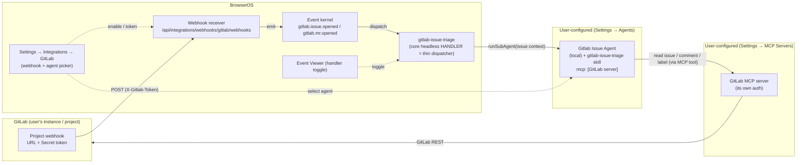

# Design: GitLab Integration (Webhook → Triage)

**Spec**: [`spec.md`](./spec.md) · **UI contract**: [`mockup.html`](./mockup.html) · **Checklist**: [`checklists/requirements.md`](./checklists/requirements.md)
**Feature Branch**: `002-gitlab-integration` · **Status**: Draft (v6 — R8: the GitLab agent runs the spec-kit pipeline *itself* on a server-side, per-issue feature branch — no Build Studio delegation. Adds the approval-path dispatcher logic, the agent's expanded headless tool gate, the skill's pipeline-running stage, and the mid-run branch-creation mechanism.)
**App Target**: `bos-core` (confirmed; agrees with `spec.md`)

---

## 1. Classification

**`bos-core`.** This is a first-class part of BOS itself, not a self-contained app or an installable marketplace item:

- It adds an **integration** to the generic integration framework — a manifest, a webhook handler, and an actions-adapter registration — all under `src/lib/integrations/`. Integrations are compiled into BOS (`src/lib/integrations/index.ts` barrel), not user-installable; `registerIntegration`/`registerAdapter` are module-load side effects. (Precedent: the `telegram` and `gsuite` integrations, `src/lib/integrations/services/{telegram,gsuite}/`.)
- It adds a **core headless event handler** (`gitlab-issue-triage`) to the event kernel. The only in-process mechanism for a core-owned headless handler is `dispatch.registerCoreExecutor` + `api.register({ declaredBy: "core" })` — exactly what the self-healing spine does (`src/lib/self-heal/spine-handler.ts`). Worker-IPC `handler_declare` is for worker-thread services, which this is not. **R6:** this handler is a **thin dispatcher** — it forwards the issue to a configured agent; it contains no triage logic.
- It **seeds an agent + a skill** (the `Gitlab Issue Agent` and the `gitlab-issue-triage` skill) — the unit of capability (classification, workflow, GitLab updates via MCP) lives there, configured like any normal agent.
- It adds **Settings → Integrations** panel components under `src/components/apps/settings/integrations/`.
- It adds **two platform-level capabilities** that future authless integrations will also need (the `authless` manifest flag + the `mintSecret` opt-out on webhook enable).

Nothing here is a `builtin-app` (no `src/apps/<id>/` window) and nothing is a `marketplace-item` (no `data/user-apps/items/<id>/` installable). The spec's `App Target: bos-core` is correct.

> **Relationship to self-healing (R6 — fully separate).** The bug-fix *intelligence* is **not** reused from self-heal, and the gitlab feature does not forward issues to it. Self-heal is a BOS self-modification mechanism (its Diagnostician reads BOS source, routes by BOS scope class, delivers via the Supervisor preview). A GitLab bug issue is about the *user's* codebase — a different problem shape. Only the **orchestration plumbing** is shared by pattern (core headless handler → prompt-ack → fire-and-forget `runSubAgent`), which is the self-heal spine's R4 pattern reused as a platform idiom, not a shared code path. The two features have no import-level coupling.

> **Note on a string overlap (not a collision).** `gitlab` already appears in the codebase as a *git-remote OAuth credential provider* id: `src/app/api/integrations/git-providers/route.ts` and `src/components/apps/settings/integrations/GitProvidersTab.tsx` store GitLab client-credentials under the `git_remote_oauth` namespace, and `IntegrationDetailView.tsx`'s `FIELD_CREDENTIAL_PROVIDERS` set contains `"gitlab"`. That is a **separate subsystem** (git push/pull credentials) from the integration registry this feature adds to. They do not share a store; implementers must not "reuse" the git-providers code, and the gitlab detail view must **not** be the generic `IntegrationDetailView` (which would render the git-provider OAuth panels). See ADR-6.

---

## 2. Constitution check

| Principle | Status |
|---|---|
| **I. Spec-Driven** | ✅ Grounded in `spec.md`; this design is the `design` step of the pipeline. |
| **II. Server Authority & SSR Boundary** | ✅ All webhook parsing, secret verification, state, and event emission are server-only. The shared token (`WebhookSecrets.primary`) lives in the SecretsStore and is returned to the client **exactly once** (the reveal). No GitLab credential is stored in BOS at all (R1/R4). |
| **III. Always Delegate; Claude Codes** | ✅ Implementation is delegated to the Developer. At runtime the dispatcher hands the issue to a `local` agent (`runSubAgent`) — a headless local agent. **R8:** on approval the agent *itself* runs the spec-kit method (headless) and delegates the *implementation* to the Developer (`dev_delegate`, `type: claude`) — "Claude Codes" still holds, now through the agent's own `dev_delegate`, exactly as self-heal's Build Studio path does. |
| **IV. Minimize Blast Radius** | ✅ All `src/` changes land on the `002-gitlab-integration` feature branch via `dev_delegate`. The two platform-level additions (`authless` flag, `mintSecret` opt-out) are additive and back-compatible. **R8:** the R8 additions are likewise additive — one new server tool, a new dispatcher module, skill references, and label constants; no existing R6/R7 path is altered in its mechanism (only the resume task's wording + the agent's tool gate). |
| **V. The VFS Is Not the Source** | ✅ No VFS writes for source. **R8:** the draft deliverable (pre-approval) is still a GitLab comment; *after* approval the agent writes real spec-kit artifacts (`spec.md`/`mockup.html`/`design.md`/`plan.md`/`tasks.md`) to the branch-coupled `user-specs` store — which is spec content, not source, and lands on the feature branch, never the base. Source itself is edited only by the Developer in its isolated worktree. |
| **VI. Specs & Docs Stay in Sync** | ✅ File plan includes `docs/` additions (a `gitlab` integration page + an agent/skill setup note). |
| **VII. Respect Boundaries** | ✅ No `package.json`/lockfile/build changes. `npx tsc --noEmit` + `npm run lint` are the gates. No new external dependency (the GitLab MCP server is user-configured external tooling). |

**Conflict flagged:** none.

---

## 3. Architecture

### 3.1 Context (how the user/agent sees it)

From the user's view: **Settings → Integrations → GitLab** is a card that drills into a detail view (the mockup) with two concerns, cleanly separated:

1. **The webhook** (enable, URL, token) — the inbound signal. No MCP, no credential.
2. **The workflow** (which agent handles a new issue) — a picker defaulting to the **Gitlab Issue Agent**, plus a pointer to the Events handler toggle.

When a new issue is opened in a hooked GitLab project: the receiver emits `gitlab.issue.opened`; the default **`gitlab-issue-triage`** core headless handler (a **thin dispatcher**, enabled by default) forwards the issue context to the **configured agent** (the **Gitlab Issue Agent**); the agent — driven by its **`gitlab-issue-triage` skill** (the state machine) — classifies the issue, runs the matching workflow, and updates the issue (comments + status labels) **through its configured GitLab MCP server**, ending at the terminal `Needs Review` state. The webhook and the handler are **two independent switches**; the handler and the agent's behavior are **user-configurable** (agent in Settings → Agents; the pipeline in the skill).



**Dependency split (R4, enforced by structure):**
- **Webhook side** (GL → R → K): depends only on the shared token. No MCP, no GitLab credential, no agent.
- **Handling side** (K → H → A → M): the handler is dependency-free apart from the event; the *agent* is where the GitLab MCP server is required. The handler does **not** pre-check MCP — the agent is the unit of capability.

### 3.2 Container (BOS's real containers)

Everything lives in the **Next.js app process**. No new worker-thread service, no new item git repo, no Bastion change:

- **Webhook receiver route** — `src/app/api/integrations/webhooks/[integrationId]/[serviceId]/route.ts` (existing, unchanged). Thin delegate: handler lookup → enable gate → connected gate → verify → dedup ring → `receive()` → `emitIntegrationEvent`.
- **Integration framework** — `src/lib/integrations/**`. The gitlab manifest + handlers register into these at module load.
- **Event kernel** — `src/lib/events/**`. Emission is `api.emit`; the `gitlab-issue-triage` handler is a **core** headless handler (`registerCoreExecutor`), dispatched in-process.
- **Sub-agent runtime** — `src/lib/agent/subagents/runner.ts` (`runSubAgent` → `runLocalHeadless`) composes the configured agent's instructions (including its skills index + MCP index block) and runs the agent loop with its gated tools.
- **MCP gateway** — `src/lib/mcp/gateway.ts` enforces the **agent's MCP allowlist** (`agent.mcp`) at every `mcp_tool_*` call via `ctx.agentId`.
- **Agent store / seed** — `data/agents/<id>/AGENT.md` (seeded from `seed/agents/`); the skill under `seed/skills/<id>/`.
- **Secrets** — webhook token in the integration SecretsStore (`webhook:webhooks`); **no** GitLab credential anywhere.

### 3.3 Component (modules this feature creates/modifies)

Two registries both need a `gitlab/webhooks` entry (the "two adapter-ish files" gotcha is unchanged from v3 — see ADR-8):

1. **Webhooks *handler* registry** (`src/lib/integrations/webhooks/registry.ts`) — read by the receiver route. The handler does `verify` + `receive`.
2. **Actions *adapter* registry** (`src/lib/integrations/actions/adapter-registry.ts`) — a zero-method adapter with `capabilities: { webhook: true }` for the panel's `supported` flag.

```
src/lib/integrations/services/gitlab/
  manifest.ts              GITLAB_MANIFEST (authless: true, service "webhooks", placeholder oauthConfig)
  index.ts                 registerIntegration + import the two adapters
  labels.ts                classification + status label constants (shared: skill + panel + handler)
  adapters/
    webhook.ts             GitLabWebhookHandler (verify X-Gitlab-Token; receive parse+filter)
    webhooks-adapter.ts    zero-method ServiceAdapter, capabilities { webhook: true }
  triage/
    handler.ts             gitlab-issue-triage core handler (register + prompt-ack + fire-and-forget dispatch to the selected agent)
    dispatch.ts            build the issue-context task, resolve the selected agent, runSubAgent, graceful-failure wrapper (R8: the noted run is conversation-bound, §3.10)
    pipeline.ts            R8 — the per-issue conversation: id derivation, the ghost seed, branch binding (the self-heal pattern), and the conversation-bound run wrapper

  tools/
    gitlab-feature-branch.ts   R8 — `gitlab_start_feature` server tool: resolves the chosen project + next NNN + slug, binds the ordinary branch to the run's conversation, returns the branch + feature path (non-interactive; the headless counterpart to dev_branch_request)

seed/agents/gitlab-issue-agent/AGENT.md      the Gitlab Issue Agent (type local; frontmatter skills: ["gitlab-issue-triage"], mcp allowlist; R8: tools widened to the pipeline gate, §3.11)
seed/skills/gitlab-issue-triage/SKILL.md     the triage skill = the state machine (R6) — R8: the router's human-waiting states become pipeline-running stages, and the references grow the pipeline stages (§3.12)

src/components/apps/settings/integrations/
  GitLabDetailView.tsx            header + WebhookSection + WorkflowSection + labels ref
  GitLabWorkflowSection.tsx       the "Workflow" card: agent picker + skill note + Events toggle pointer
  GitLabLabelsReference.tsx       classification + status chips
```

### 3.4 Webhook handler (receive/verify) — *unchanged from v3*

`GitLabWebhookHandler` (`adapters/webhook.ts`) implements `WebhookHandler`:

- **`verify`** — *plain string match*, not HMAC. Read the `X-Gitlab-Token` header; timing-safe-compare against `[secrets.previous, secrets.primary]`. Reuse the `timingSafeEqual` shape from `TelegramBotWebhookHandler.verify`. **No candidates present ⇒ reject** (a manual GitLab webhook with no token yet must 401, never "accept all").
- **`receive`** — `JSON.parse` the body, then three branches:
  - `object_kind === "note"` **and** `object_attributes.noteable_type === "Issue"` → one `IntegrationEvent` `{ type: "issue-noted", service: "gitlab/webhooks", data: <note projection> }` (R7 / FR-022). A note on a `MergeRequest`, a `Snippet` or a `Commit` → `{ events: [] }`: only issues have a pipeline to re-enter (Q1).
  - `object_kind === "issue"` **and** `action === "open"` → `{ type: "issue-opened", … }`.
  - `object_kind === "merge_request"` **and** `action === "open"` → `{ type: "mr-opened", … }`.
  - **anything else** → `{ events: [] }` (2xx `emitted: 0`).

  Lifecycle hooks are **routing-only** (ADR-1c): `onEnable` / `onSecretsRotated` / `onDisable` register and revoke `sha256(token)` in the Bastion credentials index. Nothing is ever *registered with GitLab* — that stays manual.
- **Item projection** (bounded): `project.id`, `object_attributes.iid`, `.title`, `.labels[].title` → `labels[]`, top-level `user {name, username}`, `object_attributes.url`, `.description` truncated (e.g. 2 000 chars). MRs also `source_branch`/`target_branch`.
- **Note projection** (bounded): `project.id`, `project.path_with_namespace`, **`issue.iid`**, `object_attributes.note` truncated (2 000 chars), top-level `user {name, username}`, `object_attributes.url`, **and the issue's CURRENT labels** — `issue.labels[].title → labels[]`.

  > **R8 — the note carries the issue's current labels, and that is load-bearing.** The note hook sets `data[:issue] = note.noteable.hook_attrs` — the *issue's own* `SAFE_HOOK_ATTRIBUTES`, the same object the issue event emits (verified against GitLab's `lib/gitlab/data_builder/note.rb`); and `labels` is in that set (the issue event's documented payload carries `labels[]`, and the agent already reads them for classification). So `issue.labels[]` on a note hook is the issue's status **at the moment the note was posted** — exactly the gate state the dispatcher needs to know whether the note is an approval of a deliverable (`Spec Drafted`/`Fix Proposed`/`Design Complete`). The dispatcher does *not* read the note's `object_attributes` for this (those describe the comment, not the issue). Defensive read: if a self-hosted GitLab omits `issue.labels`, treat the note as carrying no gate state and fall back to the skill's MCP read of the live issue — the agent re-reads the issue as its first act anyway, so the dispatcher's labels are an optimization for *binding the branch*, not the source of truth. Pinned by `webhook.receive.test.ts` with a note payload whose `issue.labels` carries a gate label.

  > **The iid is on the top-level `issue`, not on `object_attributes`.** A note hook's `object_attributes` describes the COMMENT; it carries `noteable_id`, which is the issue's **global/database** id, and GitLab emits **no `noteable_iid`** at all (verified against `lib/gitlab/hook_data/note_builder.rb`'s `SAFE_HOOK_ATTRIBUTES` and the documented "Comment on an issue" payload). Reading `noteable_id` as the iid points the agent at a different issue in every project whose first issue is not also the instance's first. The implementation reads `object_attributes.noteable_iid` first and falls back to `issue.iid`, in the same defensive spirit as the rest of the projection, but `issue.iid` is the field that actually answers.

The IntegrationEvent types (`issue-opened`/`mr-opened`/`issue-noted`) are mapped to kernel types separately (ADR-2).

### 3.5 Event-type mapping — see ADR-2

Add to `KNOWN_TYPES`: `"gitlab/webhooks:issue-opened" → "gitlab.issue.opened"`, `"gitlab/webhooks:mr-opened" → "gitlab.mr.opened"`, `"gitlab/webhooks:issue-noted" → "gitlab.issue.noted"`; add `KNOWN_NAMES.gitlab = "GitLab"`; add `legacyFriendlySummary` branches (`"issue #<iid> <title>"` / `"MR !<iid> <title>"` / `"comment on issue #<iid>"`). All three final types pass `isValidEventType`.

The two `gitlab.issue.*` names are load-bearing **as a pair**: the handler subscribes to that prefix (§3.6), and the systematic derivation would have produced `com.bos.gitlab.webhooks.issue-noted` — outside the prefix, and so never dispatched. The note's summary deliberately omits the comment text: summaries are capped at 140 characters and read in a list, where the useful fact is which issue woke the agent.

### 3.6 Triage handler = thin dispatcher — see ADR-3, ADR-12

`triage/handler.ts` registers **one** core headless handler, exactly as `spine-handler.ts` does:

```
registerCoreExecutor("gitlab-issue-triage", async (record) => {
  // A `gitlab.issue.*` type the dispatcher has no task shape for → ack, no run.
  if (!isTriageEventType(record.type)) return { result: { dispatched: false, … } };
  // Otherwise FIRE-AND-FORGET the dispatch:  void dispatchToAgent(record)
  // Return immediately → prompt ack, never block the 30 s ack window.
});
api.register({
  handlerId: "gitlab-issue-triage",
  eventType: "gitlab.issue.*",        // PREFIX — opened AND noted (R7); still not MRs
  mode: "headless",
  ownerId: "core",
  declaredBy: "core",
  displayName: "GitLab issue triage",
  /* no `enabled` field — omit so disable persists across restarts (§9 F1) */
});
```

- **Registered for the `gitlab.issue.*` prefix** (R7, ADR-13). `isValidRegistrationType` accepts a `prefix.*` pattern and `typeMatches` resolves it per event, so **one** handler covers `gitlab.issue.opened` and `gitlab.issue.noted`. One handler is the point: the Event Viewer toggle stays meaningful (disabling "GitLab issue triage" disables all of it, not the half that starts it), and the per-handler FIFO queue serializes a fresh run and a resume run for the same issue instead of racing them.
- **The prefix stops at `issue`.** `gitlab.*` would sweep in `gitlab.mr.opened`, which gets no built-in workflow (Q1=A) — the constraint the old exact-type registration expressed.
- **A prefix means unknown types will arrive.** The executor asks the dispatcher whether it has a task shape (`isTriageEventType`, one source of truth, §3.7) and acks without running when it does not. Guessing the fresh task for a future `gitlab.issue.closed` would restart finished work and re-comment on it.
- **The handler holds no triage logic** (R6): it resolves which agent to run and hands over the context. Classification, the workflow, all GitLab updates — and, under R7, the agent's own GitLab **identity** — are the **agent + skill's** job (R4 boundary intact; ADR-13).
- **Prompt-ack + fire-and-forget** (ADR-3, unchanged in mechanism): the executor returns immediately; `dispatchToAgent` is the detached async work.

### 3.7 Dispatch + graceful failure — see ADR-12, ADR-4 (revised)

`triage/dispatch.ts`:

1. **Resolve the agent.** Read the panel's "agent that handles new issues" from the persisted integration config — `state.services["webhooks"].config.triageAgentId` (the exact analog of Telegram's `state.services["bot"].config.agentConfig.agentId`), default `gitlab-issue-agent` → `getAgent(id)`. If it resolves to nothing, emit `com.bos.gitlab.triage.failed` (`agent_not_found`) and stop — no run.
2. **Build the task — one of TWO shapes, chosen by `record.type`** (R7, ADR-13). A single `TASK_BUILDERS` table keyed by event type is the only place that knows which is which; `taskForRecord(record)` returns `undefined` for a `gitlab.issue.*` type with no shape, which is also the handler's guard (§3.6). In both shapes the skill (loaded by the agent) supplies the actual state-machine logic — the task supplies only the entry context.
   - **`gitlab.issue.opened` → the FRESH task**: *"A new GitLab issue was opened: project #<id> (proj/app), issue #<iid>, title …, labels …, url …. Use the `gitlab-issue-triage` skill. Read the issue via the GitLab MCP server, classify it, work it through the pipeline, and update it with comments and status labels as you go."*
   - **`gitlab.issue.noted` → the RESUME task** (R8): *"A human commented on GitLab issue #<iid> in project #<projectId> (<url>). The note (by @<username>): <note>. Resume the `gitlab-issue-triage` pipeline for this issue. Read the issue and its notes via the GitLab MCP server. **Determine your OWN GitLab identity from the MCP server (the token's user).** If the newest note is from a HUMAN: read the issue's CURRENT status label and its comment, and disambiguate per `references/notes.md` — **approval** advances the pipeline (at `Spec Drafted`/`Fix Proposed` read `references/approve-spec.md`; at `Design Complete` read `references/approve-design.md`), **feedback** revises the deliverable and re-posts it, staying in the same state; at `Needs Input` they answered your question, so continue; at `Needs Review` revise and re-post, keeping `Needs Review`. Post exactly one reply and state your interpretation of the comment. If the newest note is YOUR OWN, or there is no new human input: do NOTHING — post no comment, change no label, and stop. Never close the issue or open a merge request; never promote or merge."*

   The identity instruction is the load-bearing half of loop prevention for notes (ADR-9, ADR-13) and it **cannot** move into this file: BOS holds no GitLab credential (R1), so the only party that can answer "who does this token act as" is the agent holding the MCP server. The "do NOTHING" branch is what makes the chain self-terminate; "exactly one reply" is what keeps a single dispatch from spawning several. **R8:** the task names the two approval reference files but carries no branch-creation instruction — that is the *agent's* decision (it is the state owner), and the tool (`gitlab_start_feature`) is one the agent calls only after judging the note an approval (§3.10). The "never promote or merge" clause is new in R8 and restates the widened boundary (FR-028).
3. **Run — the conversation bound changes by trigger (R8, §3.10).** `runSubAgent(agent, task, { contentOnly, conversationId?, onEvent })`, the headless mechanism (Telegram router precedent). `contentOnly` is **inert for a `local` agent** (it is consumed only by the Claude harness) and is **omitted on the noted path** (load-bearing for the nested Developer — §3.10). `onEvent` collects the run's `tool_result` events (`{ name, result, ok }`, runner ADR-13) so step 4 can inspect outcomes.
   - **`gitlab.issue.opened` → FRESH, genuinely headless.** No `conversationId` (the deliverable is a GitLab comment, not a branch-gated spec write). `contentOnly: true` for precedent consistency.
   - **`gitlab.issue.noted` → RESUME, conversation-bound (R8).** `conversationId = pipelineConversationId(projectId, iid)`, ghost-seeded first (§3.10.2). This is what lets the agent bind a branch *and* run the spec pipeline during the run: its `file_*` writes and `dev_delegate` resolve the branch from the conversation on every call (§3.10). Even a resume that turns out to be feedback (no approval) costs only a ghost conversation the branch never materializes. `contentOnly` omitted (a resume may reach `dev_delegate`). The v5 "no `conversationId`" note above is thus **superseded for the noted path** — it holds only for the fresh path.
4. **Graceful failure — post-run, outcome-based** (FR-015/FR-016/SC-007). The contract here is subtle (the v4 re-review blocker): the MCP gateway is resilient (a missing/unreachable server yields an in-band `Error: …` *tool-result string*, not a throw), and the agent loop's contract is "runs never die of tools" — so `runSubAgent` **returns** a clean `{ endedReason: "completed", error: undefined }` even when the agent had no MCP access. A `try/catch` around the run therefore **never fires** for the no-MCP case, and `run.error` stays `undefined`. The dispatcher detects failure **post-run and outcome-based**:
   - **agent missing** (`getAgent` → undefined, step 1) → emit `com.bos.gitlab.triage.failed` (`agent_not_found`), no run.
   - **`run.error` / `run.endedReason === "error"`** → genuine model/provider failure → emit `com.bos.gitlab.triage.failed` with `run.error`.
   - **the run finished but NO `mcp_tool_call` succeeded** (every collected `tool_result` for `mcp_tool_call` has `ok: false`) → the agent had no usable GitLab MCP access → emit `com.bos.gitlab.triage.failed` (`no_gitlab_mcp`). This is the deterministic surface for the SC-007 case.
   - **at least one `mcp_tool_call` succeeded** → the agent reached GitLab and acted; any mid-pipeline problem is the *skill's* responsibility to reflect with a `Failed` status label. The dispatcher does not second-guess a run that demonstrably touched GitLab.

   In every failure case **the receiver never crashes and the original event is never lost** (the `gitlab.issue.*` record is already durably stored before dispatch). This guard is post-hoc and outcome-based — it is **not** a pre-flight reachability check, so R6's "no deterministic MCP pre-flight" principle stands.

   **A no-op resume is a SUCCESS, and nothing had to change for that to hold** (R7). The commonest resume run writes nothing: the agent sees that the newest note is its own and stops. Reporting that as a failure would raise one spurious `com.bos.gitlab.triage.failed` per comment the agent has ever posted. It falls out for free because the analysis asks *how far the run got*, never *whether it wrote*: a real no-op still READS GitLab (the issue, its notes, the token's identity), so it produces successful `mcp_tool_call`s and lands on the success branch. Zero successful MCP calls still means exactly what it meant before — the agent could not reach GitLab at all, and did not even manage the reads. The corollary is that the dispatcher cannot distinguish a deliberate no-op from a run that read the issue and gave up, and must not try: once a run has touched GitLab, what it did there is the skill's story to tell. Pinned by `dispatch.test.ts` ("a no-op resume … is a SUCCESS").

> **R6 — the deterministic MCP pre-flight is removed.** v3's §3.8 pre-checked "is a GitLab-named MCP server reachable by the agent" before running. That check encoded *the agent's capability inside the handler* — the wrong layer, and it duplicated the gateway's own enforcement. R6 deletes it: the dispatcher runs unconditionally, and failure is detected **post-run, outcome-based** (§3.7.4) rather than pre-checked. (The gateway's in-band `Error:` is model *data*, not a thrown error, so the only reliable no-MCP signal is "the run finished with no successful `mcp_tool_call`." The design's own cited precedent — the Telegram router, `agent-router.ts` — observes `if (run.error)`, not a try/catch, for exactly this reason.) The unit of capability is the agent, configured in Settings → Agents. FR-013 states this explicitly.

### 3.8 The triage skill drives the pipeline (model-followed guidance) — see ADR-12

The skill is **multi-file**: a lean `SKILL.md` **router** (the state machine) plus per-stage **reference documents** under `seed/skills/gitlab-issue-triage/references/`:

| File | Carries |
|---|---|
| `SKILL.md` | The router: the Q2 boundary, orient, resume-or-start, classify, route, finish. Loaded whole. |
| `references/status-labels.md` | The cross-cutting label model, the transition procedure (both MCP shapes), the transition map, the `Needs Input` / `Failed` side states. Read once at the start. |
| `references/classify.md` | Classify → `Triage` |
| `references/bug-analyzing.md` · `bug-verifying.md` · `bug-fix-proposed.md` | The Bug path, one file per stage |
| `references/spec-drafted.md` | The Feature / Improvement path |
| `references/finalize.md` | `Needs Review`, the hand-off comment, the final message — **resumable** on a new human comment (R7) |
| `references/notes.md` | **R7** — re-entry: establish your own GitLab identity, read the thread, and either resume from the current status label or self-terminate on your own note |

The router instructs the agent to read a stage's reference **before acting on that stage** — progressive disclosure, so the stage the run is actually in gets depth without every run paying for all of it up front. This depends on the agent being able to open bundled skill files at run time: `skill_read_file` (`src/lib/assistant/tools/server/skills.ts`) is in the seed agent's `tools` allowlist, is a **server** tool, and therefore survives `headlessGate` — which matters because the dispatcher runs this agent headless. Guarded by `tests/agent/gitlab-triage-skill-references.test.ts`.

The skill as a whole is still the **behavior contract the model follows**. The `Gitlab Issue Agent` loads it (its seed `AGENT.md` sets `skills: ["gitlab-issue-triage"]`). **Honesty about the guarantee:** a skill is a prompt index entry the model reads on demand (`buildSkillsIndexBlock`) — it is *guidance*, not an execution-time state machine. The classify → workflow → label transitions, the "exactly one active status label" swap (FR-014), and the resume/idempotency branch below are **expected from the model, not enforced by any mechanism**. A misbehaving run (e.g. leaving two status labels, or skipping a stage) is possible and un-backstopped; SC-003's "≥90%" absorbs that residual. This is inherent to the user-directed agent + skill model (R6) — the alternative would be re-adding the deterministic pipeline R6 deliberately removed. Splitting it into a router plus references changes *where* the guidance lives, not what it says — the boundary, the resume branch and the single-active-status invariant are unchanged. Its content drives:

1. **Read** the issue via the GitLab MCP server (title, description, current labels).
2. **Classify** — labels first: exactly one of `Bug` / `Feature` / `Improvement` (case-insensitive; other labels ignored). Fallback: infer from title+description and state the inferred type in a comment. Apply the classification label (additive).
3. **Idempotency / resume**: if the issue already carries one of the handler's status labels, resume from that stage rather than restarting (covers a dedup-ring loss re-emitting the same open, a manual re-dispatch, and — since R7 — the normal case: a human comment). When the dispatch was caused by a note, the router sends the agent to `references/notes.md` **first**, because that file decides whether to resume at all: the agent is re-dispatched for its own comments too, and answering one of those is what would turn this into a loop.
4. **Run the matching pipeline**, applying the transient **status label** (exactly one active, swapped per step) via MCP:
   - `Bug`: `Triage` → `Analyzing` → `Verifying` → `Fix Proposed` → **`Needs Review`** (post the proposed fix as a comment).
   - `Feature` / `Improvement`: `Triage` → (work) → `Spec Drafted` → **`Needs Review`** (post the draft spec — including a UI mockup where relevant — as a comment).
   - Side states: `Needs Input` (blocked, needs info from the reporter — stop and wait), `Failed` (run errored; failure comment posted).
5. **Autonomy boundary (Q2=A)**: comment + label only. **Never** close the issue or open an MR. `Needs Review` is terminal *for the pipeline* — the agent never advances past it on its own initiative — but since R7 it is **resumable**: a human comment re-dispatches the agent, which revises its deliverable and re-posts, keeping the label. The human still closes the issue or opens the MR. Re-entry changes *when* the agent acts, never *what it may do*, and a human asking in a comment for the issue to be closed does not widen the boundary.
6. **Label mechanics**: to keep the single-active-status invariant, the skill reads current labels, removes any existing handler status label, and adds the new one (GitLab add/remove-label semantics). It never removes the additive classification label.
7. **`"verify"` scope (tightened from the scenario walkthrough)**: for a Bug, "verify" = assess plausibility and identify the likely root cause from the description **and any accessible code context** (e.g. a registered repo / the agent's file tools); if no code context is reachable, the skill notes that in the comment and proceeds to propose a fix from the description alone. It is *not* "reproduce in a running environment."

### 3.9 Settings panel (mockup = binding UI contract)

A dedicated **`GitLabDetailView`** is routed for `gitlab` in `IntegrationsTab`. The generic `IntegrationDetailView` is **not** used (it would render the git-provider OAuth panel — ADR-6). It composes, top to bottom, matching the mockup:

- **Header card** — GitLab icon, name, a `Webhook` badge, one-line "webhook only — handling is a separate, configurable step" copy.
- **`WebhookSection`** (reused, `serviceId="webhooks"`). Stock: enable/disable, URL + copy, one-time amber token reveal, rotate, delete, "Secret set" badge, `X-Gitlab-Token` hint. "Generate token" = the stock rotate (first use = generation); enable does **not** auto-mint for gitlab (ADR-1b), so the "enabled, no token" state (B) is real and safe.
- **`GitLabWorkflowSection`** (new, R6) — the **Workflow** card:
  - **Agent picker** — "Agent that handles new issues", a `<select>` over available agents, default **Gitlab Issue Agent**, a "Manage" affordance → Settings → Agents. Persisted in the integration config (the dispatcher reads it, §3.7.1).
  - **Skill note** — one line: "Its *skill* defines the pipeline (classify → workflow → status labels → `Needs Review`); the agent performs GitLab operations via its configured GitLab MCP server (no credential is stored in BOS)."
  - **Handler toggle pointer** — "A built-in `gitlab-issue-triage` handler is enabled by default and forwards each new issue to the agent above. Toggle it in the Events handler configuration, or point another consumer (e.g. the Workflow app) at the `gitlab.issue.opened` event instead." + an "Open Events" link that opens the **Event Viewer** app (the real toggle surface — ADR-7).
- **`GitLabLabelsReference`** — the two chip groups (Classification + the eight Status labels) from the mockup, sourced from `labels.ts`.
- **No MCP status anywhere** (R4).

`IntegrationsTab` change: add a `currentItem.manifest.id === "gitlab"` branch → `GitLabDetailView`, and update the generic-view fallback from `id !== "telegram"` to `id !== "telegram" && id !== "gitlab"` (§9 F2).

### 3.10 The approval path: per-issue conversation + mid-run branch creation (R8) — see ADR-14, ADR-15

R8 turns two of the pipeline's human-waiting states into **branch-gated, pipeline-running** states. Everything that makes a `file_*` write and a `dev_delegate` resolve a branch is a single fact the whole design turns on:

> **The branch is read fresh from the conversation on every tool call.** `getConversationActiveFeatureBranch` (`conversations-server.ts`) is an uncached `vfs.readText(/Documents/Chats/<id>.json)`; the spec-fs tools and `dev_delegate`'s claude path call it per call and `withFeatureScope({conversationId})` / pass it straight through. There is no run-scoped snapshot. **Consequence: a branch bound to a conversation *while the agent is already running on that conversation* is picked up by the agent's *next* spec write / `dev_delegate` — no re-rooting, no new run.** This is the exact seam self-heal exploits (it binds the branch *before* the run in `intake.ts:518`), and it is what lets R8 bind the branch *during* the run.

That single fact resolves the crux the task poses — "approval is detected by the AGENT, so the dispatcher can't set the branch before the run" — and the two candidate framings both turn out to be incomplete:

- **Pure (a) — dispatcher creates the branch on a gate-state note** is *impossible for a sound reason*: the `gitlab.issue.noted` event carries the issue's current labels (§3.4), so the dispatcher *can* tell the issue is at a human-waiting gate, but it **cannot tell the note is an approval rather than feedback** (FR-027 is a *semantic* read — "looks good" vs "looks wrong" — that only the model can make). If the dispatcher bound the branch on *every* gate-state note, feedback comments would burn a feature number and materialize an empty branch, and a follow-up approval would collide with it. The dispatcher knows the *gate*, not the *intent*.
- **Pure (b) — a server tool the agent calls to create the branch** is *feasible* precisely because of the fact above: the agent can call it mid-run and the conversation-bound writes that follow resolve the branch. But a tool alone doesn't place the run *on a conversation* in the first place — `runLocalHeadless` resolves the branch from `opts.conversationId`, and a genuinely headless run (the v5 noted path) has `conversationId: ""`, so a branch a tool binds would have nowhere to bind *to*.

**The mechanism is their combination** (ADR-14): the dispatcher, on *every* `gitlab.issue.noted`, seeds/updates a **stable per-issue conversation** (id derived from `project.iid`) and runs the agent **conversation-bound** to it; the agent — the state owner —, once it has read the live issue + its labels + the note and judged the note to be an *approval*, calls the new **`gitlab_start_feature`** tool, which resolves the next `NNN-slug` for the chosen `user-specs` project and binds that ordinary branch to the *run's own conversation* (the same seam self-heal uses, but mid-run). Subsequent `file_*` writes and `dev_delegate` resolve it for free. A note judged to be *feedback* never calls the tool — the branch goes unbound and is never materialized.

`triage/pipeline.ts` (new) holds the per-issue plumbing, mirroring self-heal's `pipelineConversationId` + seed + `setConversationActiveFeatureBranch`:

1. **`pipelineConversationId(projectId, iid)`** → `c-gitlab-issue-<projectId>-<iid>`. Stable and per-issue: a fresh issue and every note on it land on the *same* conversation, so its `activeFeatureBranch` survives across the two approval gates (approval-1 binds it; approval-2's run reads the same value off the same file). (Contrast self-heal, which keys on caseId; here the GitLab issue *is* the long-lived unit of work.)
2. **Ghost seed** — before a run, `conversationStore.saveConversationMessages(conversationId, agentId, [ { role: "user", content: task } ])` creates the conversation file (idempotent if it exists), exactly as `intake.ts:515` does. The transcript is inert: `runLocalHeadless` ignores it (its `io.loadMessages` returns `[]`), and the conversation exists *only* to (i) carry the branch and (ii) be the FR-030 visibility home. This is the "ghost" — it is not a user Assistant conversation and the trajectory is *not* attached to it (the Assumption holds; ADR-14).
3. **The run** — `runSubAgent(agent, task, { conversationId, onEvent })`. `contentOnly` is **omitted** (not `true`): it is inert for the agent's own `local` run but *load-bearing* for the nested Developer (`dev_delegate` → `runClaudeAgent`) — a `contentOnly:true` delegation would take the standalone-content path and *refuse* a bos-core source edit (claude-runner.ts). The v5 noted path passes `contentOnly:true` only because its deliverable was a comment with no dev work; the R8 approval path has dev work and must not.

**Branch creation — `gitlab_start_feature` (new server tool, `tools/gitlab-feature-branch.ts`).** This is the non-interactive counterpart to `dev_branch_request`, and it is the one thing R8 needs that the existing toolset does not give a headless agent (the v5 resume task correctly told the agent to call `dev_branch_request` *only* for a user-driven branch; that is a frontend elicitation a headless run cannot answer, so R8 gives it a server tool instead — FR-024). It:

1. **Resolves the target.** The chosen `user-specs` project (from the spec/deliverable) and the next feature `NNN` *inside that project* (scan the project's feature dirs, `NNN = max(existing)+1`, the same rule the spec-kit driver states: "Feature numbering (`NNN-slug`) resets per Project, not per store"). A slug from the feature/issue title. Composes `NNN-slug` → validates via `isValidFeatureBranch` → the branch is `bos/<NNN-slug>`.
2. **Binds it** to `ctx.conversationId` via `setConversationActiveFeatureBranch(conversationId, branch)` — **not** by calling `dev_branch_request` (which would elicit) and **not** by `POST /api/assistant/feature-branches` (which records `activeFeatureBranch` on *another*, client-scoped conversation and would not reach the run's own). `setConversationActiveFeatureBranch` is a server-only function the tool can call directly on the run's own conversation id — the precise mechanism, applied in-run.
3. **Records the feature path** it will use (`user-specs/<project>/<NNN-slug>/`) and returns `{ branch, featurePath, store: "user-specs" }` so the agent writes its artifacts to the exact path the branch will carry (FR-030: the branch artifacts are the source of truth, and the agent must write to where they will be visible).

> **Number contention (spec edge case).** The `NNN` is computed *at the tool's invocation*, and the returned branch + feature path are what the agent uses — not a name it pre-guessed. Two concurrently-approved issues in the *same* project both invoke the tool; the per-conversation queue on the branch *file* does not serialize `NNN` computation across different conversations, so a true race can yield the same `NNN`. v1 mitigates this by the single-active-pipeline reality (one approval in flight per project in practice) and by the tool *re-checking* the directory and bumping `NNN` if the target path already exists at write time — a retry loop bounded to a few attempts. This is recorded as an ADR-15 risk, not silently assumed away.

**What the agent does on each approval (the skill's job, §3.12):**
- **Approval-1** (issue at `Spec Drafted` or `Fix Proposed`, note judged approval): call `gitlab_start_feature` → write `spec.md` (all types); for `Feature`/`Improvement` *with a UI surface*, write `mockup.html` (a `file_write`, §3.11) and `design.md` (technical design, the agent runs the architect role headless) — applying work-stage labels `Mockup`, `Design` as it goes — and end the issue at `Design Complete`. **`dev_delegate` is NOT called here** (FR-025 is design-phase only; implementation is approval-2).
- **Approval-2** (issue at `Design Complete`, note judged approval): the branch is already bound (approval-1's conversation carries it) — re-read it via `gitlab_start_feature`'s companion or `dev_git_status`, or simply reuse it; write `plan.md` → `tasks.md`, then `dev_delegate` (TDD; the plan's file list as the scope constraint) **on the same branch**, applying `Plan`, `Tasks`, `Implementing`, and end at `Needs Review` when the preview is healthy.

### 3.11 The agent's tool gate (FR-028) — headless-verified — see ADR-16

The GitLab agent runs **headless** (the dispatcher, `runSubAgent` → `runLocalHeadless`), so its effective tool set is `headlessGate(agent, tools, baseGate)`: `baseGate.allow` **filtered to `execution === "server"`**. Every tool the gate must keep for R8, verified against source:

| Tool | Execution | Survives `headlessGate`? | Note |
|---|---|---|---|
| `file_list`/`file_read`/`file_write`/`file_edit`/`file_patch`/`file_search`/`file_glob` | `server` (`files.ts`, all `withFeatureScope({conversationId: ctx.conversationId})`) | ✅ | Spec artifacts (`spec.md`/`mockup.html`/`design.md`/`plan.md`/`tasks.md`) are written here. The branch resolves per call (§3.10). `user-specs` writes require an active branch (`prepareWrite` → `BranchRequiredError`) — which is why approval-1 must call `gitlab_start_feature` *first*. |
| `gitlab_start_feature` (new) | `server` | ✅ | R8 branch creation (§3.10). |
| `dev_delegate` | `server` (`dev-delegate.ts`) | ✅ | **Proven headless-capable**: self-heal's Build Studio run is a headless `runLocalHeadless` (with a `conversationId`) whose `dev_delegate` → `delegateToAgent` → `runClaudeAgent` provisions the Supervisor worktree off `getConversationActiveFeatureBranch(ctx.conversationId)` (claude path, `contentOnly:false`, `featureBranch` set). The GitLab agent's approval-2 `dev_delegate` is structurally identical. The Developer is `type: claude`, so this never touches `runLocalDelegation`/`runManager` (the local-delegation path needs a live `run`, which a headless run has) — it goes straight to `runClaudeAgent`. |
| `skill_load`/`skill_read_file`/`skill_list` | `server` (`skills.ts`) | ✅ | Required to run the spec-kit method headless (ADR-16). Already in the v5 gate. |
| `web_search`/`web_fetch` | `server` (`web-search.ts`; `web_fetch` via the server web tool) | ✅ | Research during specify/design. |
| `scratchpad_*`, `memory_*` | `server` (`scratchpad.ts`, `memory.ts`) | ✅ | Working notes + cross-run memory (the per-issue conversation's state). |
| `mcp_server_list`/`mcp_server_tools`/`mcp_tool_search`/`mcp_tool_schema`/`mcp_tool_call` | `server` (`mcp.ts`) | ✅ | All GitLab read/write (the skill's existing dependency). |
| `ui_preview_generate`/`ui_preview_patch`/`web_view` | **frontend** (UI Preview app surface tools; rendered into a live window) | ❌ **stripped** | No browser in a headless run. **This is the spec-affecting finding** (below). |

**The mockup finding (spec-affecting — see ADR-16).** FR-025 names the mockup as produced "via the UI preview tooling." The UI Preview tooling (`ui_preview_generate`/`ui_preview_patch`) is **frontend-execution**: it drives a *live, in-browser* A2UI surface in an open UI Preview window (`src/apps/ui-preview/agent-tools-v2.ts`; the A2UI generation endpoint `src/app/api/a2ui/route.ts` is called *by* the frontend tool "which run in the browser"). `headlessGate` strips every non-server tool, so a headless GitLab agent **cannot** call `ui_preview_generate` — there is no browser, no open window, and `awaitFrontendResult` is hard-wired to `{kind:"timeout"}` in `runLocalHeadless`. **The mockup must therefore be produced as a static `mockup.html` written with `file_write`** to the spec directory — exactly the artifact the spec-kit `ui-designer` role already writes for a `bos-core` target ("a live-editable HTML mockup at `mockup.html` inside the SAME spec directory … via `file_write`"; the A2UI live surface is the *other* case, "only when the spec explicitly requires an A2UI-rendered UI," which a headless GitLab issue does not). `mockup.html` is then visible in Build Studio's artifact viewer (FR-030) with **no** browser dependency. **This changes the spec's wording**: FR-025's "via the UI preview tooling" must be read as "as a `mockup.html` file (the spec-kit mockup artifact), not a live A2UI surface" — flagged for the spec owner; the design proceeds on the file-write interpretation because it is the only one that survives the headless gate.

The seed `Gitlab Issue Agent`'s `tools` list is widened from the v5 MCP+text/skill set to the full gate above (all of which are server tools, so widening `allow` is what makes them present; `headlessGate` then keeps them because they're server). The `mcp` allowlist stays as R7 set it. The boundary holds by construction: the gate has **no promote/merge tool** (promotion is a top-bar UI action on the candidate; there is no `promote` server tool in the agent's reach), and the skill restates "never promote or merge" (ADR-16).

### 3.12 The skill runs the spec-kit method headless (R8) — see ADR-16

The skill is **the same method, run headless.** Its router's two human-waiting states (`Spec Drafted`/`Fix Proposed` and `Design Complete`), which v5 treated as *post-and-stop*, become **pipeline-running stages** under R8. The agent, on an approval, `skill_load`s the spec-kit **driver** (the `spec-kit-driver` skill — the method the `user-specs` store is bound to; `methods_list` names it) and runs *its* stages, writing to the branch, instead of re-deriving a pipeline. Concretely the references gain:

| File | R8 content |
|---|---|
| `references/notes.md` (existing, extended) | The **approval-vs-feedback disambiguation** (FR-027): on a human note, read the issue's CURRENT status label + the note; if approval → advance (call the approval path); if feedback → revise the deliverable, re-post, *stay in the same state*, and **state the interpretation** in the reply. The self-terminating "newest note is mine ⇒ do nothing" branch is unchanged. |
| `references/status-labels.md` (existing, extended) | The R8 work stages (`Mockup`, `Design`, `Plan`, `Tasks`, `Implementing`) and the two gate reclassifications (`Design Complete`, `Needs Review` refined to *implementation complete, preview healthy*); the single-active invariant unchanged. |
| `references/approve-spec.md` (new) | **Approval-1**: judge approval (else §notes feedback path) → `gitlab_start_feature` → `skill_load` the spec-kit driver → run `specify` (write `spec.md`); if there is a UI surface, run the `ui-designer` stage as a **`file_write` of `mockup.html`** (NOT `ui_preview_*` — §3.11) and the `design` stage (write `design.md`, the architect role headless — the agent *is* the orchestrator here, so it runs the role itself or via `agent_delegate` if the role skill allows) → labels `Mockup`→`Design` → end at `Design Complete`. No `dev_delegate`. |
| `references/approve-design.md` (new) | **Approval-2**: judge approval → reuse the bound branch → run `plan` (write `plan.md`) → `tasks` (write `tasks.md`) → `implement` via **`dev_delegate`** (TDD; the plan's file list is the scope constraint) on the same branch → labels `Plan`→`Tasks`→`Implementing` → end at `Needs Review` when the preview is healthy. |

**Why the agent runs the method itself rather than delegating to Build Studio (the R8 lock):** the agent is the **state owner** — it is the one reading and advancing the GitLab labels, and the labels are the GitLab surface's source of truth. Delegating the pipeline to the Build Studio agent would strand the state (the GitLab agent would stop owning the labels mid-pipeline, and Build Studio has no notion of the GitLab issue to update). Running the *same* method skills headless keeps the agent the single owner while producing byte-compatible artifacts (the method skills + templates are agent-agnostic). The Build Studio path remains the *front-end-driven* route over the *same branch artifacts* (FR-030) — if the user switches to Build Studio on the branch, the ordinary flow applies and the GitLab labels simply stop advancing past the handoff.

**Honesty about the guarantee (carried from §3.8).** The pipeline is still *model-followed guidance*, not a mechanism-enforced state machine: the label transitions, the "stop at `Design Complete` / `Needs Review`" gates, and the approval-vs-feedback read are expected from the model, not code-enforced. R8 widens the surface that relies on this (a multi-minute method run, not just a comment), so the residual risk is correspondingly larger — ADR-16 and Risk 12 address it.

---

## 4. Concrete file / module plan (only what this feature creates or modifies)

**New:**
- `src/lib/integrations/services/gitlab/manifest.ts`
- `src/lib/integrations/services/gitlab/index.ts`
- `src/lib/integrations/services/gitlab/labels.ts`
- `src/lib/integrations/services/gitlab/adapters/webhook.ts`
- `src/lib/integrations/services/gitlab/adapters/webhooks-adapter.ts`
- `src/lib/integrations/services/gitlab/triage/handler.ts`
- `src/lib/integrations/services/gitlab/triage/dispatch.ts`
- `seed/agents/gitlab-issue-agent/AGENT.md`
- `seed/skills/gitlab-issue-triage/SKILL.md` + `references/*.md` (the router + per-stage references, §3.8 — including `references/notes.md` the R7 re-entry decision) — **R8** adds `references/approve-spec.md` (approval-1), `references/approve-design.md` (approval-2), and extends `references/notes.md` (approval-vs-feedback) + `references/status-labels.md` (R8 work stages + gate reclassifications), §3.12
- `src/lib/integrations/services/gitlab/triage/pipeline.ts` — **R8** the per-issue conversation: id derivation, ghost seed, the conversation-bound run wrapper (§3.10)
- `src/lib/integrations/services/gitlab/tools/gitlab-feature-branch.ts` — **R8** the `gitlab_start_feature` server tool: resolve project + next NNN + slug, bind the ordinary branch to the run's conversation, return branch + feature path (§3.10) — registered into the agent's server-tool map (the `assistantTools()` composition the dispatcher's run resolves through)
- `seed/agents/gitlab-issue-agent/AGENT.md` — **R8** `tools` widened to the pipeline gate (§3.11); `skills` gains `spec-kit-driver` + `ui-designer-craft` (the method + mockup craft the agent runs headless)
- `src/components/apps/settings/integrations/GitLabDetailView.tsx`
- `src/components/apps/settings/integrations/GitLabWorkflowSection.tsx`
- `src/components/apps/settings/integrations/GitLabLabelsReference.tsx`
- `docs/usage/integrations/gitlab.md` (end-user) + a `docs/dev/integrations/` note (dev) — webhook-only/authless pattern + agent/skill setup.

**Modified:**
- `src/lib/integrations/types.ts` — add `authless?: boolean` to `IntegrationManifest`.
- `src/lib/integrations/state/store.ts` — `readState`: coerce `connected = true` when the manifest is `authless`.
- `src/lib/integrations/index.ts` — `import "./services/gitlab";`.
- `src/lib/integrations/webhooks/registry.ts` — add `gitlab: { webhooks: new GitLabWebhookHandler() }`.
- `src/lib/integrations/webhooks/manager.ts` — `enableWebhook` gains `mintSecret?: boolean` (default `true`).
- `src/app/api/integrations/[id]/services/[serviceId]/webhook/route.ts` — POST `enable` forwards `body.mintSecret`.
- `src/lib/events/legacy-mapping.ts` — `KNOWN_TYPES` + `KNOWN_NAMES` + `legacyFriendlySummary` for gitlab (§3.5).
- `src/instrumentation.ts` — call `registerGitLabTriageHandler()` after `startEventKernel()`.
- `src/components/apps/settings/IntegrationsTab.tsx` — route `gitlab` → `GitLabDetailView`; update the generic fallback (F2).

> The webhook **receiver route** is **not** modified. The self-heal module is **not** modified (R6 — fully separate).

---

## 5. Integration points (existing mechanisms called into, not created/modified)

- **Webhook receiver route** — `src/app/api/integrations/webhooks/[integrationId]/[serviceId]/route.ts` (enable gate → connected gate → verify → dedup → receive → emit).
- **Webhook store/manager/verify** — `webhooks/{store,manager,verify}.ts` (`WebhookSecrets`, `enableWebhook`/`rotateSecret`, dedup ring). The `mintSecret` opt-out is the one platform addition to `manager.ts`.
- **Event kernel** — `events/{api,kernel,dispatch}.ts` (`api.emit`, `registerCoreExecutor`, `api.register({declaredBy:"core"})`, `api.setEnabled`). Toggle surface: the Event Viewer's `ConfigPanel`.
- **Legacy mapping** — `events/legacy-mapping.ts` via `from-integration-event.ts`.
- **Sub-agent runtime** — `agent/subagents/{store,runner}.ts` (`getAgent`, `runSubAgent` → `runLocalHeadless` → `runAgentLoop`, `composeInstructions`, `gateFor`/`headlessGate`). The trajectory the user asked about is the headless run's `TranscriptionWriter` output (run transcript / Workflow Manager surface) — **not** an Assistant conversation (R6 decision: no Assistant attachment). **R8:** `runLocalHeadless` resolves the active branch **from `opts.conversationId`** (it ignores the `featureBranch` option for `local` agents) and reads it fresh per tool call — the seam ADR-14 builds on. Its run bounds are `getMaxAgentSteps()` + `toolTimeoutMs: 600_000` (Risk 12).
- **Conversation feature-branch binding (R8)** — `lib/assistant/conversation-store.ts` (`saveConversationMessages` creates a conversation; `setConversationActiveFeatureBranch` patches its `activeFeatureBranch`) and `lib/agent/conversations-server.ts` (`getConversationActiveFeatureBranch`, an uncached `vfs.readText`). This is the self-heal branch mechanism (`intake.ts:515-518`) reused by the GitLab per-issue conversation + `gitlab_start_feature`. Called into, not created.
- **Branch-coupled spec writes (R8)** — `lib/dev/spec-fs.ts` (`prepareWrite` requires an active branch; `resolveInStore` routes a branch write through `supervisorBeginOrThrow(branch)` — so approval-1's first `spec.md` write *is* what materializes the branch's spec-store worktree, not only `dev_delegate`) and `lib/specs/feature-context.ts` (`withFeatureScope({conversationId})`). The ordinary `NNN-slug` naming is validated by `lib/agent/feature-branch.ts` (`isValidFeatureBranch`/`normalizeFeatureBranch`).
- **Headless `dev_delegate` → Developer (R8)** — `lib/assistant/tools/server/dev-delegate.ts` → `delegate-common.ts` (the claude path resolves the branch from `ctx.conversationId`) → `claude-runner.ts` (`runClaudeAgent` provisions the Supervisor worktree off that branch and builds the candidate). Proven headless-capable by self-heal's Build Studio path; the GitLab agent's approval-2 `dev_delegate` reuses it unmodified.
- **Agent + skill stores** — `data/agents/<id>/AGENT.md` (seeded from `seed/agents/`), skills seeded from `seed/skills/`; the panel's agent picker resolves via `getAgent`.
- **MCP gateway + store + capability scoping** — `mcp/{gateway,store}.ts`, `agent/capabilities.ts` (`isAllowed`); agent tools `mcp_tool_*` scope every call to `ctx.agentId`. The gateway is resilient (returns `{error}` in-band on a down server) — this is what makes the removed pre-flight unnecessary (ADR-4 revised).
- **Settings integration panel primitives** — `integrations/{WebhookSection,IntegrationListView,IntegrationsBreadcrumb}.tsx`, `useIntegrations.ts`, `GET /api/integrations`.
- **Event Viewer app** — `src/apps/event-viewer/` (the real handler-toggle surface; ADR-7).

---

## 6. ADRs

### ADR-1 — Authless integration: connected-by-default at the platform level *(unchanged)*
- **Context.** The receiver 404s on `!state.connected`; `WebhookSection`'s Enable is disabled while `!connected`. A webhook-only integration has no OAuth connect to set `connected=true`.
- **Decision.** Add `authless?: boolean` to `IntegrationManifest`; in `readState(id)`, when `authless`, coerce `connected = true` (derived on every read, not persisted). GitLab sets `authless: true`.
- **Consequences.** Receiver gate passes with no connect step; Enable is enabled; no per-feature branching; any future authless integration sets one flag. Back-compatible (G Suite/Telegram keep OAuth-driven `connected`).

### ADR-1b — Webhook enable does not auto-mint the secret for manual webhooks *(unchanged)*
- **Context.** `enableWebhook` unconditionally mints a token — correct for Gmail/Telegram (needed to register the provider push) but wrong for a manual webhook (it would mint an invisible secret). The mockup shows *Enable* (no token) then an explicit *Generate token*.
- **Decision.** `enableWebhook` gains `mintSecret?: boolean` (default `true`); gitlab enable passes `mintSecret: false`. "Generate token" = stock rotate (first use = generation; each use mints a fresh primary, demotes the old to `previous`, reveals once).
- **Consequences.** "Enabled, no token" is a real, safe state (401 until a token is generated + pasted). Matches the mockup. Back-compatible.

### ADR-1c — A manual webhook still needs lifecycle hooks: inbound routing ≠ provider registration *(v6, from a production 401)*
- **Context.** v3–v5 concluded "GitLab webhooks are registered by hand, BOS never calls GitLab, therefore the handler needs no `onEnable`/`onDisable`." That confused **registration** with **routing**. A delivery is an *unauthenticated inbound POST* — no cookie, no `Authorization` header — so a Bastion-fronted deployment (which fronts previews and base alike) routes it solely by resolving `sha256(X-Gitlab-Token)` against `data/system/credentials-index.json` (034-secrets-authentication). With no entry, Bastion answered `401` (empty body + `WWW-Authenticate: Basic`) **before** the receiver route ran, so the correct `verify()` of ADR-1b/§3.4 never executed. Symptom: a freshly rotated, verbatim-pasted token 401s in every fronted environment. A second, independent half was missing too: Bastion's `WEBHOOK_SECRET_HEADERS` listed only Telegram's header, so `x-gitlab-token` was not even recognised as a credential.
- **Decision.**
  1. The handler gains **routing-only** hooks — `onEnable` (restore routing for an existing token), `onDisable` (revoke everything it registered, also reached by delete), and a new framework hook **`WebhookHandler.onSecretsRotated`**, called by `rotateSecret`. The third is load-bearing precisely *because* of ADR-1b: with `mintSecret:false` the first token is minted by the rotate action, i.e. after `onEnable` has already run, so an enable-only implementation would index nothing, ever.
  2. Exactly the tokens `verify()` accepts are routable — `primary` **and** the demoted `previous`, so the rotation grace window survives the gateway as well as the receiver. Registered hashes are persisted in `config.extras.routingSecretHashes` so teardown is exact.
  3. The write/revoke **policy** lives in one shared module, `src/lib/integrations/webhooks/routing-index.ts` (Telegram, which had it hand-written inline, now calls it too). `bastion/src/webhook-secret-header.ts` owns the header list and gains `x-gitlab-token`.
  4. `disableWebhook` no longer swallows a failing `onDisable`: a silently-failed revocation leaves a withdrawn token routable while reporting success.
- **Options rejected.** (a) Have the framework index every webhook secret automatically — wrong for a provider that *signs* rather than echoes (Gmail's Pub/Sub JWT has no raw secret on the wire), so the decision must stay per-handler. (b) Index only the `primary` — drops in-flight deliveries carrying the grace token at the gateway even though `verify()` would accept them. (c) Special-case `/api/integrations/webhooks/*` in Bastion by path — reintroduces the per-protocol path check `credential-routing.ts` exists to avoid.
- **Consequences.** R1/R4 are untouched — BOS still stores no GitLab credential and still never calls GitLab; the hooks only make the container reachable. The no-GitLab-credential, webhook-only model is preserved. Adding another echoed-secret provider is now a documented two-edit checklist. Pinned by `webhook.routing-index.test.ts` and `tests/bastion/webhook-secret-header.test.ts`.

### ADR-2 — Event-type mapping via `KNOWN_TYPES` *(extended by R7)*
- **Decision.** Data-table entries for the **three** event types — `issue-opened → gitlab.issue.opened`, `mr-opened → gitlab.mr.opened`, `issue-noted → gitlab.issue.noted` — plus `KNOWN_NAMES.gitlab` and the `legacyFriendlySummary` branches. No code-logic branch in `deriveLegacyType`.
- **Why `gitlab.issue.noted` and not the systematic name.** The default derivation would give `com.bos.gitlab.webhooks.issue-noted`, which does not match the `gitlab.issue.*` prefix the handler subscribes to (ADR-13) and so would never be dispatched. The two `gitlab.issue.*` names are a pinned pair, not two independent choices.

### ADR-3 — Triage is a core headless handler: prompt-ack + fire-and-forget *(mechanism unchanged; the async work is now the agent dispatch)*
- **Context.** The triage is multi-minute (agent reasoning + many MCP calls). The kernel's `invoke()` for a `declaredBy:"core"` handler awaits the executor raced against `timeoutMs` (default 30 s); a non-returning executor is marked failed and retried up to 3× (doubling side-effectful MCP writes).
- **Decision.** Core headless handler; the executor returns immediately and launches the dispatch fire-and-forget (`void dispatchToAgent(record)`), mirroring the spine's R4 pattern. The dispatcher owns completion + failure.
- **Consequences.** HTTP response never blocked (FR-007); 30 s window safe; no timeout-retry double-runs. Trade-off accepted: a process death between ack and run-finish loses that one triage (event stays acked, visible) — mitigated by the skill's resume/idempotency (§3.8.3). `declaredBy:"core"` ⇒ `isHandlerActive` is a plain `enabled` boolean, so the Event Viewer toggle is authoritative.

### ADR-4 — No deterministic MCP pre-flight; failure detected post-run, outcome-based *(R6 — supersedes v3's pre-flight ADR-4; corrected at v5 re-review)*
- **Context.** v3 pre-checked "is a GitLab-named MCP server reachable by the agent" in the handler before running. R6 (user direction) identifies this as the wrong paradigm: it encodes the *agent's* capability inside the *handler*, duplicates the gateway's own per-call enforcement, and is brittle to server naming.
- **The v5 correction (re-review blocker).** v4's §3.7.4 relied on a `try/catch` around `runSubAgent` to catch the no-MCP case. That is the **wrong contract**, verified against source: the MCP gateway (`callServerTool`, `gateway.ts`) is resilient and returns an in-band `{error}` (surfaced to the model as an `Error: …` tool-result *string*, `mcp.ts`), and the agent loop's contract is "runs never die of tools" (`agent-loop.ts`) — so `runSubAgent` (`runner.ts`) **returns** a clean `{ endedReason: "completed", error: undefined }` even when the agent had no MCP access. A try/catch never fires; `run.error` stays `undefined`. The design's own cited precedent (the Telegram router, `agent-router.ts`) observes `if (run.error)`, not try/catch, for exactly this reason.
- **Decision.** The dispatcher runs unconditionally (no pre-flight) and detects failure **post-run, outcome-based** (§3.7.4): (a) agent missing → fail immediately; (b) `run.error` / `endedReason === "error"` → model/provider failure; (c) the run finished but **no `mcp_tool_call` succeeded** (all collected `onEvent` `tool_result`s for `mcp_tool_call` have `ok: false`) → no usable GitLab MCP access. Any of these emits `com.bos.gitlab.triage.failed`. The receiver never crashes; the event is never lost.
- **Consequences.** FR-015/FR-016/SC-007 hold at the **run** layer (deterministic, post-hoc), not a pre-check. The capability boundary lives where the user configures it (Settings → Agents → MCP). No name-matching heuristic. The handler does not model the agent's configuration at all — it only observes the run's outcomes.

### ADR-5 — "MCP server assigned to the agent" = the agent's `mcp` allowlist *(retained; the agent is now the configurable one)*
- **Mechanism.** An agent is `data/agents/<id>/AGENT.md`; frontmatter `mcp` is an allowlist (empty = all). The gateway enforces it at call time via `ctx.agentId`; `composeInstructions` builds the "## MCP servers" index from the same allowlist. So "assigned to the agent" is precisely `agent.mcp` + gateway enforcement — no new mechanism.
- **Decision.** Seed a **`Gitlab Issue Agent`** (`type: local`) that loads the `gitlab-issue-triage` skill. Its `mcp` allowlist defaults to **empty (all)** so whatever GitLab server the user configures is reachable (robust to naming); the user may narrow it. Its `tools` are scoped to what the triage needs (MCP tools + text/skill capability; no source-edit / VFS-write-spec tools).
- **Consequences.** All GitLab access is via the user's MCP server with its own auth (FR-012/R4). The webhook/panel shows no MCP status. (v3's "fixed named agent, not user-pickable" rationale is now relaxed: the panel *does* let the user pick any agent (FR-017), but **defaults** to the seeded `Gitlab Issue Agent`, which remains the discoverable, well-scoped recommendation.)

### ADR-6 — GitLab gets a dedicated `GitLabDetailView`, not the generic one *(unchanged)*
- **Decision.** New `GitLabDetailView` (pattern: `TelegramDetailView`) routed in `IntegrationsTab`; composes header + `WebhookSection` + `GitLabWorkflowSection` + `GitLabLabelsReference`. Placeholder `oauthConfig` must stay inert in `IntegrationListView` (F3). The generic view and git-providers are untouched.

### ADR-7 — The handler toggle lives in the Event Viewer *(unchanged)*
- **Decision.** The pointer's "Open Events" link opens the **Event Viewer** app (id `event-viewer`), whose `ConfigPanel` toggles headless handlers via `POST /api/events/handlers`. No Settings→Events tab is invented.

### ADR-8 — Two registries, two registrations *(unchanged)*
- **Decision.** Register `gitlab/webhooks` in both the webhooks handler registry and the actions adapter registry (zero-method, `capabilities:{webhook:true}`).

### ADR-9 — Loop prevention is now TWO-PART: structural for edits, agent-side identity for notes *(revised by R7)*
- **Context.** v1 was purely structural: the agent's comments AND its label edits both came back as webhooks the receiver dropped — comments because `object_kind: "note"` was not in the accepted set, label edits because they arrive as `issue` hooks with `action: "update"`. R7 needs comments to be a *trigger*, so exactly half of that structural guarantee had to go.
- **Decision — two mechanisms, one per traffic class.**
  - **Label / state edits → structural, unchanged.** The agent's relabels arrive as `issue`/`merge_request` hooks with `action:"update"`; the `action === "open"` filter excludes them categorically. No sender-id or timestamp guard is needed, and the agent may relabel freely.
  - **Comments → agent-side identity.** A note is re-dispatched (FR-022). The agent's own comment and a human's are the **same webhook shape** — same `object_kind`, same fields, differing only in `user`, which BOS cannot evaluate because it holds no GitLab credential and does not know who the token is. So the receiver does not try. The agent determines its own GitLab identity from the MCP server (the token's user; the skill's `references/notes.md` also documents the stage-prefix fallback for servers with no whoami tool) and, when the newest note is its own or there is no new human input, posts nothing and changes no label. That is the whole of the self-termination.
- **Options rejected.** (a) Filter notes by author in the receiver — requires BOS to know the agent's GitLab username, which is R1/R4's line: the token belongs to the user's MCP server, not BOS, and the username would have to be configured by hand and kept in sync. (b) Suppress notes within N seconds of a run — a timestamp heuristic that drops the human comment typed while the agent was still writing. (c) A "BOS wrote this" marker in the comment body — a per-comment convention the agent must never forget, visible to users, and unenforceable.
- **Consequences.** The remaining risk moves from "a filter is wrong" to "the model ignores an instruction", which is the same class of soft guarantee the rest of the skill already carries (§3.8) and is bounded the same way: the worst case is an extra comment, then another no-op dispatch, not an unbounded loop — each dispatch is one run and each run is told to post at most one reply. Cost in the normal case is one cheap no-op run per agent comment (ADR-13).

### ADR-10 — Reuse, not special-case *(retained; now includes the agent/skill reuse)*
- **Added under R6:** the handling side reuses the **agent + skill** model (Settings → Agents, `runSubAgent`, the skill index) rather than hardcoding a bespoke step pipeline in the integration. The integration contributes a *dispatcher* and a *seed agent + seed skill* — all standard BOS extension points. The two platform additions (`authless`, `mintSecret`) remain the only framework deltas.

### ADR-11 — MCP as agent dependency, not webhook dependency *(R4; rephrased under R6)*
- **Decision.** The webhook path touches no MCP code; the integration panel shows no MCP status. The **agent** is where the GitLab MCP server is required, and the handler trusts that boundary (no pre-flight, ADR-4). The two switches (webhook enable / handler enable) gate independent paths.

### ADR-12 — Thin dispatcher + configurable agent/skill (the R6 handling model)
- **Context.** The user's direction (R6): "what should happen is that some agent should be configured to handle the step and work is handed off to that agent — configured in Settings → Agents as any normal agent — so it can use various skills, which makes the whole solution more flexible." v3's model (a hardcoded `gitlab-triage` agent + a handler-internal `workflow.ts` step pipeline + a deterministic MCP pre-flight) put the *intelligence* in the integration, which is the opposite of how BOS agents work and less flexible.
- **Decision.**
  1. **The handler is a thin dispatcher** (`triage/handler.ts` + `triage/dispatch.ts`): on `gitlab.issue.opened`, resolve the selected agent, build an issue-context task, `runSubAgent`, and gracefully record any failure. It has **no** classification/workflow/label logic and **no** MCP pre-check.
  2. **A configurable agent is the unit of capability**: the **Gitlab Issue Agent** (seeded, but a normal Settings → Agents agent — skills, MCP, tools, system prompt all user-editable). The panel's agent picker (FR-017) lets the user swap it for any valid agent, defaulting to the seeded one.
  3. **A skill drives the pipeline** (model-followed guidance, not a mechanism-enforced state machine — see §3.8): `seed/skills/gitlab-issue-triage/SKILL.md` defines classify → workflow → status-label transitions → `Needs Review`, with resume/idempotency and the Q2 autonomy boundary. Editing the skill changes the pipeline without touching the integration. The single-active-status invariant (FR-014) is a *soft* guarantee the model is expected to maintain, not one any code enforces.
- **Options rejected.** (a) v3's handler-internal `workflow.ts` step pipeline — hardcodes the pipeline, duplicates what a skill expresses better, and isn't user-tunable. (b) Per-step agent assignment (the intermediate model before R6) — more moving parts than needed; one agent + one skill is the natural BOS shape and keeps the panel to a single picker. (c) Reusing self-heal's pipeline — wrong problem shape (BOS self-mod vs user codebase); kept fully separate (see §1 note).
- **Consequences.** The integration stays small (a dispatcher, not an engine); the user gains real flexibility (swap the agent, edit the skill's workflow, change its MCP server/tools) with no integration change; FR-009/FR-010/FR-017 are satisfied; the panel's "Workflow" card is an honest, single-control surface. Risk: pipeline quality now depends on the seed skill being well-written — mitigated by treating SKILL.md as a spec'd contract (§3.8) and documenting it in `docs/`.

### ADR-13 — Comment-driven re-entry (R7)

- **Context.** v1 had exactly one trigger: a new issue. Everything after it was one long agent run ending at `Needs Review`, and a human had no way to say anything back — a comment answering the agent's `Needs Input` question changed nothing, because note hooks were filtered out at the receiver. The skill already carried a resume branch (§3.8.3, "if the issue already carries a status label, resume from that stage"); it was **dead code**, because nothing in BOS could re-dispatch an issue that was already open. The user's direction (R7) is that the whole process be drivable from GitLab by commenting.
- **Decision — four coordinated pieces, and one deliberate non-piece.**
  1. **Receiver** emits `issue-noted` for `object_kind: "note"` with `noteable_type: "Issue"` (§3.4, FR-022). MR notes and other noteable types still emit nothing.
  2. **Mapping** pins `issue-noted → gitlab.issue.noted` (ADR-2) — inside the prefix, which the systematic derivation would not have been.
  3. **Handler** subscribes to `gitlab.issue.*` instead of the exact opened type (§3.6, FR-009). One handler, one toggle, one FIFO queue.
  4. **Dispatcher** gains a second task shape, chosen by `record.type` (§3.7.2).
  5. **Not a piece: identity.** The handler and dispatcher learn nothing about GitLab users. The resume task *instructs* the agent to determine its own identity from the MCP token; it does not supply one. This is the R4 boundary, and it is also the only option — BOS has no GitLab credential to ask with (R1).
- **How it self-terminates, and what that costs.** Every comment the agent posts comes back as another `gitlab.issue.noted`, because the receiver cannot tell it from a human's. The agent recognizes its own and stops: no comment, no label, end of run. So a typical pipeline pays **one cheap no-op dispatch per comment the agent posted** — a read-only run of a few MCP calls. A Bug run that comments three times (classification, verification, proposed fix + hand-off) costs three no-ops, each one terminal. The chain cannot grow: a no-op writes nothing, so it generates no further note, and the skill's "one reply per dispatch" rule keeps even a *responding* run from fanning out.
- **Options rejected.** (a) **Author-filter notes in the receiver** — ADR-9's (a): BOS would have to be told the agent's GitLab username and keep it in sync, which is exactly the credential knowledge R1/R4 keep out. (b) **A second handler for notes** — two registrations means two Event Viewer toggles for one feature, a user who disables "triage" and still gets re-dispatched, and two FIFO queues that can run a fresh pipeline and a resume on the same issue concurrently. (c) **Leave `Needs Review` terminal and add a separate "revise" trigger** — a second mechanism for what is the same act (a human replying), and it still needs a note hook to notice.
- **Consequences.** `Needs Review` becomes **resumable** (FR-021 revised): the agent revises and re-posts, keeping the label, and a human still owns closing the issue — the Q2 boundary is untouched, and the resume task restates it. The skill's resume branch is now reachable, so the idempotency story that already justified it (a duplicate delivery, a restart) is real rather than notional. The soft-guarantee surface grows by one instruction (§3.8): a model that ignores "do nothing on your own note" posts an extra comment and buys one more dispatch — bounded, self-limiting, and visible in the issue.

### ADR-14 — Branch creation is mid-run and agent-driven, on a dispatcher-seeded per-issue conversation (R8 — the headline ADR)
- **Context.** R8's approval-1 (`Spec Drafted`/`Fix Proposed`) → branch + `spec.md`(+`mockup.html`+`design.md`) and approval-2 (`Design Complete`) → `plan.md`/`tasks.md`/`dev_delegate` both need an **active feature branch** the agent's `file_*` writes and `dev_delegate` resolve. The crux: in self-heal the branch is bound **server-side before the run** (`intake.ts` → `saveConversationMessages` + `setConversationActiveFeatureBranch`, then `runSubAgent(..., {conversationId})`). In R8 the dispatcher **cannot** do that for a note: a `gitlab.issue.noted` event carries the issue's current labels (§3.4) so the dispatcher knows the issue is at a *gate*, but it cannot know the note is an *approval* rather than *feedback* — that read is semantic (FR-027) and belongs to the model. Binding a branch on every gate-state note would burn a feature number and materialize an empty branch for each feedback comment, and a later approval would collide with it.
- **Decision.** The branch is bound **during** the run, by the agent, the moment it has judged the note an approval — made possible by two verified source facts: (1) the branch is read **fresh from the conversation file on every tool call** (`getConversationActiveFeatureBranch` is an uncached `vfs.readText`; spec-fs + `dev_delegate`'s claude path call it per call), so a branch bound mid-run is picked up by the agent's next write — no re-rooting; (2) `runLocalHeadless` resolves the branch **from `opts.conversationId`** (it ignores the `featureBranch` option for `local` agents), so the run must be placed on a conversation for the tool's binding to reach it. The mechanism: the dispatcher, on **every** `gitlab.issue.noted`, seeds a stable **per-issue conversation** (`c-gitlab-issue-<projectId>-<iid>`, a "ghost" — inert transcript, exists only to carry the branch and be the FR-030 home) and runs the agent **conversation-bound** to it; the agent, on a judged approval, calls the new non-interactive server tool **`gitlab_start_feature`**, which resolves the next `NNN-slug` for the chosen `user-specs` project and binds `bos/<NNN-slug>` to the **run's own conversation** via `setConversationActiveFeatureBranch(ctx.conversationId, branch)`.
- **Options rejected.** (a) **Dispatcher binds the branch on a gate-state note** — rejected: the dispatcher cannot distinguish approval from feedback (the semantic read), so it would bind for feedback too; the number-burn + collision are the concrete failure. (b) **A new tool that re-roots the run onto a fresh conversation** — rejected as *framed* ("create the conversation the run is on") because a running `runLocalHeadless` resolves its branch from the `conversationId` it *started* with; you cannot move it to a different conversation mid-run. The tool is used instead to bind the branch to the **already-active** per-issue conversation — which is exactly what makes it work. (c) **Pure per-issue-always + a separate server "bind" call the agent triggers** — this *is* the decision, stated without the tool; the tool is the concrete form. (d) **Let the agent call `dev_branch_request`** — rejected: it is a frontend elicitation (a confirmation card) that a headless run cannot answer (`runLocalHeadless` has no browser; `awaitFrontendResult` → `{kind:"timeout"}`), and FR-024 forbids the agent calling it. `gitlab_start_feature` is its headless, non-interactive counterpart.
- **Consequences.** The dispatcher learns the *gate* (labels) but not the *intent* (approval) — the R4 boundary is preserved in a stronger form (it also holds no branch-creation logic; the agent does). A feedback note costs a ghost conversation whose branch never materializes (cheap; the per-issue conversation already exists from the issue's own history). The per-issue conversation id is stable across both approval gates, so the branch bound at approval-1 is still the active branch at approval-2. This mirrors self-heal's mechanism (`pipelineConversationId` + seed + `setConversationActiveFeatureBranch`) with two deliberate differences: the key is the GitLab issue (not the case), and the bind is mid-run (agent-driven) not pre-run (spine-driven). The single-source-of-truth is the branch file, not the dispatcher — consistent with FR-030.

### ADR-15 — `NNN` is computed server-side at invocation, with a write-time re-check (R8)
- **Context.** FR-023 requires the **ordinary** feature-branch naming `bos/<NNN-slug>`, `NNN` = next feature number in the *chosen `user-specs` project* — explicitly **not** self-heal's naming. The spec-kit driver states the numbering rule: "Feature numbering (`NNN-slug`) resets per Project, not per store — check the highest `NNN` inside the chosen Project only." The dispatcher cannot compute this: it knows the project only via the agent's classification/deliverable, and the number is a spec-store fact, not an integration fact.
- **Decision.** `gitlab_start_feature` computes it: given the chosen project (the agent passes it, or the tool resolves it from the deliverable's store path), it scans the project's feature dirs (`<NNN>-<slug>`), takes `NNN = max(existing)+1`, composes the slug from the feature/issue title, validates via `isValidFeatureBranch`, and binds `bos/<NNN-slug>`. It returns `{ branch, featurePath, store }` so the agent writes artifacts to the exact path the branch carries.
- **Options rejected.** (a) Dispatcher computes it — it lacks the project + the store scan, and would put spec-store logic in the handler (R4). (b) Agent computes it and the tool only binds — the agent would have to `file_list` the project to find `NNN`, duplicating the scan and risking a pre-guessed name that collides; FR-023/SC-009 want the *server-computed* name to be authoritative. The agent passes intent (project + title), the tool produces the authoritative name.
- **Consequences.** Number contention: the per-conversation write queue does not serialize `NNN` across *different* conversations, so two concurrently-approved issues in the same project can race to the same `NNN`. v1 mitigates via (i) the single-active-pipeline reality (one approval in flight per project in practice) and (ii) the tool **re-checking the target path at bind time and bumping `NNN` on collision** (bounded retry). If a deployment sees real concurrent approvals in one project, the fix is a small store-level reservation (record the claimed `NNN` before the run) — recorded as Risk 11, not built speculatively.

### ADR-16 — The mockup is a `file_write` of `mockup.html`, not the live UI-Preview surface; the gate is all-server (R8 — spec-affecting)
- **Context.** FR-025 produces `mockup.html` "via the UI preview tooling." Verified against source: the UI Preview tooling (`ui_preview_generate`/`ui_preview_patch`) is **frontend-execution** — it renders into a *live, in-browser* A2UI surface in an open UI Preview window (`src/apps/ui-preview/agent-tools-v2.ts`; the A2UI endpoint `src/app/api/a2ui/route.ts` is called *by* the frontend tool, which "run in the browser"). `headlessGate` (`ephemeral-tools.ts`) keeps only `execution === "server"` tools; a headless GitLab agent has no browser and `awaitFrontendResult` is hard-wired to `{kind:"timeout"}` in `runLocalHeadless`. So those tools are **stripped** and cannot be called headless.
- **Decision.** The mockup is produced as a **static `mockup.html` written with `file_write`** to the spec directory — the same artifact the spec-kit `ui-designer` role writes for a `bos-core` target ("a live-editable HTML mockup at `mockup.html` … via `file_write`"; the A2UI live surface is the *other*, explicitly-optional case, which a headless GitLab issue does not require). `file_write` is a server tool, survives `headlessGate`, and routes to the branch via `withFeatureScope({conversationId})`. The mockup is then visible in Build Studio's artifact viewer (FR-030) with no browser. The full R8 gate is **all server tools** (verified §3.11): `file_*`, `gitlab_start_feature`, `dev_delegate`, `skill_*`, `web_search`/`web_fetch`, `scratchpad_*`, `memory_*`, `mcp_*`. No frontend tool is required, so the gate is consistent with `headlessGate` by construction.
- **Options rejected.** (a) Keep `ui_preview_generate` — impossible headless (stripped; no browser/window). (b) Make the GitLab agent's mockup an A2UI surface — no: A2UI renders in a window a headless run has no way to open, and the spec-kit artifact contract for `bos-core` is `mockup.html`. (c) Have the agent delegate the UI-design to a browser-attached agent — rejected: there is no browser, and it would reintroduce the Build-Studio-delegation R8 explicitly removes.
- **Spec-affecting finding.** FR-025's phrase "via the UI preview tooling" **cannot** be honored headless and must be read as "as a `mockup.html` file (the spec-kit mockup artifact), not a live A2UI surface." This design proceeds on the file-write interpretation, which is the only one consistent with `headlessGate` and with the spec-kit `ui-designer` role's own `bos-core` output contract. Flagged for the spec owner to reword FR-025 (and `mockup.html`'s provenance note) accordingly. The `design.md` (technical) half of FR-025 is produced by the agent running the architect role headless (it *is* the orchestrator; it writes `design.md` itself or via `agent_delegate` to the architect sub-agent, both of which are headless-capable — architect writes a real file, §3.12).
- **Consequences.** The boundary holds: the gate has **no promote/merge server tool** (promotion is a top-bar UI action on the Supervisor candidate; nothing in the agent's toolset merges or promotes), and the skill restates "never promote or merge" (FR-028). `dev_delegate` is proven headless-capable — self-heal's Build Studio run is a headless `runLocalHeadless` whose `dev_delegate` → `runClaudeAgent` provisions the Supervisor worktree off the conversation's branch; the GitLab agent's approval-2 `dev_delegate` is structurally identical (the Developer is `type: claude`, so it bypasses the local-delegation `runManager` path entirely).

---

## 7. Risks / open questions

1. **In-memory dedup ring lost on restart** — a byte-identical retry after restart re-emits one event. Mitigated by the **skill's resume/idempotency** (§3.8.3: existing status label ⇒ resume, not restart), not a persistent ring.
2. **Long-run vs. kernel timeout / double-run** — prompt-ack (ADR-3) means a process death between ack and run-finish loses that one triage (event acked, visible). Per-handler FIFO serializes runs (concurrency 1); a backlog processes one at a time — acceptable for v1.
3. **Agent misconfiguration (R6)** — the selected agent missing, or its skill/MCP incomplete, now surfaces as a run failure (ADR-4) rather than a handler pre-check. The failure is recorded and non-crashing, but the *diagnosis* is the user's (agent config). Mitigation: the panel names the default agent, the "Manage" link goes to Settings → Agents, and the `com.bos.gitlab.triage.failed` event carries the cause.
4. **Self-hosted GitLab payload differences** — the projection reads defensively (tolerant field access, defaults); the `object_kind`/`action`/`open` contract is stable and documented.
5. **Label conflicts with user-managed labels** — the skill swaps only its own status labels and never clobbers the additive classification label; if a user has their own label *named* `Triage`/`Needs Review` etc., the skill treats/overwrites it — expected behavior of the fixed label set (R3/R5).
6. **`gitlab` string overlap** with the git-remote OAuth provider (ADR-6) — flagged so the implementer doesn't reach for git-providers code.
7. **Mockup parity** (cosmetic) — reusing `WebhookSection` verbatim surfaces chrome the mockup omits (event-type filter + save button; "Rotate secret" vs "Generate token"). Accept stock or add a small label prop; functionally identical.
8. **Autonomy boundary (Q2=A)** is enforced by the **skill** (never close/commit) — a *soft* guard; widening is a deliberate skill change.
9. **Re-entry depends on an instruction, not a filter (R7)** — a *fresh* issue is still one agent run doing the whole pipeline (FR-021); a human comment re-dispatches it (ADR-13). The thing that stops the chain is the agent recognizing its own note, which is model-followed guidance like the rest of the skill (§3.8) rather than a mechanism. A run that ignores it posts one extra comment and buys one more dispatch — bounded and visible, not an unbounded loop, because each dispatch is one run and each run is told to reply at most once. If a deployment sees chatter, the lever is `references/notes.md`, not the receiver.
10. **A note hook with no resolvable iid** — the projection falls back to `0` if neither `object_attributes.noteable_iid` nor the top-level `issue.iid` is present (a payload shape GitLab does not currently produce). The event is still emitted, so the delivery is visible rather than silently dropped, and the run then fails through the normal outcome analysis (§3.7.4) rather than acting on the wrong issue.

**R8 risks (11–14):**

11. **`NNN` contention across concurrent approvals** (ADR-15) — two issues approved concurrently in the *same* `user-specs` project can race to the same next number; the per-conversation write queue does not serialize `NNN` across different conversations. v1 mitigates with the single-active-pipeline reality + the tool's write-time re-check-and-bump. Residual: a deployment that genuinely approves several features in one project at once could still produce a collision the retry resolves into the *next* free number (harmless to correctness — the returned name is authoritative — but the two issues' branch numbers are not the "obvious" ones). Fix if it bites: a store-level number reservation. Low likelihood, bounded impact.
12. **The agent runs a multi-minute method pipeline headless** (ADR-14/16) — approval-2 is `specify`/`plan`/`tasks`/`dev_delegate` in one run, and `dev_delegate` alone is the Supervisor worktree + Claude Code + typecheck — comfortably minutes to tens of minutes. The run is bounded by `maxSteps` (`getMaxAgentSteps`) and `toolTimeoutMs: 600_000` (10 min/tool) in `runLocalHeadless`. A run that exhausts `maxSteps` returns `endedReason: "max_steps"` (not `error`) — the dispatcher's outcome analysis (§3.7.4) treats a non-`error` run that touched GitLab as a *success*, so a half-finished pipeline would be reported as acted-upon while the issue is left mid-stage. Mitigation: the skill's stage-references are idempotent/resumable (§3.8), so the *next* note (or a re-dispatch) resumes from the current label rather than restarting; the branch + partial artifacts survive on the conversation. This is the same soft-guarantee class as §3.8, widened — SC-003's "≥90%" absorbs it. The one hard failure a headless run *can* hit is the Claude CLI/Supervisor being unavailable, which `dev_delegate` reports in-band and the skill reflects as `Failed`.
13. **Ghost-conversation proliferation** (ADR-14) — every noted issue creates/reuses a `c-gitlab-issue-<projectId>-<iid>` conversation under `/Documents/Chats`. These are per-issue and stable (not per-note), so the count is bounded by the number of distinct issues the webhook has seen, not the number of notes. They are inert (the agent loop ignores their transcript) and are the FR-030 visibility home (the user can open Build Studio / the Assistant on the issue's branch through them). No automatic GC in v1 — acceptable because they are small JSON files; if a deployment hooks very high-churn projects, a sweep of issue conversations past a terminal state is a cheap future addition. Not a correctness risk.
14. **The user switches to Build Studio mid-pipeline** (FR-030) — after the agent binds the branch at approval-1, the user may open Build Studio on that branch and drive `plan`/`tasks`/`implement` there (the ordinary front-end flow). The branch artifacts are the source of truth, so this is safe — but the *GitLab labels* stop advancing past the handoff (the BS conversation is a different conversation with its own, or the same, active branch; it does not update the GitLab issue). The design assumes the user accepts that the GitLab surface goes quiet once they take over in BS. If the user later comments an approval on the *GitLab* issue again, the agent re-dispatches on the per-issue conversation, re-reads the (BS-advanced) branch state, and resumes — the resumability is what makes the two paths composable. Residual risk: a divergence where BS advanced the branch but the GitLab issue's label still reads a stale gate; the agent's first act on re-dispatch is to read the live issue *and* the branch artifacts, so it should reconcile, but reconciliation is model-followed guidance (soft), not enforced. Low likelihood, and the user is the one who switched, so the surprise is on them.

**Open questions (need a human decision):**
- (b) `WebhookSection` parity (Risk 7): accept the stock labels/chrome, or add a small label prop to match the mockup exactly? (Low stakes.)
- (c) Confirm the "draft spec" deliverable is **posted as a GitLab issue comment** (not written to a BOS spec store / Build Studio run) — this design assumes the former per FR-012/FR-014.
- (d) **Seed agent scope**: confirm the seeded `Gitlab Issue Agent` defaults to `mcp: []` (all servers) and a tool set limited to MCP + text/skill (no source/VFS-spec tools), or tighten the default to a named `mcp: ["<gitlab>"]`? (Recommend empty=all for naming robustness.)

---

## 8. UI mockup reference

`mockup.html` (Settings → Integrations → GitLab, webhook-only, no OAuth, no MCP status). Screen → component mapping:

- **Header card** → `GitLabDetailView` header (name + `Webhook` badge + "webhook only — handling is separate/configurable" copy).
- **State A/B/C** → `WebhookSection` (disabled / enabled-no-token / enabled+token hero with the amber one-time reveal).
- **Workflow card** → `GitLabWorkflowSection` (agent picker defaulting to Gitlab Issue Agent + Manage → Agents; skill note; Events toggle pointer + "Open Events" → Event Viewer).
- **Labels reference** → `GitLabLabelsReference` (Classification: Bug/Feature/Improvement; Status: the eight labels).
- The **state switcher** is mockup-only.

Receiver URL `…/api/integrations/webhooks/gitlab/webhooks` matches `webhookUrl("gitlab","webhooks")` with serviceId `webhooks`.

---

## 9. Design review history

- **v6 — R8 (user direction): the GitLab agent runs the spec-kit pipeline *itself*, no Build Studio delegation.** The webhook side and R6/R7 (dispatcher, skill router, loop prevention) are unchanged in mechanism; R8 adds a layer. Headline: the **branch-creation mechanism** (ADR-14) — verified against source that the branch is read fresh from the conversation on every tool call and that `runLocalHeadless` resolves it from `opts.conversationId` (ignoring `featureBranch`), so a branch bound **mid-run** by a new server tool (`gitlab_start_feature`, ADR-15) on a **dispatcher-seeded per-issue conversation** is picked up by the agent's next spec write / `dev_delegate` with no re-rooting. This resolves the crux (the dispatcher knows the gate from the note's `issue.labels[]` — verified GitLab's note hook carries them — but not the intent, so the agent, the state owner, binds the branch on a judged approval). Other R8 decisions: the **mockup is a `file_write` of `mockup.html`, not the live UI-Preview surface** (ADR-16, **spec-affecting** — the `ui_preview_*` tools are frontend and stripped by `headlessGate`; FR-025's "via the UI preview tooling" must be read as a file), the gate is **all server tools** (verified), the **skill runs the method headless** (new `references/approve-spec.md`/`approve-design.md` + extended `notes.md`/`status-labels.md`), and `dev_delegate` is **proven headless-capable** (self-heal's Build Studio path is structurally identical). New risks 11–14. R8 does **not** re-derive the already-promoted R6/R7 decisions.
- **One-round review (v3, architect-reviewer):** Approve-with-notes, no blockers.** Re-derived every load-bearing claim against live source. Fixes applied (F1 drop `enabled:true`; F2 `IntegrationsTab` fallback excludes gitlab; F3 placeholder `oauthConfig` inert in list view; F4 `legacyFriendlySummary`; F5 `WebhookSection` chrome noted).
- **v4** — driven by R6 (user handling-model direction): handler → thin dispatcher; agent + skill = unit of capability; deterministic MCP pre-flight **removed** (ADR-4 revised); seed agent + seed skill added; panel gains a Workflow/agent-picker card; self-heal confirmed **fully separate** (ADR-12 + §1 note). Webhook side, event mapping (ADR-2), and panel ADRs (1/1b/6/7/8) unchanged.
- **v5 (this revision) — R6 re-review (architect-reviewer): one [BLOCKER] + 3 [NOTE]s, all resolved.** The reviewer re-derived the R6 layer against live source. **[BLOCKER]** the no-pre-flight graceful-failure story did not hold: the MCP gateway is in-band (resilient) and the agent loop "never dies of tools," so `runSubAgent` returns a clean `completed` even with no MCP access — v4's `try/catch` never fires and the promised `com.bos.gitlab.triage.failed` was never emitted (FR-016/SC-007). **Fixed**: failure detection is now **post-run, outcome-based** (§3.7.4 + ADR-4 revised) — agent-missing / `run.error` / "no successful `mcp_tool_call`" — keeping R6's no-pre-flight model. **[NOTE]**s applied: (i) the skill is model-followed *guidance*, not a mechanism state machine — the single-active-status invariant (FR-014) is a soft guarantee (§3.8, ADR-12 reworded); (ii) `contentOnly:true` is inert for a `local` agent — rationale corrected (§3.7.3); (iii) the seed `AGENT.md` pins `skills: ["gitlab-issue-triage"]` and the picker key is named (`state.services.webhooks.config.triageAgentId`). Verified clean: seeding is real (`seed-sync.ts`), the picker persistence home is real, `runSubAgent` resolution, F1 (omit `enabled`), self-heal separation, `authless` is a genuine new field, and no webhook-side regressions. **Verdict: Ready for plan.**
- **v7 — R7 (user direction): the pipeline must be drivable from GitLab by commenting.** Four coordinated changes (ADR-13): the receiver emits `issue-noted` for note hooks targeting Issues (§3.4, FR-022); the mapping pins `gitlab.issue.noted` (ADR-2); the handler moves from the exact `gitlab.issue.opened` to the **prefix** `gitlab.issue.*`, with an unknown-type guard (§3.6); the dispatcher gains a second task shape (§3.7.2). Loop prevention becomes **two-part** (ADR-9 revised): still structural for the agent's label edits, now **agent-side identity** for its comments — the receiver cannot tell the agent's note from a human's and does not try. `Needs Review` is **resumable** (FR-021 revised) and the skill grows `references/notes.md`. Cost: one cheap no-op dispatch per comment the agent posts, self-terminating. **A correction to the task's stated payload shape:** GitLab's note hook has **no `noteable_iid`** (verified against `note_builder.rb`'s `SAFE_HOOK_ATTRIBUTES` and the documented payload) — `object_attributes.noteable_id` is the issue's *global* id and the project-scoped iid is on the top-level `issue` object. §3.4 records the field layout; `webhook.receive.test.ts` pins it with a payload where the two ids deliberately differ.
- **v6 — production defect, not a review finding: HTTP 401 on every delivery in a Bastion-fronted deployment** (reported against both a preview of `bos/002-gitlab-integration` and the base after promotion — the "both" is what identified the gateway rather than the branch). Root cause in **two coupled halves**, neither in `verify()`, which was correct throughout: the handler registered no credentials-index entry (it had no lifecycle hooks at all, by the reasoning ADR-1c now retracts), and Bastion did not recognise `x-gitlab-token` as a secret-bearing header. Resolved by **ADR-1c**; §3.4 amended. No change to the event model, the dispatcher, the skill, or the panel.
