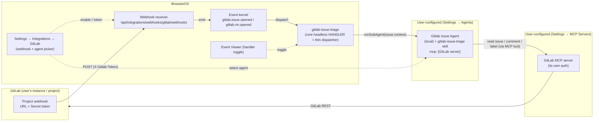

# Design: GitLab Integration (Webhook → Triage)

**Spec**: [`spec.md`](./spec.md) · **UI contract**: [`mockup.html`](./mockup.html) · **Checklist**: [`checklists/requirements.md`](./checklists/requirements.md)
**Feature Branch**: `002-gitlab-integration` · **Status**: Draft (v5 — R6 handling-model revision + re-review fixes: failure detected post-run, outcome-based; deterministic MCP pre-flight removed)
**App Target**: `bos-core` (confirmed; agrees with `spec.md`)

---

## 1. Classification

**`bos-core`.** This is a first-class part of BOS itself, not a self-contained app or an installable marketplace item:

- It adds an **integration** to the generic integration framework — a manifest, a webhook handler, and an actions-adapter registration — all under `src/lib/integrations/`. Integrations are compiled into BOS (`src/lib/integrations/index.ts` barrel), not user-installable; `registerIntegration`/`registerAdapter` are module-load side effects. (Precedent: the `telegram` and `gsuite` integrations, `src/lib/integrations/services/{telegram,gsuite}/`.)
- It adds a **core headless event handler** (`gitlab-issue-triage`) to the event kernel. The only in-process mechanism for a core-owned headless handler is `dispatch.registerCoreExecutor` + `api.register({ declaredBy: "core" })` — exactly what the self-healing spine does (`src/lib/self-heal/spine-handler.ts`). Worker-IPC `handler_declare` is for worker-thread services, which this is not. **R6:** this handler is a **thin dispatcher** — it forwards the issue to a configured agent; it contains no triage logic.
- It **seeds an agent + a skill** (the `Gitlab Issue Agent` and the `gitlab-issue-triage` skill) — the unit of capability (classification, workflow, GitLab updates via MCP) lives there, configured like any normal agent.
- It adds **Settings → Integrations** panel components under `src/components/apps/settings/integrations/`.
- It adds **two platform-level capabilities** that future authless integrations will also need (the `authless` manifest flag + the `mintSecret` opt-out on webhook enable).

Nothing here is a `builtin-app` (no `src/apps/<id>/` window) and nothing is a `marketplace-item` (no `data/user-apps/items/<id>/` installable). The spec's `App Target: bos-core` is correct.

> **Relationship to self-healing (R6 — fully separate).** The bug-fix *intelligence* is **not** reused from self-heal, and the gitlab feature does not forward issues to it. Self-heal is a BOS self-modification mechanism (its Diagnostician reads BOS source, routes by BOS scope class, delivers via the Supervisor preview). A GitLab bug issue is about the *user's* codebase — a different problem shape. Only the **orchestration plumbing** is shared by pattern (core headless handler → prompt-ack → fire-and-forget `runSubAgent`), which is the self-heal spine's R4 pattern reused as a platform idiom, not a shared code path. The two features have no import-level coupling.

> **Note on a string overlap (not a collision).** `gitlab` already appears in the codebase as a *git-remote OAuth credential provider* id: `src/app/api/integrations/git-providers/route.ts` and `src/components/apps/settings/integrations/GitProvidersTab.tsx` store GitLab client-credentials under the `git_remote_oauth` namespace, and `IntegrationDetailView.tsx`'s `FIELD_CREDENTIAL_PROVIDERS` set contains `"gitlab"`. That is a **separate subsystem** (git push/pull credentials) from the integration registry this feature adds to. They do not share a store; implementers must not "reuse" the git-providers code, and the gitlab detail view must **not** be the generic `IntegrationDetailView` (which would render the git-provider OAuth panels). See ADR-6.

---

## 2. Constitution check

| Principle | Status |
|---|---|
| **I. Spec-Driven** | ✅ Grounded in `spec.md`; this design is the `design` step of the pipeline. |
| **II. Server Authority & SSR Boundary** | ✅ All webhook parsing, secret verification, state, and event emission are server-only. The shared token (`WebhookSecrets.primary`) lives in the SecretsStore and is returned to the client **exactly once** (the reveal). No GitLab credential is stored in BOS at all (R1/R4). |
| **III. Always Delegate; Claude Codes** | ✅ Implementation is delegated to the Developer. At runtime the dispatcher hands the issue to a `local` agent (`runSubAgent`) — a headless local agent is the correct default (it reads/classifies/drafts text and calls MCP tools; it does not edit BOS source). |
| **IV. Minimize Blast Radius** | ✅ All `src/` changes land on the `002-gitlab-integration` feature branch via `dev_delegate`. The two platform-level additions (`authless` flag, `mintSecret` opt-out) are additive and back-compatible. |
| **V. The VFS Is Not the Source** | ✅ No VFS writes for source. The triage agent's deliverable is a comment posted to GitLab via MCP (not a BOS spec-store write). |
| **VI. Specs & Docs Stay in Sync** | ✅ File plan includes `docs/` additions (a `gitlab` integration page + an agent/skill setup note). |
| **VII. Respect Boundaries** | ✅ No `package.json`/lockfile/build changes. `npx tsc --noEmit` + `npm run lint` are the gates. No new external dependency (the GitLab MCP server is user-configured external tooling). |

**Conflict flagged:** none.

---

## 3. Architecture

### 3.1 Context (how the user/agent sees it)

From the user's view: **Settings → Integrations → GitLab** is a card that drills into a detail view (the mockup) with two concerns, cleanly separated:

1. **The webhook** (enable, URL, token) — the inbound signal. No MCP, no credential.
2. **The workflow** (which agent handles a new issue) — a picker defaulting to the **Gitlab Issue Agent**, plus a pointer to the Events handler toggle.

When a new issue is opened in a hooked GitLab project: the receiver emits `gitlab.issue.opened`; the default **`gitlab-issue-triage`** core headless handler (a **thin dispatcher**, enabled by default) forwards the issue context to the **configured agent** (the **Gitlab Issue Agent**); the agent — driven by its **`gitlab-issue-triage` skill** (the state machine) — classifies the issue, runs the matching workflow, and updates the issue (comments + status labels) **through its configured GitLab MCP server**, ending at the terminal `Needs Review` state. The webhook and the handler are **two independent switches**; the handler and the agent's behavior are **user-configurable** (agent in Settings → Agents; the pipeline in the skill).



**Dependency split (R4, enforced by structure):**
- **Webhook side** (GL → R → K): depends only on the shared token. No MCP, no GitLab credential, no agent.
- **Handling side** (K → H → A → M): the handler is dependency-free apart from the event; the *agent* is where the GitLab MCP server is required. The handler does **not** pre-check MCP — the agent is the unit of capability.

### 3.2 Container (BOS's real containers)

Everything lives in the **Next.js app process**. No new worker-thread service, no new item git repo, no Bastion change:

- **Webhook receiver route** — `src/app/api/integrations/webhooks/[integrationId]/[serviceId]/route.ts` (existing, unchanged). Thin delegate: handler lookup → enable gate → connected gate → verify → dedup ring → `receive()` → `emitIntegrationEvent`.
- **Integration framework** — `src/lib/integrations/**`. The gitlab manifest + handlers register into these at module load.
- **Event kernel** — `src/lib/events/**`. Emission is `api.emit`; the `gitlab-issue-triage` handler is a **core** headless handler (`registerCoreExecutor`), dispatched in-process.
- **Sub-agent runtime** — `src/lib/agent/subagents/runner.ts` (`runSubAgent` → `runLocalHeadless`) composes the configured agent's instructions (including its skills index + MCP index block) and runs the agent loop with its gated tools.
- **MCP gateway** — `src/lib/mcp/gateway.ts` enforces the **agent's MCP allowlist** (`agent.mcp`) at every `mcp_tool_*` call via `ctx.agentId`.
- **Agent store / seed** — `data/agents/<id>/AGENT.md` (seeded from `seed/agents/`); the skill under `seed/skills/<id>/`.
- **Secrets** — webhook token in the integration SecretsStore (`webhook:webhooks`); **no** GitLab credential anywhere.

### 3.3 Component (modules this feature creates/modifies)

Two registries both need a `gitlab/webhooks` entry (the "two adapter-ish files" gotcha is unchanged from v3 — see ADR-8):

1. **Webhooks *handler* registry** (`src/lib/integrations/webhooks/registry.ts`) — read by the receiver route. The handler does `verify` + `receive`.
2. **Actions *adapter* registry** (`src/lib/integrations/actions/adapter-registry.ts`) — a zero-method adapter with `capabilities: { webhook: true }` for the panel's `supported` flag.

```
src/lib/integrations/services/gitlab/
  manifest.ts              GITLAB_MANIFEST (authless: true, service "webhooks", placeholder oauthConfig)
  index.ts                 registerIntegration + import the two adapters
  labels.ts                classification + status label constants (shared: skill + panel + handler)
  adapters/
    webhook.ts             GitLabWebhookHandler (verify X-Gitlab-Token; receive parse+filter)
    webhooks-adapter.ts    zero-method ServiceAdapter, capabilities { webhook: true }
  triage/
    handler.ts             gitlab-issue-triage core handler (register + prompt-ack + fire-and-forget dispatch to the selected agent)
    dispatch.ts            build the issue-context task, resolve the selected agent, runSubAgent, graceful-failure wrapper

seed/agents/gitlab-issue-agent/AGENT.md      the Gitlab Issue Agent (type local; frontmatter skills: ["gitlab-issue-triage"], mcp allowlist)
seed/skills/gitlab-issue-triage/SKILL.md     the triage skill = the state machine (R6)

src/components/apps/settings/integrations/
  GitLabDetailView.tsx            header + WebhookSection + WorkflowSection + labels ref
  GitLabWorkflowSection.tsx       the "Workflow" card: agent picker + skill note + Events toggle pointer
  GitLabLabelsReference.tsx       classification + status chips
```

### 3.4 Webhook handler (receive/verify) — *unchanged from v3*

`GitLabWebhookHandler` (`adapters/webhook.ts`) implements `WebhookHandler`:

- **`verify`** — *plain string match*, not HMAC. Read the `X-Gitlab-Token` header; timing-safe-compare against `[secrets.previous, secrets.primary]`. Reuse the `timingSafeEqual` shape from `TelegramBotWebhookHandler.verify`. **No candidates present ⇒ reject** (a manual GitLab webhook with no token yet must 401, never "accept all").
- **`receive`** — `JSON.parse` the body. `object_kind === "issue"` **and** `action === "open"` → one `IntegrationEvent` `{ type: "issue-opened", service: "gitlab/webhooks", data: <issue projection> }`; `object_kind === "merge_request"` **and** `action === "open"` → `{ type: "mr-opened", … }`; **anything else** → `{ events: [] }` (2xx `emitted: 0`). Lifecycle hooks are **routing-only** (ADR-1c): `onEnable` / `onSecretsRotated` / `onDisable` register and revoke `sha256(token)` in the Bastion credentials index. Nothing is ever *registered with GitLab* — that stays manual.
- **Projection** (bounded): `project.id`, `object_attributes.iid`, `.title`, `.labels[].title` → `labels[]`, top-level `user {name, username}`, `object_attributes.url`, `.description` truncated (e.g. 2 000 chars). MRs also `source_branch`/`target_branch`.

The IntegrationEvent types (`issue-opened`/`mr-opened`) are mapped to kernel types separately (ADR-2).

### 3.5 Event-type mapping — see ADR-2 *(unchanged)*

Add to `KNOWN_TYPES`: `"gitlab/webhooks:issue-opened" → "gitlab.issue.opened"`, `"gitlab/webhooks:mr-opened" → "gitlab.mr.opened"`; add `KNOWN_NAMES.gitlab = "GitLab"`; add a `legacyFriendlySummary` branch (`"issue #<iid> <title>"` / `"MR !<iid> <title>"`). Both final types pass `isValidEventType`.

### 3.6 Triage handler = thin dispatcher — see ADR-3, ADR-12

`triage/handler.ts` registers **one** core headless handler, exactly as `spine-handler.ts` does:

```
registerCoreExecutor("gitlab-issue-triage", async (record) => {
  // Resolve the selected agent (panel picker, default "gitlab-issue-agent").
  // Then FIRE-AND-FORGET the dispatch:  void dispatchToAgent(record)
  // Return immediately → prompt ack, never block the 30 s ack window.
});
api.register({
  handlerId: "gitlab-issue-triage",
  eventType: "gitlab.issue.opened",   // exact; issue-only per Q1 — NOT a prefix
  mode: "headless",
  ownerId: "core",
  declaredBy: "core",
  displayName: "GitLab issue triage",
  /* no `enabled` field — omit so disable persists across restarts (§9 F1) */
});
```

- **Registered for `gitlab.issue.opened` only.** `gitlab.mr.opened` is deliberately not a target (Q1=A). The per-handler FIFO queue serializes runs (concurrency 1) — prevents concurrent double-processing of the same issue.
- **The handler holds no triage logic** (R6): it resolves which agent to run and hands over the issue context. Classification, the workflow, and all GitLab updates are the **agent + skill's** job.
- **Prompt-ack + fire-and-forget** (ADR-3, unchanged in mechanism): the executor returns immediately; `dispatchToAgent` is the detached async work.

### 3.7 Dispatch + graceful failure — see ADR-12, ADR-4 (revised)

`triage/dispatch.ts`:

1. **Resolve the agent.** Read the panel's "agent that handles new issues" from the persisted integration config — `state.services["webhooks"].config.triageAgentId` (the exact analog of Telegram's `state.services["bot"].config.agentConfig.agentId`), default `gitlab-issue-agent` → `getAgent(id)`. If it resolves to nothing, emit `com.bos.gitlab.triage.failed` (`agent_not_found`) and stop — no run.
2. **Build the task.** A short, context-bearing instruction: *"A new GitLab issue was opened: project #<id> (proj/app), issue #<iid>, title …, labels …, url …. Use the `gitlab-issue-triage` skill. Read the issue via the GitLab MCP server, classify it, work it through the pipeline, and update it with comments and status labels as you go."* The skill (loaded by the agent) supplies the actual state-machine logic — the task only supplies the entry context.
3. **Run.** `const run = await runSubAgent(agent, task, { contentOnly: true, onEvent })` — the headless mechanism (Telegram router precedent). `contentOnly` is **inert for a `local` agent** (it is consumed only by the Claude harness); it is passed for consistency with the precedent and does nothing here — the local run is gated by the agent's own `tools`/gate. No `conversationId` (genuinely headless; the deliverable is a GitLab comment, not a branch-gated spec write). `onEvent` collects the run's `tool_result` events (`{ name, result, ok }`, runner ADR-13) so step 4 can inspect outcomes.
4. **Graceful failure — post-run, outcome-based** (FR-015/FR-016/SC-007). The contract here is subtle (the v4 re-review blocker): the MCP gateway is resilient (a missing/unreachable server yields an in-band `Error: …` *tool-result string*, not a throw), and the agent loop's contract is "runs never die of tools" — so `runSubAgent` **returns** a clean `{ endedReason: "completed", error: undefined }` even when the agent had no MCP access. A `try/catch` around the run therefore **never fires** for the no-MCP case, and `run.error` stays `undefined`. The dispatcher detects failure **post-run and outcome-based**:
   - **agent missing** (`getAgent` → undefined, step 1) → emit `com.bos.gitlab.triage.failed` (`agent_not_found`), no run.
   - **`run.error` / `run.endedReason === "error"`** → genuine model/provider failure → emit `com.bos.gitlab.triage.failed` with `run.error`.
   - **the run finished but NO `mcp_tool_call` succeeded** (every collected `tool_result` for `mcp_tool_call` has `ok: false`) → the agent had no usable GitLab MCP access → emit `com.bos.gitlab.triage.failed` (`no_gitlab_mcp`). This is the deterministic surface for the SC-007 case.
   - **at least one `mcp_tool_call` succeeded** → the agent reached GitLab and acted; any mid-pipeline problem is the *skill's* responsibility to reflect with a `Failed` status label. The dispatcher does not second-guess a run that demonstrably touched GitLab.

   In every failure case **the receiver never crashes and the original event is never lost** (the `gitlab.issue.opened` record is already durably stored before dispatch). This guard is post-hoc and outcome-based — it is **not** a pre-flight reachability check, so R6's "no deterministic MCP pre-flight" principle stands.

> **R6 — the deterministic MCP pre-flight is removed.** v3's §3.8 pre-checked "is a GitLab-named MCP server reachable by the agent" before running. That check encoded *the agent's capability inside the handler* — the wrong layer, and it duplicated the gateway's own enforcement. R6 deletes it: the dispatcher runs unconditionally, and failure is detected **post-run, outcome-based** (§3.7.4) rather than pre-checked. (The gateway's in-band `Error:` is model *data*, not a thrown error, so the only reliable no-MCP signal is "the run finished with no successful `mcp_tool_call`." The design's own cited precedent — the Telegram router, `agent-router.ts` — observes `if (run.error)`, not a try/catch, for exactly this reason.) The unit of capability is the agent, configured in Settings → Agents. FR-013 states this explicitly.

### 3.8 The triage skill drives the pipeline (model-followed guidance) — see ADR-12

`seed/skills/gitlab-issue-triage/SKILL.md` is the **behavior contract the model follows**. The `Gitlab Issue Agent` loads it (its seed `AGENT.md` sets `skills: ["gitlab-issue-triage"]`). **Honesty about the guarantee:** a skill is a prompt index entry the model reads on demand (`buildSkillsIndexBlock`) — it is *guidance*, not an execution-time state machine. The classify → workflow → label transitions, the "exactly one active status label" swap (FR-014), and the resume/idempotency branch below are **expected from the model, not enforced by any mechanism**. A misbehaving run (e.g. leaving two status labels, or skipping a stage) is possible and un-backstopped; SC-003's "≥90%" absorbs that residual. This is inherent to the user-directed agent + skill model (R6) — the alternative would be re-adding the deterministic pipeline R6 deliberately removed. Its content drives:

1. **Read** the issue via the GitLab MCP server (title, description, current labels).
2. **Classify** — labels first: exactly one of `Bug` / `Feature` / `Improvement` (case-insensitive; other labels ignored). Fallback: infer from title+description and state the inferred type in a comment. Apply the classification label (additive).
3. **Idempotency / resume**: if the issue already carries one of the handler's status labels, resume from that stage rather than restarting (covers a dedup-ring loss re-emitting the same open, or a manual re-dispatch).
4. **Run the matching pipeline**, applying the transient **status label** (exactly one active, swapped per step) via MCP:
   - `Bug`: `Triage` → `Analyzing` → `Verifying` → `Fix Proposed` → **`Needs Review`** (post the proposed fix as a comment).
   - `Feature` / `Improvement`: `Triage` → (work) → `Spec Drafted` → **`Needs Review`** (post the draft spec — including a UI mockup where relevant — as a comment).
   - Side states: `Needs Input` (blocked, needs info from the reporter — stop and wait), `Failed` (run errored; failure comment posted).
5. **Autonomy boundary (Q2=A)**: comment + label only. **Never** close the issue or open an MR. `Needs Review` is the terminal state — a human verifies and finalizes.
6. **Label mechanics**: to keep the single-active-status invariant, the skill reads current labels, removes any existing handler status label, and adds the new one (GitLab add/remove-label semantics). It never removes the additive classification label.
7. **`"verify"` scope (tightened from the scenario walkthrough)**: for a Bug, "verify" = assess plausibility and identify the likely root cause from the description **and any accessible code context** (e.g. a registered repo / the agent's file tools); if no code context is reachable, the skill notes that in the comment and proceeds to propose a fix from the description alone. It is *not* "reproduce in a running environment."

### 3.9 Settings panel (mockup = binding UI contract)

A dedicated **`GitLabDetailView`** is routed for `gitlab` in `IntegrationsTab`. The generic `IntegrationDetailView` is **not** used (it would render the git-provider OAuth panel — ADR-6). It composes, top to bottom, matching the mockup:

- **Header card** — GitLab icon, name, a `Webhook` badge, one-line "webhook only — handling is a separate, configurable step" copy.
- **`WebhookSection`** (reused, `serviceId="webhooks"`). Stock: enable/disable, URL + copy, one-time amber token reveal, rotate, delete, "Secret set" badge, `X-Gitlab-Token` hint. "Generate token" = the stock rotate (first use = generation); enable does **not** auto-mint for gitlab (ADR-1b), so the "enabled, no token" state (B) is real and safe.
- **`GitLabWorkflowSection`** (new, R6) — the **Workflow** card:
  - **Agent picker** — "Agent that handles new issues", a `<select>` over available agents, default **Gitlab Issue Agent**, a "Manage" affordance → Settings → Agents. Persisted in the integration config (the dispatcher reads it, §3.7.1).
  - **Skill note** — one line: "Its *skill* defines the pipeline (classify → workflow → status labels → `Needs Review`); the agent performs GitLab operations via its configured GitLab MCP server (no credential is stored in BOS)."
  - **Handler toggle pointer** — "A built-in `gitlab-issue-triage` handler is enabled by default and forwards each new issue to the agent above. Toggle it in the Events handler configuration, or point another consumer (e.g. the Workflow app) at the `gitlab.issue.opened` event instead." + an "Open Events" link that opens the **Event Viewer** app (the real toggle surface — ADR-7).
- **`GitLabLabelsReference`** — the two chip groups (Classification + the eight Status labels) from the mockup, sourced from `labels.ts`.
- **No MCP status anywhere** (R4).

`IntegrationsTab` change: add a `currentItem.manifest.id === "gitlab"` branch → `GitLabDetailView`, and update the generic-view fallback from `id !== "telegram"` to `id !== "telegram" && id !== "gitlab"` (§9 F2).

---

## 4. Concrete file / module plan (only what this feature creates or modifies)

**New:**
- `src/lib/integrations/services/gitlab/manifest.ts`
- `src/lib/integrations/services/gitlab/index.ts`
- `src/lib/integrations/services/gitlab/labels.ts`
- `src/lib/integrations/services/gitlab/adapters/webhook.ts`
- `src/lib/integrations/services/gitlab/adapters/webhooks-adapter.ts`
- `src/lib/integrations/services/gitlab/triage/handler.ts`
- `src/lib/integrations/services/gitlab/triage/dispatch.ts`
- `seed/agents/gitlab-issue-agent/AGENT.md`
- `seed/skills/gitlab-issue-triage/SKILL.md`
- `src/components/apps/settings/integrations/GitLabDetailView.tsx`
- `src/components/apps/settings/integrations/GitLabWorkflowSection.tsx`
- `src/components/apps/settings/integrations/GitLabLabelsReference.tsx`
- `docs/usage/integrations/gitlab.md` (end-user) + a `docs/dev/integrations/` note (dev) — webhook-only/authless pattern + agent/skill setup.

**Modified:**
- `src/lib/integrations/types.ts` — add `authless?: boolean` to `IntegrationManifest`.
- `src/lib/integrations/state/store.ts` — `readState`: coerce `connected = true` when the manifest is `authless`.
- `src/lib/integrations/index.ts` — `import "./services/gitlab";`.
- `src/lib/integrations/webhooks/registry.ts` — add `gitlab: { webhooks: new GitLabWebhookHandler() }`.
- `src/lib/integrations/webhooks/manager.ts` — `enableWebhook` gains `mintSecret?: boolean` (default `true`).
- `src/app/api/integrations/[id]/services/[serviceId]/webhook/route.ts` — POST `enable` forwards `body.mintSecret`.
- `src/lib/events/legacy-mapping.ts` — `KNOWN_TYPES` + `KNOWN_NAMES` + `legacyFriendlySummary` for gitlab (§3.5).
- `src/instrumentation.ts` — call `registerGitLabTriageHandler()` after `startEventKernel()`.
- `src/components/apps/settings/IntegrationsTab.tsx` — route `gitlab` → `GitLabDetailView`; update the generic fallback (F2).

> The webhook **receiver route** is **not** modified. The self-heal module is **not** modified (R6 — fully separate).

---

## 5. Integration points (existing mechanisms called into, not created/modified)

- **Webhook receiver route** — `src/app/api/integrations/webhooks/[integrationId]/[serviceId]/route.ts` (enable gate → connected gate → verify → dedup → receive → emit).
- **Webhook store/manager/verify** — `webhooks/{store,manager,verify}.ts` (`WebhookSecrets`, `enableWebhook`/`rotateSecret`, dedup ring). The `mintSecret` opt-out is the one platform addition to `manager.ts`.
- **Event kernel** — `events/{api,kernel,dispatch}.ts` (`api.emit`, `registerCoreExecutor`, `api.register({declaredBy:"core"})`, `api.setEnabled`). Toggle surface: the Event Viewer's `ConfigPanel`.
- **Legacy mapping** — `events/legacy-mapping.ts` via `from-integration-event.ts`.
- **Sub-agent runtime** — `agent/subagents/{store,runner}.ts` (`getAgent`, `runSubAgent` → `runLocalHeadless` → `runAgentLoop`, `composeInstructions`, `gateFor`/`headlessGate`). The trajectory the user asked about is the headless run's `TranscriptionWriter` output (run transcript / Workflow Manager surface) — **not** an Assistant conversation (R6 decision: no Assistant attachment).
- **Agent + skill stores** — `data/agents/<id>/AGENT.md` (seeded from `seed/agents/`), skills seeded from `seed/skills/`; the panel's agent picker resolves via `getAgent`.
- **MCP gateway + store + capability scoping** — `mcp/{gateway,store}.ts`, `agent/capabilities.ts` (`isAllowed`); agent tools `mcp_tool_*` scope every call to `ctx.agentId`. The gateway is resilient (returns `{error}` in-band on a down server) — this is what makes the removed pre-flight unnecessary (ADR-4 revised).
- **Settings integration panel primitives** — `integrations/{WebhookSection,IntegrationListView,IntegrationsBreadcrumb}.tsx`, `useIntegrations.ts`, `GET /api/integrations`.
- **Event Viewer app** — `src/apps/event-viewer/` (the real handler-toggle surface; ADR-7).

---

## 6. ADRs

### ADR-1 — Authless integration: connected-by-default at the platform level *(unchanged)*
- **Context.** The receiver 404s on `!state.connected`; `WebhookSection`'s Enable is disabled while `!connected`. A webhook-only integration has no OAuth connect to set `connected=true`.
- **Decision.** Add `authless?: boolean` to `IntegrationManifest`; in `readState(id)`, when `authless`, coerce `connected = true` (derived on every read, not persisted). GitLab sets `authless: true`.
- **Consequences.** Receiver gate passes with no connect step; Enable is enabled; no per-feature branching; any future authless integration sets one flag. Back-compatible (G Suite/Telegram keep OAuth-driven `connected`).

### ADR-1b — Webhook enable does not auto-mint the secret for manual webhooks *(unchanged)*
- **Context.** `enableWebhook` unconditionally mints a token — correct for Gmail/Telegram (needed to register the provider push) but wrong for a manual webhook (it would mint an invisible secret). The mockup shows *Enable* (no token) then an explicit *Generate token*.
- **Decision.** `enableWebhook` gains `mintSecret?: boolean` (default `true`); gitlab enable passes `mintSecret: false`. "Generate token" = stock rotate (first use = generation; each use mints a fresh primary, demotes the old to `previous`, reveals once).
- **Consequences.** "Enabled, no token" is a real, safe state (401 until a token is generated + pasted). Matches the mockup. Back-compatible.

### ADR-1c — A manual webhook still needs lifecycle hooks: inbound routing ≠ provider registration *(v6, from a production 401)*
- **Context.** v3–v5 concluded "GitLab webhooks are registered by hand, BOS never calls GitLab, therefore the handler needs no `onEnable`/`onDisable`." That confused **registration** with **routing**. A delivery is an *unauthenticated inbound POST* — no cookie, no `Authorization` header — so a Bastion-fronted deployment (which fronts previews and base alike) routes it solely by resolving `sha256(X-Gitlab-Token)` against `data/system/credentials-index.json` (034-secrets-authentication). With no entry, Bastion answered `401` (empty body + `WWW-Authenticate: Basic`) **before** the receiver route ran, so the correct `verify()` of ADR-1b/§3.4 never executed. Symptom: a freshly rotated, verbatim-pasted token 401s in every fronted environment. A second, independent half was missing too: Bastion's `WEBHOOK_SECRET_HEADERS` listed only Telegram's header, so `x-gitlab-token` was not even recognised as a credential.
- **Decision.**
  1. The handler gains **routing-only** hooks — `onEnable` (restore routing for an existing token), `onDisable` (revoke everything it registered, also reached by delete), and a new framework hook **`WebhookHandler.onSecretsRotated`**, called by `rotateSecret`. The third is load-bearing precisely *because* of ADR-1b: with `mintSecret:false` the first token is minted by the rotate action, i.e. after `onEnable` has already run, so an enable-only implementation would index nothing, ever.
  2. Exactly the tokens `verify()` accepts are routable — `primary` **and** the demoted `previous`, so the rotation grace window survives the gateway as well as the receiver. Registered hashes are persisted in `config.extras.routingSecretHashes` so teardown is exact.
  3. The write/revoke **policy** lives in one shared module, `src/lib/integrations/webhooks/routing-index.ts` (Telegram, which had it hand-written inline, now calls it too). `bastion/src/webhook-secret-header.ts` owns the header list and gains `x-gitlab-token`.
  4. `disableWebhook` no longer swallows a failing `onDisable`: a silently-failed revocation leaves a withdrawn token routable while reporting success.
- **Options rejected.** (a) Have the framework index every webhook secret automatically — wrong for a provider that *signs* rather than echoes (Gmail's Pub/Sub JWT has no raw secret on the wire), so the decision must stay per-handler. (b) Index only the `primary` — drops in-flight deliveries carrying the grace token at the gateway even though `verify()` would accept them. (c) Special-case `/api/integrations/webhooks/*` in Bastion by path — reintroduces the per-protocol path check `credential-routing.ts` exists to avoid.
- **Consequences.** R1/R4 are untouched — BOS still stores no GitLab credential and still never calls GitLab; the hooks only make the container reachable. The no-GitLab-credential, webhook-only model is preserved. Adding another echoed-secret provider is now a documented two-edit checklist. Pinned by `webhook.routing-index.test.ts` and `tests/bastion/webhook-secret-header.test.ts`.

### ADR-2 — Event-type mapping via `KNOWN_TYPES` *(unchanged)*
- **Decision.** Data-table entries for the two event types + `KNOWN_NAMES.gitlab` + a `legacyFriendlySummary` branch. No code-logic branch in `deriveLegacyType`.

### ADR-3 — Triage is a core headless handler: prompt-ack + fire-and-forget *(mechanism unchanged; the async work is now the agent dispatch)*
- **Context.** The triage is multi-minute (agent reasoning + many MCP calls). The kernel's `invoke()` for a `declaredBy:"core"` handler awaits the executor raced against `timeoutMs` (default 30 s); a non-returning executor is marked failed and retried up to 3× (doubling side-effectful MCP writes).
- **Decision.** Core headless handler; the executor returns immediately and launches the dispatch fire-and-forget (`void dispatchToAgent(record)`), mirroring the spine's R4 pattern. The dispatcher owns completion + failure.
- **Consequences.** HTTP response never blocked (FR-007); 30 s window safe; no timeout-retry double-runs. Trade-off accepted: a process death between ack and run-finish loses that one triage (event stays acked, visible) — mitigated by the skill's resume/idempotency (§3.8.3). `declaredBy:"core"` ⇒ `isHandlerActive` is a plain `enabled` boolean, so the Event Viewer toggle is authoritative.

### ADR-4 — No deterministic MCP pre-flight; failure detected post-run, outcome-based *(R6 — supersedes v3's pre-flight ADR-4; corrected at v5 re-review)*
- **Context.** v3 pre-checked "is a GitLab-named MCP server reachable by the agent" in the handler before running. R6 (user direction) identifies this as the wrong paradigm: it encodes the *agent's* capability inside the *handler*, duplicates the gateway's own per-call enforcement, and is brittle to server naming.
- **The v5 correction (re-review blocker).** v4's §3.7.4 relied on a `try/catch` around `runSubAgent` to catch the no-MCP case. That is the **wrong contract**, verified against source: the MCP gateway (`callServerTool`, `gateway.ts`) is resilient and returns an in-band `{error}` (surfaced to the model as an `Error: …` tool-result *string*, `mcp.ts`), and the agent loop's contract is "runs never die of tools" (`agent-loop.ts`) — so `runSubAgent` (`runner.ts`) **returns** a clean `{ endedReason: "completed", error: undefined }` even when the agent had no MCP access. A try/catch never fires; `run.error` stays `undefined`. The design's own cited precedent (the Telegram router, `agent-router.ts`) observes `if (run.error)`, not try/catch, for exactly this reason.
- **Decision.** The dispatcher runs unconditionally (no pre-flight) and detects failure **post-run, outcome-based** (§3.7.4): (a) agent missing → fail immediately; (b) `run.error` / `endedReason === "error"` → model/provider failure; (c) the run finished but **no `mcp_tool_call` succeeded** (all collected `onEvent` `tool_result`s for `mcp_tool_call` have `ok: false`) → no usable GitLab MCP access. Any of these emits `com.bos.gitlab.triage.failed`. The receiver never crashes; the event is never lost.
- **Consequences.** FR-015/FR-016/SC-007 hold at the **run** layer (deterministic, post-hoc), not a pre-check. The capability boundary lives where the user configures it (Settings → Agents → MCP). No name-matching heuristic. The handler does not model the agent's configuration at all — it only observes the run's outcomes.

### ADR-5 — "MCP server assigned to the agent" = the agent's `mcp` allowlist *(retained; the agent is now the configurable one)*
- **Mechanism.** An agent is `data/agents/<id>/AGENT.md`; frontmatter `mcp` is an allowlist (empty = all). The gateway enforces it at call time via `ctx.agentId`; `composeInstructions` builds the "## MCP servers" index from the same allowlist. So "assigned to the agent" is precisely `agent.mcp` + gateway enforcement — no new mechanism.
- **Decision.** Seed a **`Gitlab Issue Agent`** (`type: local`) that loads the `gitlab-issue-triage` skill. Its `mcp` allowlist defaults to **empty (all)** so whatever GitLab server the user configures is reachable (robust to naming); the user may narrow it. Its `tools` are scoped to what the triage needs (MCP tools + text/skill capability; no source-edit / VFS-write-spec tools).
- **Consequences.** All GitLab access is via the user's MCP server with its own auth (FR-012/R4). The webhook/panel shows no MCP status. (v3's "fixed named agent, not user-pickable" rationale is now relaxed: the panel *does* let the user pick any agent (FR-017), but **defaults** to the seeded `Gitlab Issue Agent`, which remains the discoverable, well-scoped recommendation.)

### ADR-6 — GitLab gets a dedicated `GitLabDetailView`, not the generic one *(unchanged)*
- **Decision.** New `GitLabDetailView` (pattern: `TelegramDetailView`) routed in `IntegrationsTab`; composes header + `WebhookSection` + `GitLabWorkflowSection` + `GitLabLabelsReference`. Placeholder `oauthConfig` must stay inert in `IntegrationListView` (F3). The generic view and git-providers are untouched.

### ADR-7 — The handler toggle lives in the Event Viewer *(unchanged)*
- **Decision.** The pointer's "Open Events" link opens the **Event Viewer** app (id `event-viewer`), whose `ConfigPanel` toggles headless handlers via `POST /api/events/handlers`. No Settings→Events tab is invented.

### ADR-8 — Two registries, two registrations *(unchanged)*
- **Decision.** Register `gitlab/webhooks` in both the webhooks handler registry and the actions adapter registry (zero-method, `capabilities:{webhook:true}`).

### ADR-9 — Loop prevention: the agent's own updates never re-trigger it *(unchanged; "handler" → "agent")*
- **Decision.** Structural: the agent's updates produce GitLab `note` (comment, `object_kind:"note"`) and `issue`/`merge_request` **`action:"update"`** (label) webhooks, which the receiver's `object_kind ∈ {issue, merge_request}` **and** `action === "open"` filter categorically excludes. Verified against GitLab's webhook-events docs. No sender-id / timestamp guard needed. (Secondary optional `X-Gitlab-Event` gate noted.)

### ADR-10 — Reuse, not special-case *(retained; now includes the agent/skill reuse)*
- **Added under R6:** the handling side reuses the **agent + skill** model (Settings → Agents, `runSubAgent`, the skill index) rather than hardcoding a bespoke step pipeline in the integration. The integration contributes a *dispatcher* and a *seed agent + seed skill* — all standard BOS extension points. The two platform additions (`authless`, `mintSecret`) remain the only framework deltas.

### ADR-11 — MCP as agent dependency, not webhook dependency *(R4; rephrased under R6)*
- **Decision.** The webhook path touches no MCP code; the integration panel shows no MCP status. The **agent** is where the GitLab MCP server is required, and the handler trusts that boundary (no pre-flight, ADR-4). The two switches (webhook enable / handler enable) gate independent paths.

### ADR-12 — Thin dispatcher + configurable agent/skill (the R6 handling model)
- **Context.** The user's direction (R6): "what should happen is that some agent should be configured to handle the step and work is handed off to that agent — configured in Settings → Agents as any normal agent — so it can use various skills, which makes the whole solution more flexible." v3's model (a hardcoded `gitlab-triage` agent + a handler-internal `workflow.ts` step pipeline + a deterministic MCP pre-flight) put the *intelligence* in the integration, which is the opposite of how BOS agents work and less flexible.
- **Decision.**
  1. **The handler is a thin dispatcher** (`triage/handler.ts` + `triage/dispatch.ts`): on `gitlab.issue.opened`, resolve the selected agent, build an issue-context task, `runSubAgent`, and gracefully record any failure. It has **no** classification/workflow/label logic and **no** MCP pre-check.
  2. **A configurable agent is the unit of capability**: the **Gitlab Issue Agent** (seeded, but a normal Settings → Agents agent — skills, MCP, tools, system prompt all user-editable). The panel's agent picker (FR-017) lets the user swap it for any valid agent, defaulting to the seeded one.
  3. **A skill drives the pipeline** (model-followed guidance, not a mechanism-enforced state machine — see §3.8): `seed/skills/gitlab-issue-triage/SKILL.md` defines classify → workflow → status-label transitions → `Needs Review`, with resume/idempotency and the Q2 autonomy boundary. Editing the skill changes the pipeline without touching the integration. The single-active-status invariant (FR-014) is a *soft* guarantee the model is expected to maintain, not one any code enforces.
- **Options rejected.** (a) v3's handler-internal `workflow.ts` step pipeline — hardcodes the pipeline, duplicates what a skill expresses better, and isn't user-tunable. (b) Per-step agent assignment (the intermediate model before R6) — more moving parts than needed; one agent + one skill is the natural BOS shape and keeps the panel to a single picker. (c) Reusing self-heal's pipeline — wrong problem shape (BOS self-mod vs user codebase); kept fully separate (see §1 note).
- **Consequences.** The integration stays small (a dispatcher, not an engine); the user gains real flexibility (swap the agent, edit the skill's workflow, change its MCP server/tools) with no integration change; FR-009/FR-010/FR-017 are satisfied; the panel's "Workflow" card is an honest, single-control surface. Risk: pipeline quality now depends on the seed skill being well-written — mitigated by treating SKILL.md as a spec'd contract (§3.8) and documenting it in `docs/`.

---

## 7. Risks / open questions

1. **In-memory dedup ring lost on restart** — a byte-identical retry after restart re-emits one event. Mitigated by the **skill's resume/idempotency** (§3.8.3: existing status label ⇒ resume, not restart), not a persistent ring.
2. **Long-run vs. kernel timeout / double-run** — prompt-ack (ADR-3) means a process death between ack and run-finish loses that one triage (event acked, visible). Per-handler FIFO serializes runs (concurrency 1); a backlog processes one at a time — acceptable for v1.
3. **Agent misconfiguration (R6)** — the selected agent missing, or its skill/MCP incomplete, now surfaces as a run failure (ADR-4) rather than a handler pre-check. The failure is recorded and non-crashing, but the *diagnosis* is the user's (agent config). Mitigation: the panel names the default agent, the "Manage" link goes to Settings → Agents, and the `com.bos.gitlab.triage.failed` event carries the cause.
4. **Self-hosted GitLab payload differences** — the projection reads defensively (tolerant field access, defaults); the `object_kind`/`action`/`open` contract is stable and documented.
5. **Label conflicts with user-managed labels** — the skill swaps only its own status labels and never clobbers the additive classification label; if a user has their own label *named* `Triage`/`Needs Review` etc., the skill treats/overwrites it — expected behavior of the fixed label set (R3/R5).
6. **`gitlab` string overlap** with the git-remote OAuth provider (ADR-6) — flagged so the implementer doesn't reach for git-providers code.
7. **Mockup parity** (cosmetic) — reusing `WebhookSection` verbatim surfaces chrome the mockup omits (event-type filter + save button; "Rotate secret" vs "Generate token"). Accept stock or add a small label prop; functionally identical.
8. **Autonomy boundary (Q2=A)** is enforced by the **skill** (never close/commit) — a *soft* guard; widening is a deliberate skill change.
9. **Single-run pipeline (FR-021)** — v1 does the whole pipeline in one agent run; a human intervening mid-pipeline (removing a status label, replying) is handled by the skill's resume logic, but a *guaranteed* per-transition re-entry loop is a future extension, not v1.

**Open questions (need a human decision):**
- (b) `WebhookSection` parity (Risk 7): accept the stock labels/chrome, or add a small label prop to match the mockup exactly? (Low stakes.)
- (c) Confirm the "draft spec" deliverable is **posted as a GitLab issue comment** (not written to a BOS spec store / Build Studio run) — this design assumes the former per FR-012/FR-014.
- (d) **Seed agent scope**: confirm the seeded `Gitlab Issue Agent` defaults to `mcp: []` (all servers) and a tool set limited to MCP + text/skill (no source/VFS-spec tools), or tighten the default to a named `mcp: ["<gitlab>"]`? (Recommend empty=all for naming robustness.)

---

## 8. UI mockup reference

`mockup.html` (Settings → Integrations → GitLab, webhook-only, no OAuth, no MCP status). Screen → component mapping:

- **Header card** → `GitLabDetailView` header (name + `Webhook` badge + "webhook only — handling is separate/configurable" copy).
- **State A/B/C** → `WebhookSection` (disabled / enabled-no-token / enabled+token hero with the amber one-time reveal).
- **Workflow card** → `GitLabWorkflowSection` (agent picker defaulting to Gitlab Issue Agent + Manage → Agents; skill note; Events toggle pointer + "Open Events" → Event Viewer).
- **Labels reference** → `GitLabLabelsReference` (Classification: Bug/Feature/Improvement; Status: the eight labels).
- The **state switcher** is mockup-only.

Receiver URL `…/api/integrations/webhooks/gitlab/webhooks` matches `webhookUrl("gitlab","webhooks")` with serviceId `webhooks`.

---

## 9. Design review history

- **One-round review (v3, architect-reviewer): Approve-with-notes, no blockers.** Re-derived every load-bearing claim against live source. Fixes applied (F1 drop `enabled:true`; F2 `IntegrationsTab` fallback excludes gitlab; F3 placeholder `oauthConfig` inert in list view; F4 `legacyFriendlySummary`; F5 `WebhookSection` chrome noted).
- **v4** — driven by R6 (user handling-model direction): handler → thin dispatcher; agent + skill = unit of capability; deterministic MCP pre-flight **removed** (ADR-4 revised); seed agent + seed skill added; panel gains a Workflow/agent-picker card; self-heal confirmed **fully separate** (ADR-12 + §1 note). Webhook side, event mapping (ADR-2), and panel ADRs (1/1b/6/7/8) unchanged.
- **v5 (this revision) — R6 re-review (architect-reviewer): one [BLOCKER] + 3 [NOTE]s, all resolved.** The reviewer re-derived the R6 layer against live source. **[BLOCKER]** the no-pre-flight graceful-failure story did not hold: the MCP gateway is in-band (resilient) and the agent loop "never dies of tools," so `runSubAgent` returns a clean `completed` even with no MCP access — v4's `try/catch` never fires and the promised `com.bos.gitlab.triage.failed` was never emitted (FR-016/SC-007). **Fixed**: failure detection is now **post-run, outcome-based** (§3.7.4 + ADR-4 revised) — agent-missing / `run.error` / "no successful `mcp_tool_call`" — keeping R6's no-pre-flight model. **[NOTE]**s applied: (i) the skill is model-followed *guidance*, not a mechanism state machine — the single-active-status invariant (FR-014) is a soft guarantee (§3.8, ADR-12 reworded); (ii) `contentOnly:true` is inert for a `local` agent — rationale corrected (§3.7.3); (iii) the seed `AGENT.md` pins `skills: ["gitlab-issue-triage"]` and the picker key is named (`state.services.webhooks.config.triageAgentId`). Verified clean: seeding is real (`seed-sync.ts`), the picker persistence home is real, `runSubAgent` resolution, F1 (omit `enabled`), self-heal separation, `authless` is a genuine new field, and no webhook-side regressions. **Verdict: Ready for plan.**
- **v6 — production defect, not a review finding: HTTP 401 on every delivery in a Bastion-fronted deployment** (reported against both a preview of `bos/002-gitlab-integration` and the base after promotion — the "both" is what identified the gateway rather than the branch). Root cause in **two coupled halves**, neither in `verify()`, which was correct throughout: the handler registered no credentials-index entry (it had no lifecycle hooks at all, by the reasoning ADR-1c now retracts), and Bastion did not recognise `x-gitlab-token` as a secret-bearing header. Resolved by **ADR-1c**; §3.4 amended. No change to the event model, the dispatcher, the skill, or the panel.
