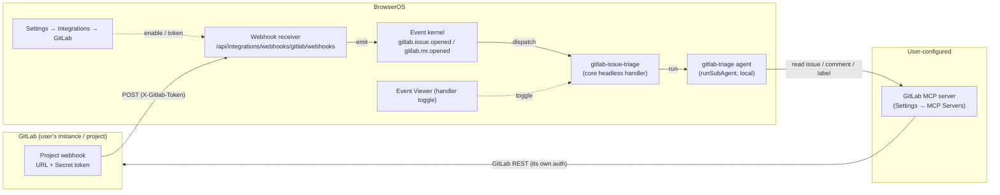

# Design: GitLab Integration (Webhook → Triage)

**Spec**: [`spec.md`](./spec.md) · **UI contract**: [`mockup.html`](./mockup.html) · **Checklist**: [`checklists/requirements.md`](./checklists/requirements.md)
**Feature Branch**: `002-gitlab-integration` · **Status**: Draft (v1)
**App Target**: `bos-core` (confirmed; agrees with `spec.md`)

---

## 1. Classification

**`bos-core`.** This is a first-class part of BOS itself, not a self-contained app or an installable marketplace item:

- It adds an **integration** to the generic integration framework — a manifest, a webhook handler, and an actions-adapter registration — all under `src/lib/integrations/`. Integrations are compiled into BOS (`src/lib/integrations/index.ts` barrel), not user-installable; `registerIntegration`/`registerAdapter` are module-load side effects. (Precedent: the `telegram` and `gsuite` integrations, `src/lib/integrations/services/{telegram,gsuite}/`.)
- It adds a **core headless event handler** (`gitlab-issue-triage`) to the event kernel. The only in-process mechanism for a core-owned headless handler is `dispatch.registerCoreExecutor` + `api.register({ declaredBy: "core" })` — exactly what the self-healing spine does (`src/lib/self-heal/spine-handler.ts`). Worker-IPC `handler_declare` is for worker-thread services, which this is not.
- It adds **Settings → Integrations** panel components under `src/components/apps/settings/integrations/` (Settings is bos-core, not a `src/apps/<id>/` folder).
- It adds **two platform-level capabilities** that future authless integrations will also need (the `authless` manifest flag + the `mintSecret` opt-out on webhook enable). The user's standing principle is to fix the mechanism at the platform level, not per-feature.

Nothing here is a `builtin-app` (no `src/apps/<id>/` window) and nothing is a `marketplace-item` (no `data/user-apps/items/<id>/` installable). The spec's `App Target: bos-core` is correct and this design is consistent with it.

> **Note on a string overlap (not a collision).** `gitlab` already appears in the codebase as a *git-remote OAuth credential provider* id: `src/app/api/integrations/git-providers/route.ts` and `src/components/apps/settings/integrations/GitProvidersTab.tsx` store GitLab client-credentials under the `git_remote_oauth` namespace, and `IntegrationDetailView.tsx`'s `FIELD_CREDENTIAL_PROVIDERS` set contains `"gitlab"`. That is a **separate subsystem** (git push/pull credentials) from the integration registry this feature adds to. The two do not share a store: the integration lives in the `registerIntegration` registry + `state/gitlab/state.json` + the SecretsStore under the `gitlab` integration id; the git-remote provider lives in `git_remote_oauth`. They coexist cleanly, but implementers must not "reuse" the git-providers code for the integration, and the git integration's detail view must **not** be the generic `IntegrationDetailView` (which would render the git-provider OAuth panels). See ADR-6.

---

## 2. Constitution check

| Principle | Status |
|---|---|
| **I. Spec-Driven** | ✅ Grounded in `spec.md`; this design is the `design` step of the pipeline. |
| **II. Server Authority & SSR Boundary** | ✅ All webhook parsing, secret verification, state, and event emission are server-only (`import "server-only"` / `src/app/api/**/route.ts`). The shared token (`WebhookSecrets.primary`) lives in the SecretsStore and is returned to the client **exactly once** (the reveal), mirroring the stock `rotate` path (`webhooks/route.ts` returns `primary` only on rotate). No GitLab credential is stored in BOS at all (R1). |
| **III. Always Delegate; Claude Codes** | ✅ Implementation is delegated to the Developer. At runtime the triage handler runs a `local` sub-agent (`runSubAgent`) — a headless local agent is the correct default for a non-coding orchestration task (the agent *reads/classifies/drafts text and calls MCP tools*; it does not edit BOS source). |
| **IV. Minimize Blast Radius** | ✅ All `src/` changes land on the `002-gitlab-integration` feature branch via `dev_delegate`. The two platform-level additions (`authless` flag, `mintSecret` opt-out) are additive and back-compatible (default preserves existing GSuite/Telegram behavior). |
| **V. The VFS Is Not the Source** | ✅ No VFS writes for source; runtime state (webhook config/secrets, event records) persists under `data/` as before. The triage **does not** write BOS spec stores — its deliverable is a comment posted to GitLab via MCP (see §3.4). |
| **VI. Specs & Docs Stay in Sync** | ✅ File plan includes `docs/` additions (a `gitlab` integration page + an add-a-webhook-only-integration recipe note). No doc/code drift found while grounding this design. |
| **VII. Respect Boundaries** | ✅ No `package.json`/lockfile/build changes. `npx tsc --noEmit` + `npm run lint` are the gates. No new external dependency is introduced (the GitLab MCP server is user-configured external tooling, not a BOS `npm` dependency). |

**Conflict flagged (minor):** none. The design deliberately does **not** reuse the git-providers `gitlab` OAuth path (which would contradict R1 "no OAuth / no stored GitLab credential") — it is the git-*remote* provider, a different feature.

---

## 3. Architecture

### 3.1 Context (how the user/agent sees it)

From the user's view: **Settings → Integrations → GitLab** is a card in the integrations list that drills into a detail view (the mockup). Enabling the webhook reveals a URL + a one-time token to paste into GitLab. When a new issue/MR is opened in a hooked GitLab project, a `gitlab.issue.opened` / `gitlab.mr.opened` event appears in the **Event Viewer**; the default **`gitlab-issue-triage`** handler (toggleable from the Event Viewer's handler config) classifies the issue and works it, updating the issue on GitLab (comments + labels) through the user's **GitLab MCP server**. The webhook and the handler are **two independent switches**: disable the handler and the event still lands; disable the webhook and nothing is received.



The **webhook side** (GL → R → K) has **no** MCP or GitLab-credential dependency. The **handling side** (K → H → A → M) is where the GitLab MCP server is required, and it is a handler dependency, not a webhook one (FR-015, R4).

### 3.2 Container (BOS's real containers)

Everything lives in the **Next.js app process**. There is no new worker-thread service, no new item git repo, no Bastion change:

- **Webhook receiver route** — `src/app/api/integrations/webhooks/[integrationId]/[serviceId]/route.ts` (existing, unchanged). It is a thin delegate: handler lookup → enable gate → connected gate → verify → dedup ring → `receive()` → `emitIntegrationEvent`.
- **Integration framework** — `src/lib/integrations/**` (registry, state store, webhook manager/store/verify, actions adapter-registry). The gitlab manifest + handlers register into these at module load.
- **Event kernel** — `src/lib/events/**` (the `globalThis` daemon started from `instrumentation.ts`). Emission is `api.emit`; the `gitlab-issue-triage` handler is a **core** headless handler (`registerCoreExecutor`), dispatched in-process.
- **Sub-agent runtime** — `src/lib/agent/subagents/runner.ts` (`runSubAgent` → `runLocalHeadless`) composes the triage agent's instructions (including its MCP index block) and runs the agent loop with its gated tools.
- **MCP gateway** — `src/lib/mcp/gateway.ts` enforces the **agent's MCP allowlist** (`agent.mcp`) at every `mcp_tool_*` call via `ctx.agentId`.
- **Secrets** — webhook token in the integration SecretsStore (`webhook:webhooks`); **no** GitLab credential anywhere.

### 3.3 Component (modules this feature creates/ modifies)

Two registries both need a `gitlab/webhooks` entry — this is the single most important "gotcha" and the reason there are *two* adapter-ish files:

1. **Webhooks *handler* registry** (`src/lib/integrations/webhooks/registry.ts`) — read by the **receiver route** (`getWebhookHandler`). The handler does `verify` + `receive`.
2. **Actions *adapter* registry** (`src/lib/integrations/actions/adapter-registry.ts`) — read by `GET /api/integrations` (`listAdapterServices`) which feeds `WebhookSection`'s `supported` flag (`adapterSupports(adapters, "gitlab", "webhooks", "webhook")`). Telegram lights up its webhook section by registering an adapter with `capabilities: { webhook: true }` (`services/telegram/adapters/bot.ts`). GitLab needs the same, even though it has no callable API methods → a **zero-method adapter** that only declares the capability.

```
src/lib/integrations/services/gitlab/
  manifest.ts              GITLAB_MANIFEST  (authless: true, service "webhooks", placeholder oauthConfig)
  index.ts                 registerIntegration + import the two adapters below
  labels.ts                classification + status label constants (shared: handler + panel)
  adapters/
    webhook.ts             GitLabWebhookHandler (verify X-Gitlab-Token; receive parse+filter)
    webhooks-adapter.ts    zero-method ServiceAdapter, capabilities { webhook: true }
  triage/
    handler.ts             gitlab-issue-triage core handler (register + fire-and-forget + ack)
    workflow.ts            classification → bug/feature/improvement pipeline → MCP updates
    agent-prompt.ts        system prompt + task builder for the gitlab-triage agent run

seed/agents/gitlab-triage/AGENT.md      dedicated named agent (type: local, mcp allowlist)

src/components/apps/settings/integrations/
  GitLabDetailView.tsx           header + WebhookSection + labels ref + handler pointer
  GitLabLabelsReference.tsx      classification + status chips
  GitLabHandlerPointer.tsx       bottom pointer → opens Event Viewer
```

### 3.4 Webhook handler (receive/verify)

`GitLabWebhookHandler` (`adapters/webhook.ts`) implements `WebhookHandler`:

- **`verify`** — *plain string match*, not HMAC. Read the `X-Gitlab-Token` header; timing-safe-compare against the candidates `[secrets.previous, secrets.primary]` (order: previous first so a rotation in-flight still verifies). Reuse the same `timingSafeEqual`-based helper shape as `TelegramBotWebhookHandler.verify` (`adapters/bot-webhook.ts`), which is the in-repo precedent for a custom (non-`verifySignature`) scheme. **No candidates present ⇒ reject** (unlike Telegram's "accept all when no secret" — for a manual GitLab webhook, "no token yet" must be a safe 401, see FR-003/FR-004 and the "enabled, no token" state in the mockup).
- **`receive`** — `JSON.parse` the body. Read `object_kind` and `object_attributes.action`:
  - `object_kind === "issue"` **and** `action === "open"` → one `IntegrationEvent` `{ type: "issue-opened", service: "gitlab/webhooks", data: <issue projection> }`.
  - `object_kind === "merge_request"` **and** `action === "open"` → one `IntegrationEvent` `{ type: "mr-opened", service: "gitlab/webhooks", data: <MR projection> }`.
  - **anything else** (push, pipeline, note, tag, other actions: close/reopen/update/approval/…) → `{ events: [] }` → the route returns 2xx `emitted: 0`. This is FR-006 and the first half of loop prevention.
  - **No `onEnable` / `onDisable`** — registration is manual (the user pastes URL+token into GitLab), so there is no provider call to make. This is the explicit contrast with Telegram's `setWebhook` (locked scope).
- **Projection** (bounded, per spec "truncated description"): `project.id`, `object_attributes.iid`, `object_attributes.title`, `object_attributes.labels[].title` → `labels[]`, top-level `user {name, username}` (note: GitLab puts the actor at **top-level `user`**, not under `object_attributes`), `object_attributes.url`, and `object_attributes.description` truncated to a fixed cap (e.g. 2 000 chars) to stay under the 1 MB event payload limit. For MRs also `object_attributes.source_branch` / `target_branch`.

The event *type names* emitted here (`issue-opened` / `mr-opened`) are the **IntegrationEvent** type; the **final** kernel event type is derived separately (ADR-2).

### 3.5 Event-type mapping (decision 2) — see ADR-2

`emitIntegrationEvent` (`src/lib/events/from-integration-event.ts`) derives the final type via `deriveLegacyType(event.service, event.type)` (`src/lib/events/legacy-mapping.ts`). The generic fallback would produce `com.bos.gitlab.webhooks.issue-opened` — **not** the committed `gitlab.issue.opened`. The clean fix is a data-table addition to `KNOWN_TYPES` (no code-logic change):

```
"gitlab/webhooks:issue-opened" → "gitlab.issue.opened"
"gitlab/webhooks:mr-opened"    → "gitlab.mr.opened"
```

Both final types pass `isValidEventType` (`/^[a-z0-9]+(\.[a-z0-9_-]+)+$/`). `legacySourceFor` yields `{ appId: "gitlab", name: "GitLab" }` once `KNOWN_NAMES.gitlab = "GitLab"` is added.

### 3.6 Triage handler (decision 3) — see ADR-3

`triage/handler.ts` registers **one** core headless handler, exactly as `src/lib/self-heal/spine-handler.ts` does:

```
registerCoreExecutor("gitlab-issue-triage", async (record) => {
  // pre-flight MCP check (ADR-4); on absence: emit failure, ack, return.
  // classify; then FIRE-AND-FORGET the workflow (void runTriage(...));
  // return immediately  → prompt ack, never block the 30 s ack window.
});
api.register({
  handlerId: "gitlab-issue-triage",
  eventType: "gitlab.issue.opened",   // exact; issue-only per Q1 — NOT a prefix
  mode: "headless",
  ownerId: "core",
  declaredBy: "core",                 // core-internal: no owner-liveness IPC needed
  displayName: "GitLab issue triage",
  enabled: true,                      // default on (FR-009); setEnabled-persisted
});
```

- **Registered for `gitlab.issue.opened` only.** `gitlab.mr.opened` is deliberately *not* a handler target (Q1=A: MRs are event-only). The per-handler FIFO queue (`dispatch.ts`) therefore serializes triage runs (concurrency 1 per handler) — desirable: it prevents concurrent double-processing of the same issue and matches the kernel's existing ordering guarantee.
- **Ack model = prompt-ack + background run.** `invoke()` for a `declaredBy:"core"` handler does `const out = await fn(record); settleAck(...)`, raced against `reg.timeoutMs` (default `DEFAULT_HANDLER_TIMEOUT_MS = 30_000`). A multi-minute agent run would blow that window, get marked failed, and be **retried up to `MAX_HANDLER_ATTEMPTS` (3)** with backoff — re-running side-effectful MCP writes. So the executor **returns immediately** (the self-heal spine's R4 pattern: "the executor's ack window is never at risk because the long work is launched fire-and-forget"). The triage run then owns its own failure path (ADR-3/4). The kernel's `processed` for this event means "the handler acknowledged," **not** "the workflow finished."
- **Toggle** — `api.setEnabled("gitlab-issue-triage", "core", enabled)` is reached by the Event Viewer's config panel (`POST /api/events/handlers`), which is the real handler-management surface (the mockup's "Settings → Events → Handlers" label maps to the **Event Viewer app**'s configuration tab — there is no Settings *namespace* named `events`; see ADR-7). Because `declaredBy:"core"`, `isHandlerActive` returns true whenever `enabled` (no owner-running IPC gate), so the toggle is a plain boolean flip.
- **Idempotency guard** (at-least-once safety): before running, the workflow reads the issue via MCP; if it already carries one of the handler's status labels (`Triage`…`Needs Review`/`Failed`) it is treated as already (in)progress and the run no-ops/resumes rather than re-posting. This covers a dedup-ring loss across restart re-emitting the same open, or a manual re-dispatch. (See Risks.)

### 3.7 Triage workflow (decision 3, continued)

`triage/workflow.ts` runs the agent **once** via `runSubAgent(getAgent("gitlab-triage"), task, { contentOnly: true })` — the exact headless mechanism the Telegram router uses (`integrations/services/telegram/agent-router.ts` → `runSubAgent`). The run is `type: "local"`, so `runLocalHeadless` composes `composeInstructions("gitlab-triage")` (which builds the **"## MCP servers"** index block from the agent's `mcp` allowlist) and runs `runAgentLoop` with `gateFor("gitlab-triage")` + `headlessGate`. No `conversationId` is passed (genuinely headless, like the scheduler/Telegram router) — and **correctly so**, because the deliverable is a GitLab issue comment, not a branch-gated BOS spec-store write (V. The VFS Is Not the Source).

**All GitLab reads/writes go through the GitLab MCP server** (FR-012), reached by the agent via the `mcp_tool_search` / `mcp_tool_schema` / `mcp_tool_call` tools, which enforce the agent's allowlist at call time (`gateway.callServerTool(server, tool, args, ctx.agentId)` → `allowedServers(agentId)`). The "MCP server assigned to the agent" requirement maps **directly** onto the agent's `mcp` frontmatter allowlist (see ADR-5).

**Pipeline stages** (prompt-orchestrated by `agent-prompt.ts`; the "workflow" is the agent's reasoning steps, not the retired BOS workflow engine, and "draft a spec" = draft spec *text posted as a comment*, not a Build Studio spec-store run):

1. **Read** the issue via MCP (full title/description/labels).
2. **Classify** — labels first: exactly one of `Bug` / `Feature` / `Improvement` (case-insensitive title match; any other labels ignored). Fallback: agent infers from title+description and states the inferred type.
3. **Run the matching pipeline**:
   - `Bug`: analyze → verify → propose fix.
   - `Feature`: draft a specification for the new feature.
   - `Improvement`: draft a specification to improve the existing feature.
4. **Update the issue via MCP** as it advances — this is where the **status labels** are applied, exactly one active at a time, swapped as it moves:
   `Triage → Analyzing → Verifying → Fix Proposed` (Bug) **or** `Triage → … → Spec Drafted` (Feature/Improvement) `→ Needs Review` (terminal, human finalizes — Q2=A). Side states: `Needs Input` (blocked, needs info from reporter), `Failed` (run errored; failure comment posted; event still recorded). The **classification label** (`Bug`/`Feature`/`Improvement`) is additive and persists; it is separate from the status label (FR-013).
5. **Never close the issue or open an MR** (Q2=A) — comment + label only.

Label application via MCP: read the issue's current labels, remove any existing handler status label, add the new one (GitLab's `add_label`/`remove_label` semantics), so the single-active invariant holds. See Risks (label conflicts with user-managed labels).

### 3.8 MCP-not-configured detection (decision 4) — see ADR-4

In `triage/handler.ts`, **before** launching the agent, a deterministic pre-flight:

1. `const agent = await getAgent("gitlab-triage")` (the run would fail regardless if absent).
2. `const all = await listMcpServers()` (`@/lib/mcp/store`).
3. Reachable set = `all.filter(s => isAllowed(agent.mcp, s.name, s.endpoint ?? ""))` (`@/lib/agent/capabilities`) — the *exact* predicate the MCP gateway uses, so "reachable by the agent" is authoritative, not a guess.
4. GitLab set = reachable servers whose `name` matches `/gitlab/i` (a small named helper, `isGitLabServer`).
5. If the GitLab set is empty → **graceful failure** (FR-015, SC-007): emit a `com.bos.gitlab.triage.not-configured` event/notification ("GitLab MCP not configured / not assigned to the triage agent"), leave the issue **unmodified**, and return (prompt ack). The original `gitlab.issue.opened` event is already durably recorded, so nothing is lost.

The in-agent path is the safety net: if the pre-flight passes but the server is down mid-run, `mcp_tool_call` returns an in-band `Error: …` (the gateway is resilient — `toolsForServer`/`callServerTool` return `{error}` rather than throwing), the agent's failure handling posts `Failed` + a failure comment, and the run ends without crashing the receiver.

### 3.9 Settings panel (mockup = binding UI contract)

A new **`GitLabDetailView`** (analogous to `TelegramDetailView`) is routed for `gitlab` in `IntegrationsTab`. The generic `IntegrationDetailView` is **not** used for gitlab — it would render the git-provider OAuth credential panel (because `FIELD_CREDENTIAL_PROVIDERS` includes `"gitlab"`) and a Connect/Disconnect card, both of which contradict the webhook-only, no-OAuth contract (ADR-6).

`GitLabDetailView` composes, top to bottom, matching the mockup:

- **Header card** — GitLab icon, name, a `Webhook` badge, and the one-line description that this is the *webhook only* and that handling is a separate, toggleable step (mockup §header, all three states).
- **`WebhookSection`** (reused, `src/components/apps/settings/integrations/WebhookSection.tsx`) — `serviceId="webhooks"`, `supported=adapterSupports(adapters,"gitlab","webhooks","webhook")` (true, per §3.3). This gives, stock: enable/disable, receiver URL + copy, the one-time amber token reveal, rotate, delete, "Secret set" badge, and the `X-Gitlab-Token` copy hint. The Enable button's `!connected` gate is satisfied because the integration is connected-by-default (ADR-1).
  - **Token reveal mapping** (mockup State B→C): the mockup's **"Generate token"** is the stock **rotate** action (`rotateSecret` → `ensureWebhookSecret({force:true})` → returns `primary` once → `WebhookSection` shows the amber one-time reveal). "Rotate token" (State C) is the same action. Enabling does **not** auto-mint for gitlab (ADR-1/`mintSecret:false`), so the "enabled, no token" intermediate state (State B) is real and safe (401 until a token is generated and pasted).
- **`GitLabLabelsReference`** — the two chip groups from the mockup: Classification (`Bug`/`Feature`/`Improvement`) and Status (the seven transient labels), sourced from `labels.ts`.
- **`GitLabHandlerPointer`** — the persistent bottom note: a built-in `gitlab-issue-triage` handler listens to `gitlab.issue.opened`, enabled by default, acts via the GitLab MCP server assigned to its agent; a link that opens the **Event Viewer** app (the real handler-toggle surface, ADR-7). No MCP status is shown (R4).

`IntegrationsTab` change: add a `currentItem.manifest.id === "gitlab"` branch that renders `GitLabDetailView` (passing `adapters`), exactly like the existing `telegram` branch.

---

## 4. Concrete file / module plan (only what this feature creates or modifies)

**New:**
- `src/lib/integrations/services/gitlab/manifest.ts`
- `src/lib/integrations/services/gitlab/index.ts`
- `src/lib/integrations/services/gitlab/labels.ts`
- `src/lib/integrations/services/gitlab/adapters/webhook.ts`
- `src/lib/integrations/services/gitlab/adapters/webhooks-adapter.ts`
- `src/lib/integrations/services/gitlab/triage/handler.ts`
- `src/lib/integrations/services/gitlab/triage/workflow.ts`
- `src/lib/integrations/services/gitlab/triage/agent-prompt.ts`
- `seed/agents/gitlab-triage/AGENT.md`
- `src/components/apps/settings/integrations/GitLabDetailView.tsx`
- `src/components/apps/settings/integrations/GitLabLabelsReference.tsx`
- `src/components/apps/settings/integrations/GitLabHandlerPointer.tsx`
- `docs/usage/integrations/gitlab.md` (end-user) and a `docs/dev/integrations/` note (dev) — see §4 docs.

**Modified:**
- `src/lib/integrations/types.ts` — add `authless?: boolean` to `IntegrationManifest`.
- `src/lib/integrations/state/store.ts` — `readState`: coerce `connected = true` when the manifest is `authless`.
- `src/lib/integrations/index.ts` — `import "./services/gitlab";` (barrel registration).
- `src/lib/integrations/webhooks/registry.ts` — add `gitlab: { webhooks: new GitLabWebhookHandler() }` to the static `HANDLERS` map.
- `src/lib/integrations/webhooks/manager.ts` — `enableWebhook` gains `mintSecret?: boolean` (default `true`); skip `ensureWebhookSecret` when `false`.
- `src/app/api/integrations/[id]/services/[serviceId]/webhook/route.ts` — POST `enable` forwards `body.mintSecret` to `enableWebhook`.
- `src/lib/events/legacy-mapping.ts` — `KNOWN_TYPES` + `KNOWN_NAMES` entries for gitlab (§3.5).
- `src/instrumentation.ts` — call `registerGitLabTriageHandler()` in `register()`, ordered after `startEventKernel()`/`registerAllUiHandlers()` (the self-heal spine is registered after the kernel for the same reason).
- `src/components/apps/settings/IntegrationsTab.tsx` — route `gitlab` → `GitLabDetailView` (pass `adapters`).
- `docs/` — add `docs/usage/integrations/gitlab.md`; extend the integration recipe in `docs/dev/extending-bos.md`/`docs/dev/integrations.md` with the "webhook-only / authless integration" pattern (manifest `authless` flag + `mintSecret:false` + zero-method webhook-capable adapter).

> The webhook **receiver route** `src/app/api/integrations/webhooks/[integrationId]/[serviceId]/route.ts` is **not** modified — it is a generic integration point (below).

---

## 5. Integration points (existing mechanisms called into, not created/modified)

- **Webhook receiver route** — `src/app/api/integrations/webhooks/[integrationId]/[serviceId]/route.ts` (enable gate → connected gate → verify → `hashPayload`/`markDelivery` dedup ring → `receive` → `emitIntegrationEvent`). GitLab plugs in by registering a handler; the route is unchanged.
- **Webhook store/manager/verify** — `src/lib/integrations/webhooks/{store,manager,verify}.ts`: `WebhookSecrets {primary, previous}` in the SecretsStore under `webhook:webhooks`; `enableWebhook`/`rotateSecret`/`deleteWebhook`; the in-memory dedup ring. (The `mintSecret` opt-out is the one platform addition to `manager.ts`.)
- **Event kernel** — `src/lib/events/{api,kernel,dispatch}.ts`: `api.emit`, `registerCoreExecutor`, `api.register({declaredBy:"core"})`, `api.setEnabled`, in-process core-handler dispatch. Toggle surface: `POST /api/events/handlers` via the Event Viewer's `ConfigPanel`.
- **Legacy mapping** — `src/lib/events/legacy-mapping.ts` (`deriveLegacyType`/`legacySourceFor`/`legacyFriendlySummary`) via `from-integration-event.ts`.
- **Sub-agent runtime** — `src/lib/agent/subagents/{store,runner}.ts`: `getAgent`, `runSubAgent` (`type:"local"` → `runLocalHeadless` → `runAgentLoop`), `composeInstructions` (MCP index block), `gateFor`/`headlessGate`.
- **MCP gateway + store + capability scoping** — `src/lib/mcp/{gateway,store}.ts`, `src/lib/agent/capabilities.ts` (`isAllowed`); agent tools `mcp_tool_search`/`mcp_tool_schema`/`mcp_tool_call` (`src/lib/assistant/tools/server/mcp.ts`) scope every call to `ctx.agentId`.
- **Settings integration panel primitives** — `src/components/apps/settings/integrations/{WebhookSection,IntegrationListView,IntegrationsBreadcrumb}.tsx`, `useIntegrations.ts` (`adapterSupports`), `GET /api/integrations` (feeds `items` + `adapters`).
- **Event Viewer app** — `src/apps/event-viewer/` (id `event-viewer`, name "Events"; `ConfigPanel.tsx` lists/toggles headless handlers). The handler pointer opens this app.

---

## 6. ADRs

### ADR-1 — Authless integration: connected-by-default at the platform level
- **Context.** The generic receiver 404s on `!state.connected` (`route.ts`), and `WebhookSection`'s Enable button is disabled while `!connected`. `readState` (`state/store.ts`) merges `defaultState()` (`connected:false`) with `state.json`. A webhook-only integration has **no** OAuth connect to set `connected=true` (the spec's open design decision / Assumption).
- **Options.** (a) Per-feature hack: have gitlab's registration/first-enable write `connected:true` to `state.json`. (b) Platform flag: an optional `IntegrationManifest.authless` that the state store interprets as "connected-by-default." (c) Special-case `gitlab` in the receiver route.
- **Decision.** **(b).** Add `authless?: boolean` to `IntegrationManifest`; in `readState(id)`, look up `getIntegration(id)` and, when `authless`, coerce `connected = true` (derived on every read, **not** persisted). GitLab's manifest sets `authless: true`.
- **Consequences.** The receiver gate passes for gitlab with no connect step; `WebhookSection`'s Enable is enabled; no per-feature branching. Any future webhook-only/authless integration sets one flag and inherits the behavior (the user's "fix the mechanism at the platform level" principle). The only inbound gates for gitlab are the webhook `enabled` flag (checked first) + valid `X-Gitlab-Token` — exactly the spec's assumption. Back-compatible: GSuite/Telegram don't set `authless` and keep their OAuth-driven `connected`.

### ADR-1b — Webhook enable does not auto-mint the secret for manual webhooks
- **Context.** `enableWebhook` unconditionally calls `ensureWebhookSecret` (mints a token) — correct for Gmail/Telegram (the secret is needed to register the provider push in `onEnable`), but wrong for a **manual** webhook: it would mint a token the user can never see (the stock section reveals only on rotate), leaving "enabled with a hidden secret." The mockup instead shows *Enable* (State B, no token) then an explicit *Generate token* (State C, one-time reveal).
- **Decision.** `enableWebhook` gains `mintSecret?: boolean` (default `true`); the gitlab enable path passes `mintSecret: false` (forwarded through the webhook `route.ts`). GitLab's **Generate token** is the stock **rotate** action (first use = generation; each use mints a fresh primary, demotes the old to `previous` for the rotation grace window, and reveals once).
- **Consequences.** "Enabled, no token" becomes a real, safe state (401 until a token is generated and pasted — no token ⇒ no candidate matches ⇒ reject, never accept). Matches the mockup precisely. Back-compatible (default preserves Gmail/Telegram).

### ADR-2 — Event-type mapping via `KNOWN_TYPES`, not a code-logic branch
- **Context.** `emitIntegrationEvent` → `deriveLegacyType(service, type)`. Without a mapping, gitlab's events would land as `com.bos.gitlab.webhooks.issue-opened` — not the user- and spec-committed `gitlab.issue.opened` / `gitlab.mr.opened`.
- **Options.** (a) Add the two pairs to the `KNOWN_TYPES` data table. (b) Add a `service === "gitlab"` special case in `deriveLegacyType`.
- **Decision.** **(a)** — the table is the intended extension point ("known legacy `service:type` pairs"); a data entry is smaller, more testable, and keeps the function logic untouched. Emit the IntegrationEvent types `issue-opened`/`mr-opened` with `service: "gitlab/webhooks"`; map to `gitlab.issue.opened`/`gitlab.mr.opened`. Also add `KNOWN_NAMES.gitlab = "GitLab"` for a clean source name.
- **Consequences.** The handler registers for the exact final type `gitlab.issue.opened`. Both final types pass `isValidEventType`. The IntegrationEvent type (`issue-opened`) and the kernel event type (`gitlab.issue.opened`) are intentionally distinct layers (the same split as `gsuite/gmail:new_email` → `com.bos.gsuite.email.received`).

### ADR-3 — Triage is a core headless handler: prompt-ack + fire-and-forget agent run
- **Context.** FR-009 needs a default, toggleable headless consumer of `gitlab.issue.opened`. The triage run is multi-minute (agent reasoning + many MCP calls). The kernel's `invoke()` for a `declaredBy:"core"` handler **awaits** the executor and settles the ack, raced against `reg.timeoutMs` (default 30 s); a non-returning executor is marked failed and **retried up to 3× with backoff**, then permanently-failed.
- **Options.** (a) Await the full workflow in the executor (needs `timeoutMs` raised to ~10 min). (b) Fire-and-forget the workflow and return immediately (prompt ack). (c) Hold the ack with a long timeout.
- **Decision.** **(b)** — a **core** headless handler (`registerCoreExecutor` + `api.register({declaredBy:"core", enabled:true, eventType:"gitlab.issue.opened"})`), mirroring the self-heal spine's R4 pattern ("the long work is launched fire-and-forget; the ack window is never at risk"). The executor does the MCP pre-flight, then `void runTriage(record)` and returns; the workflow owns its completion and its failure path.
- **Consequences.** The HTTP webhook response is never blocked (FR-007); the 30 s window is safe; no accidental re-runs from kernel retry (side-effectful MCP writes are not doubled by a timeout-retry). Trade-off accepted: if the process dies *between* the ack and the workflow finishing, that one triage is not re-dispatched (the event is already acked) — mitigated by the idempotency guard (§3.6) and by the fact the event record is durable and visible in the Event Viewer. Holding the ack (a/c) would serialize the single FIFO queue for ~10 min per issue and re-dispatch a still-pending long event after restart (double-processing) — worse. Because `declaredBy:"core"`, `isHandlerActive` is a plain `enabled` boolean (no owner-running IPC gate), so the Event Viewer toggle is authoritative.

### ADR-4 — MCP-not-configured: deterministic pre-flight, in-band agent fallback
- **Context.** FR-015/SC-007: with no GitLab MCP server configured (or none reachable by the triage agent), the handler must not crash, must record the event, must surface a "GitLab MCP not configured" failure, and must leave the issue unmodified.
- **Decision.** Pre-flight in the executor (before `runSubAgent`): resolve the triage agent, list MCP servers, filter by the agent's allowlist using the **exact** gateway predicate (`isAllowed(agent.mcp, name, endpoint)`), and require ≥1 server whose name matches `/gitlab/i`. Absent → emit a `com.bos.gitlab.triage.not-configured` event/notification, return (ack), issue untouched. The in-agent path is the net: the MCP gateway is resilient (returns `{error}` in-band rather than throwing on a down server), so a mid-run failure surfaces to the agent, which posts `Failed` + a failure comment.
- **Consequences.** The common "nothing configured" case is caught cheaply and deterministically (no wasted agent turn). Name-based GitLab matching is a heuristic (Risk: a non-obviously-named server is reported "not configured"); setup docs recommend a recognizable name, and the in-agent error path still degrades gracefully. Detection reuses real, existing functions (`listMcpServers`, `isAllowed`) — no reimplementation.

### ADR-5 — "MCP server assigned to the agent" = the agent's `mcp` allowlist; a dedicated named agent
- **Context.** The user's explicit model: the GitLab MCP server **must be assigned to the agent that runs the triage**, and the webhook/panel has **no** MCP dependency. This must map onto a real BOS mechanism.
- **Mechanism found.** An agent is `data/agents/<id>/AGENT.md` (markdown, seeded from `seed/agents/`). Its frontmatter `mcp` is an allowlist; **unset/empty = all** servers, a non-empty list permits only the named ones (`capabilities.isAllowed`). The MCP **gateway enforces this at call time** for every `mcp_tool_*` invocation scoped by `ctx.agentId`, and `composeInstructions` builds the agent's "## MCP servers" index from the same allowlist. So "assigned to the agent" is precisely `agent.mcp` + gateway enforcement — no new mechanism.
- **Decision.** Seed a **dedicated named agent `gitlab-triage`** (`type: local`) run via `runSubAgent`. Its `mcp` allowlist is **empty (all)** by default so that whatever GitLab server the user configures in Settings → MCP Servers is automatically reachable (robust to the user's chosen server name); the system prompt scopes it to the GitLab server. The user may narrow it (`mcp: [<their-server>]`) from Settings → Agents. The agent's `tools` are restricted to the MCP tools + the text/skill capabilities it needs (no source-editing, no VFS-write spec tools) — a locked-down run.
- **Why a fixed named agent (not user-pickable à la Telegram's `agentConfig.agentId`).** The handler is a *default*, and the whole UX hinges on the user knowing **which** agent to assign the GitLab MCP server to. A fixed, discoverable agent makes that assignment unambiguous (the panel pointer names it) and keeps the Event Viewer toggle and the MCP assignment decoupled. Telegram's pickable-agent model is for a chat router where the user *wants* to choose the persona; here predictability wins. (Alternative considered and rejected: reusing `assistant`/`build-studio` — those have broad tool sets and aren't scoped for GitLab triage, so "restricted tools" and clean MCP assignment would be weaker.)
- **Consequences.** All GitLab access is through the user's MCP server with its own auth (FR-012); BOS stores no GitLab credential. The webhook/integration panel shows no MCP status (R4). The pre-flight (ADR-4) reads this same allowlist, so detection and enforcement can't drift apart.

### ADR-6 — GitLab gets a dedicated `GitLabDetailView`, not the generic one
- **Context.** The mockup is a flat webhook-only detail view (header + WebhookSection + labels + pointer) with **no** OAuth connect card. The generic `IntegrationDetailView` would, for id `gitlab`, render the git-provider `OAuthCredentialsPanel` (because `FIELD_CREDENTIAL_PROVIDERS` already contains `"gitlab"` — that string is the *git-remote* provider, a different feature) **and** a Connect/Disconnect card — both contradict R1.
- **Decision.** New `GitLabDetailView` (pattern: `TelegramDetailView`), routed in `IntegrationsTab` for `gitlab`; it composes the header card, the reused `WebhookSection`, `GitLabLabelsReference`, and `GitLabHandlerPointer`. The generic view and the git-providers subsystem are untouched.
- **Consequences.** The two `gitlab` concepts (integration id vs. git-remote provider id) stay in their separate stores with no cross-wiring. The mockup is met exactly.

### ADR-7 — The handler pointer opens the Event Viewer (the real toggle surface)
- **Context.** The mockup labels the link "Settings → Events → Handlers," but there is **no** Settings *namespace*/tab named `events` (verified: `src/apps/settings/index.tsx` `CUSTOM_TABS` and the config-namespace list). The real handler-management surface is the **Event Viewer app** (`src/apps/event-viewer/`, id `event-viewer`, name "Events"), whose `ConfigPanel` lists headless handlers grouped by type and toggles them via `POST /api/events/handlers`.
- **Decision.** The `GitLabHandlerPointer` link **opens the Event Viewer app** (the singleton OS app) and the copy stays close to the mockup ("managed in the Events handler configuration"). This is the honest mapping to an existing surface; inventing a new Settings→Events tab would be a platform change out of scope for this feature.
- **Consequences.** FR-016 (independently toggleable handler) is served by the existing kernel `setEnabled` + Event Viewer panel. The label mismatch with the mockup is cosmetic and noted for the UI pass.

### ADR-8 — Two registries, two registrations (handler + zero-method adapter)
- **Context.** The receiver reads the **webhooks handler** registry (`webhooks/registry.ts`); `WebhookSection`'s `supported` flag reads the **actions adapter** registry (`actions/adapter-registry.ts` → `listAdapterServices` → `adapterSupports(…, "webhook")`). These are distinct (Telegram registers *both*: a `TelegramBotWebhookHandler` in `HANDLERS` and a `TelegramBotAdapter` with `capabilities:{webhook:true}`).
- **Decision.** Register `gitlab/webhooks` in **both**: a `GitLabWebhookHandler` in `webhooks/registry.ts`'s `HANDLERS`, and a **zero-method** `ServiceAdapter` subclass registered via `registerAdapter("gitlab","webhooks",{ createAdapter, methods: [], capabilities:{ webhook:true } })` whose only job is to declare the capability.
- **Consequences.** The receiver finds a handler; the panel's WebhookSection is `supported` and not the "not available" placeholder. No assistant actions are exposed (there are none — all GitLab work is via MCP), which is correct for a webhook-only integration.

### ADR-9 — Loop prevention: the handler's own updates never re-trigger it (FR-018)
- **Context.** FR-018: the handler's own GitLab updates (commenting, relabeling) must not re-trigger the resolution workflow in a loop. The receiver's `receive()` filter is the structural mechanism, but this ADR verifies it holds against GitLab's documented webhook behavior so implementers don't need to re-derive it.
- **GitLab webhook types the handler's updates produce** (per GitLab's "Events" webhook documentation):
  - **Posting a comment (note)** → `object_kind: "note"`, `object_attributes.action: "create"`. The receiver's filter (`object_kind !== "issue" && object_kind !== "merge_request"` → `{ events: [] }`) rejects this. No BOS event emitted.
  - **Applying or removing a label** → `object_kind: "issue"`, `object_attributes.action: "update"` (GitLab sends an `issue` webhook with `action: "update"` on label changes, not a new `issue` with `action: "open"`). The receiver's filter (`action !== "open"` → `{ events: [] }`) rejects this. No BOS event emitted.
  - **Both in one update** (e.g. the handler posts a comment AND applies a status label) → GitLab may emit a `note` webhook and an `issue` webhook separately; both are filtered.
- **GitLab webhook types the receiver accepts:**
  - New issue: `object_kind: "issue"`, `action: "open"` → `gitlab.issue.opened`
  - New MR: `object_kind: "merge_request"`, `action: "open"` → `gitlab.mr.opened`
- **Decision.** Loop prevention is structural, not heuristic: the handler's updates produce webhook types (`note`/`issue-update`) that the receiver's `object_kind` + `action` filter categorically excludes. No sender-id check, no `X-BOS-*` header, no timestamp guard is needed — the filter matches on two fields, and the handler's updates never produce a matching pair. This is verified against GitLab's canonical webhook-events documentation (Issue/"work item" events: `object_kind: "issue"`, `action` ∈ `open`/`close`/`reopen`/`update`; Comment/"note" events: `object_kind: "note"`, `action` ∈ `create`/`update`; Merge request events: `object_kind: "merge_request"`, `action` ∈ `open`/`close`/`reopen`/`update`/… — https://docs.gitlab.com/user/project/integrations/webhook_events/). A label change is an `issue` event with `action: "update"`, and a comment is a `note` event with `action: "create"` — neither is `action: "open"`, so the filter drops both.
- **Secondary (optional) gate.** Every GitLab webhook also carries an `X-Gitlab-Event` header (`Issue Hook`, `Note Hook`, `Merge Request Hook`). The design does not depend on it (the `object_kind`+`action` filter is sufficient and matches the existing receiver's shape), but it is a cheap, second signal the implementer may check to be defensive against a self-hosted build that mislabels an update as `open` (see Risk 4) — the two gates are independent, so a false positive on one is caught by the other.
- **Consequences.** SC-006 (no self-trigger loop) is satisfied structurally. The only remaining re-vector is the dedup ring's restart-loss (Risk 1), mitigated by the idempotency guard (§3.6). If GitLab introduces a new `object_kind` for label-only changes in a future version, the filter would need a one-line update — flagged as low-probability (Risk 4 covers self-hosted version drift generally).

### ADR-10 — Reuse, not special-case: the central design philosophy
- **Context.** The user's standing principle: build on BOS's existing mechanisms, don't special-case. This design applies it to every major decision. Documenting it as an ADR makes the "why" auditable for each choice.
- **Webhook receiver.** GitLab plugs into the generic receiver route (`src/app/api/integrations/webhooks/[integrationId]/[serviceId]/route.ts`) by registering a `WebhookHandler` in the existing `HANDLERS` map. The route is unchanged. The verify → dedup → receive → emit pipeline is shared with GSuite and Telegram.
- **Event emission.** `emitIntegrationEvent` → `deriveLegacyType` → `api.emit` is the existing path. GitLab's two event types are added as data entries to the existing `KNOWN_TYPES` table (ADR-2), not as a code-logic branch.
- **Headless handler.** `registerCoreExecutor` + `api.register({ declaredBy: "core" })` is the existing pattern (the self-heal spine is the precedent). The fire-and-forget + prompt-ack model (ADR-3) is the spine's R4 pattern.
- **Agent delegation.** `runSubAgent` is the existing mechanism (Telegram's `agent-router.ts` is the precedent). The MCP gateway + agent allowlist is the existing mechanism (no new MCP plumbing).
- **Settings panel.** `WebhookSection` is reused verbatim — the strongest "identical to existing webhook" precedent. The only new components are thin wrappers (header, labels reference, handler pointer) around existing primitives.
- **Platform additions.** The two additions (`authless` manifest flag, `mintSecret` opt-out) are additive and back-compatible (defaults preserve existing GSuite/Telegram behavior). They fix the mechanism at the platform level, not per-feature — the user's principle applied to the one case where the generic framework doesn't already handle the shape.
- **Decision.** Every component reuses an existing BOS mechanism. The two platform additions are the minimal delta required to make the generic framework handle a webhook-only/authless integration.
- **Consequences.** The feature is small and contained: ~13 new files, ~10 modified files, 2 platform additions. No new external dependencies. The pattern (webhook-only integration + core headless handler + agent-via-MCP) is reusable for future integrations.

### ADR-11 — MCP as handler dependency, not webhook dependency (R4)
- **Context.** R4 (the user's explicit, twice-enforced constraint): the GitLab MCP server is a dependency of the **handler**, not the webhook. The webhook and the integration panel have **no** MCP dependency and must not display or require MCP configuration. When no GitLab MCP server is configured/assigned, the handler fails gracefully — never crashes the receiver or loses the event.
- **Webhook side (no MCP).** The webhook receiver (`route.ts` → `verify` → `receive` → `emitIntegrationEvent`) touches no MCP code. `GitLabWebhookHandler.verify` reads only the `X-Gitlab-Token` header; `receive` reads only the raw body. The integration panel (`GitLabDetailView`) renders only the `WebhookSection` + labels reference + handler pointer — no MCP status, no MCP configuration surface.
- **Handler side (MCP required).** The triage handler (`triage/handler.ts`) does a deterministic pre-flight (ADR-4) that checks whether a GitLab-named MCP server is reachable by the triage agent (via the agent's `mcp` allowlist, ADR-5). If not: emit `com.bos.gitlab.triage.not-configured`, return (prompt ack, issue untouched). If yes: launch the agent via `runSubAgent`, which composes the agent's instructions (including the MCP index block) and runs the agent loop with MCP tools gated by the allowlist.
- **Decision.** The webhook and handler are architecturally separate paths with different dependency sets: the webhook is a pure receive-and-emit path whose only dependency is the shared token; the handler is a pure consume-and-act path whose only external dependency is the user's GitLab MCP server. The panel reflects this split: it configures the webhook (URL + token) and points to the handler (naming the MCP server as the handler's dependency), but never shows MCP status. R4 is enforced by structure, not by a runtime check in the webhook path.
- **Consequences.** FR-015 and SC-007 are satisfied: the webhook works without MCP (US1.7); the handler fails gracefully without MCP (US2.7). The panel is honest about what it configures and what it points to. The two switches (webhook enable / handler enable) are independently toggleable (FR-016, US3) because they gate different paths.

---

## 7. Risks / open questions

1. **In-memory dedup ring is lost on restart.** `verify.ts`'s ring is process-memory only; a restart wipes it, so a GitLab retry of a *byte-identical* open arriving after a restart would re-emit a new BOS event. Mitigated by the triage **idempotency guard** (§3.6: the issue already has a status label ⇒ no-op/resume), not by making the ring persistent (out of scope; the kernel's at-least-once + idempotent handler is the established posture).
2. **Long-run vs. kernel timeout / double-run.** Chosen prompt-ack (ADR-3) means a process death between ack and workflow finish loses that one triage (event stays acked, visible in Event Viewer). The per-handler FIFO serializes triage (concurrency 1) — a backlog of issues is processed one at a time; acceptable for v1, flagged if high-volume is desired.
3. **MCP server unavailable mid-run.** Pre-flight (ADR-4) catches the "nothing configured" case; a *configured-but-down* server is caught in-band by the resilient gateway → agent posts `Failed` + comment. Name-based GitLab matching (`/gitlab/i`) can mis-report a non-obviously-named server as "not configured" — setup docs recommend a recognizable name.
4. **Self-hosted GitLab payload differences.** Older/self-hosted versions differ in field names/`changes` shape and in when label-change events fire (historically some self-hosted builds fire issue `update` differently). The `object_kind`/`action`/`open` contract is stable and documented (GitLab webhook events page), but the projection reads defensively (tolerant field access, defaults) so a missing optional field degrades rather than throws.
5. **Label conflicts with user-managed labels.** The handler swaps only its own status labels, but it must (a) not clobber the additive classification label and (b) handle the user removing a status label mid-run (the next MCP update re-adds it; acceptable, noted). If a user has their own label *named* `Triage`/`Needs Review` etc., the handler will treat/overwrite it — documented as an expected behavior of the fixed label set (R3).
6. **`gitlab` string overlap** with the git-remote OAuth provider (ADR-6) — a source of implementer confusion; the design keeps them in separate stores and views. Flagged here so the implementer doesn't reach for the git-providers code.
7. **Mockup label parity** (cosmetic): the stock `WebhookSection` says "Rotate secret"; the mockup says "Generate token"/"Rotate token." Reusing the component verbatim yields "Rotate secret." If exact parity is wanted, add a small optional label prop to `WebhookSection` (default preserves current text). Open for the UI pass; functionally identical.
8. **Agent autonomy boundary (Q2=A)** is enforced by the prompt (never close issue / never open MR) — a *soft* guard. A future, deliberate widening is a prompt+label change; recorded here so it isn't silently widened.

**Open questions (need a human decision):**
- (a) `gitlab-triage` agent `mcp` allowlist: keep **empty=all** (recommended, robust to server naming) vs. a fixed `["gitlab"]`-style entry (more explicit, fragile to naming). Default to empty=all; confirm.
- (b) `WebhookSection` label parity (Risk 7): accept "Rotate secret" or add a label prop?
- (c) Confirmation that the triage deliverable ("draft spec") is **posted as a GitLab issue comment** (not written to a BOS spec store / Build Studio run) — this design assumes the former per FR-011/FR-013 (comment + label only).

---

## 8. UI mockup reference

`mockup.html` (Settings → Integrations → GitLab, webhook-only, no OAuth, no MCP status). Screen → component mapping:

- **Header card** (all states A/B/C) → `GitLabDetailView` header (name + `Webhook` badge + one-line "webhook only — handling is separate/toggleable" copy).
- **State A (disabled)** → `WebhookSection` with `enabled:false` (URL greyed, Enable primary button).
- **State B (enabled, no token)** → `WebhookSection` `enabled:true`, no secret (URL + copy; "No token yet…" + **Generate token** button = stock rotate). Reachable because enable doesn't auto-mint (ADR-1b).
- **State C (enabled + token, hero)** → `WebhookSection` `enabled:true` + `hasSecret` ("Secret set" badge), the **amber one-time token reveal** (stock rotate reveal), Rotate token + Delete buttons.
- **Labels reference** (State C) → `GitLabLabelsReference` (Classification: Bug/Feature/Improvement; Status: the seven transient labels) — data from `labels.ts`.
- **Persistent bottom handler pointer** → `GitLabHandlerPointer` (names `gitlab-issue-triage`, "enabled by default," "acts via the GitLab MCP server assigned to its agent," link → Event Viewer per ADR-7).
- The mockup's **state switcher** is mockup-only (not shipped UI).

The receiver URL shown in the mockup, `…/api/integrations/webhooks/gitlab/webhooks`, matches `webhookUrl("gitlab","webhooks")` (`webhooks/manager.ts`) with serviceId `webhooks` — consistent throughout.
