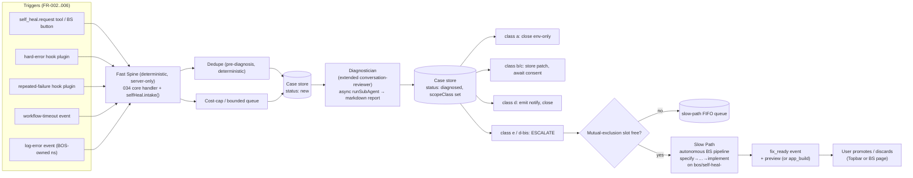
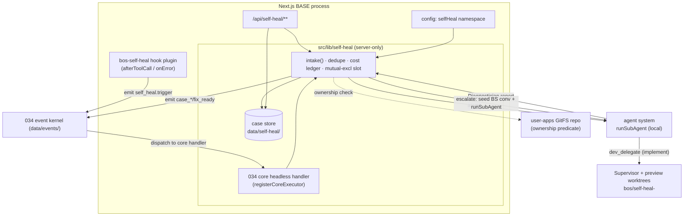
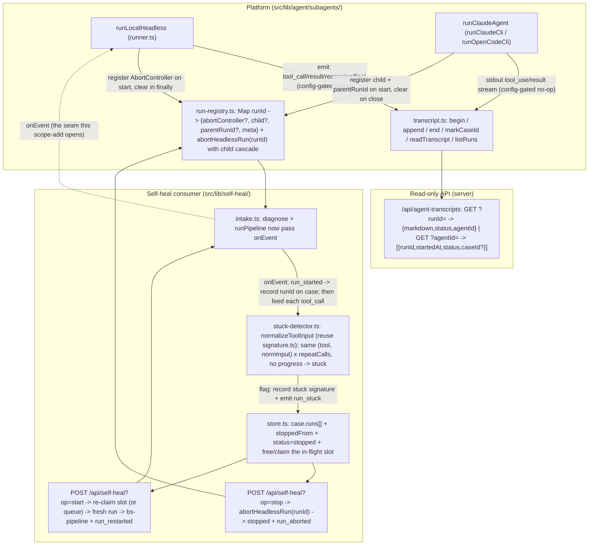

# Design: Self-Healing Mechanism (031-self-healing)

**Spec**: `/Specs/user-specs/self-modification/031-self-healing/spec.md`
**Mockup**: `/Specs/user-specs/self-modification/031-self-healing/mockup.html`
**Date**: 2026-09-07
**Author**: Architect

---

## 1. Classification

**App Target: `bos-core`** — agrees with `spec.md`'s own `App Target` field. No disagreement to flag.

The feature is a *mechanism that spans several BOS subsystems*, not a self-contained app: it adds (a) a server-side deterministic coordinator + case store, (b) a hook plugin that watches tool-call errors, (c) a server tool + agent extension, (d) a Settings config namespace + custom tab, and (e) a new **content pane inside the existing `build-studio` built-in app** (the Self-Heal page, FR-022) modeled on that app's existing `conflict/` pane. None of that is independently installable/removable; all of it is first-class BOS plumbing that ships as part of BOS. That is the definition of `bos-core` (with one `builtin-app`-shaped leaf — the BS pane — which is *part of* the bos-core change, not a separate target).

**The one classification-shaped decision that is NOT a target split, and that I had to make explicitly: the fast spine is not a "workflow."** `spec.md`'s *Assumptions* state "The Workflow Manager service (with event-triggered runs, per spec 002) is available for the fast-spine workflow," and the User Stories/Entities call the fast spine "the deterministic, fast-path **workflow**." That framing does **not** match what actually exists in BOS:

- `docs/dev/architecture-overview.md` §14: the bos-core workflow engine (`src/lib/workflows/*`) is **retired**.
- `specs/user-specs/workflow-manager/001-.../spec.md`: its replacement is a **marketplace-item service** whose nodes are **LLM agents** (static BOS agents or ephemeral agents; outputs delegate/tool/research/ag-ui). It has **no deterministic-code node type**, and I found **no event-triggered-run capability** anywhere in its spec/design (`workflow_run` is tool/agent-invoked and fire-and-poll; nothing subscribes to events to start a run).
- The fast spine, by definition (spec *Key Entities*: "deterministic, fast-path … completes in minutes"), is **deterministic code except for the single Diagnostician LLM step**, and it must (i) hold a **cross-run in-process mutual-exclusion slot** (shared server-wide state), (ii) **react to `self_heal.*` events to start**, and (iii) support an **in-run suspend/resume** (FR-016). None of those three is a capability a worker-thread 002 service has. (The fourth thing the spine does — setting a conversation's `activeFeatureBranch` for FR-015b — *is* loopback-HTTP reachable via `src/app/api/assistant/feature-branches/route.ts`, so a 002 service could do *that* part; it is **not** a disqualifier. The disqualifiers are the deterministic node, the event trigger, the shared slot, and suspend/resume — see ADR-1.)

So the fast spine is designed here as **deterministic bos-core server code** — a 034 **core headless handler** (`registerCoreExecutor`, `src/lib/events/dispatch.ts`) fronting a **server-only case store** — not a 002 workflow. This is ADR-1's spine. The spec's *Assumptions* text has already been reconciled (it now reads "a deterministic bos-core coordinator" and explicitly states 002 is NOT the spine); the *intent* — "a deterministic fast path that escalates to a long-lived BS conversation" — is preserved exactly, on the correct mechanism.

> Reaching for "the workflow engine" here would have been a third flavor of the failure mode in `references/target-*.md` (a technical framing that points at the wrong existing mechanism). The 034 core-handler + hook-plugin + case-store combination is the mechanism BOS already has for "react deterministically to an event, enforce a bound, and drive a bounded async pipeline," and it needs no new engine.

---

## 2. Constitution check

| Principle | Status |
|---|---|
| I. Spec-Driven | ✅ Compliant — this is the design artifact; the pipeline continues to plan/tasks/implement. |
| II. Server Authority & SSR Boundary | ✅ Compliant — the coordinator, case store, dedupe, cost ledger, and all trigger intake are `server-only` under `src/lib/self-heal/`; the BS pane and Settings tab talk to `/api/self-heal/**` over `fetch`. No secrets to the client. |
| III. Always Delegate; Claude Codes | ✅ Compliant — all *fix implementation* is delegated to the `developer` (Claude) agent inside the autonomous BS pipeline; the Diagnostician is a `type:local` agent (diagnosis is analysis, not code). The fast spine itself is deterministic code (no LLM) except the one Diagnostician call. |
| IV. Minimize Blast Radius | ✅ Compliant — every class-e/d-bis fix lands on a feature-branch preview or `app_build`; promotion is always explicit (FR-024); the mechanism never touches the Supervisor or base (FR-023). |
| V. VFS Is Not the Source | ✅ Compliant — the diagnostics report and (Mode 1) reports are written to the VFS `/Documents/BOS Improvements/` as *user-authored content*; code changes go through the Developer on a branch. |
| VI. Specs & Docs Stay in Sync | ✅ Required of the implement step — this feature adds `docs/dev/self-healing/self-healing.md` (and a user-facing page); recorded here as a deliverable. |
| VII. Respect Boundaries | ✅ Compliant — no `package.json`/lockfile/build-config change; new deps: none (SHA-256 via `node:crypto`, already used by the event store). |

**No conflicts to flag.** One *adjacent* note: the feature's autonomous "run the full BS pipeline without stopping" (FR-015) intentionally relaxes the Build Studio agent's default "stop after every step and let the user drive" contract **for this one conversation only**, via the pre-authorization brief. That relaxation is scoped to the self-heal conversation and does not change the `build-studio` agent definition globally — consistent with Principle I (the spec pre-authorized the user stories) and with the spec's own TDD/scope-constraint guards (FR-014). Documented in ADR-1.

---

## 3. Architecture

### 3.1 Context

From the user's/agent's seat, self-heal has three surfaces:

1. **Triggers** — a problem gets noticed five ways: an explicit `self_heal.request` (user button or agent/app tool call), a hard tool error, N repeated same-signature failures, a workflow/long-op timeout, or an error-level log in a BOS-owned component.
2. **The mechanism** (invisible until a case exists) — a deterministic coordinator dedupes, classifies the *route* (not the fix), and either resolves cheaply (env/skill/workflow/notify) or escalates to an autonomous Build Studio pipeline on a feature branch.
3. **The review surface** — the **BS Self-Heal page** (case list + detail + consent/decision/preview actions) and a **`fix_ready` event** in the Event Viewer/Topbar. The user's only *required* action is to promote (or discard); every fix is human-gated at the end.

The headline invariant: **detect → diagnose → classify → (fix or resolve) → notify → human-gated promote**, with a hard boundary that the mechanism never promotes and never touches the Supervisor/base.



### 3.2 Container

The real BOS containers this feature touches:

- **The Next.js server process (BASE)** — hosts everything deterministic: the 034 event kernel (a `globalThis` daemon, sibling to the scheduler), the new self-heal case store, the hook plugin (runs inside the agent run loop), the `/api/self-heal/**` routes, and the settings/config registry. The fast spine's core headless handler executes here.
- **The 034 event system** (`src/lib/events/`, `data/events/`) — the **transport and audit layer**, not the case store. The fast spine *registers* a core handler for `self_heal.*` trigger/decision events and *emits* the `self_heal.case_*`/`fix_ready`/`dedupe_suppressed`/`cost_cap_evicted` lifecycle events (FR-026). Events are immutable bodies + projections; they never hold the mutable case state machine (that's the case store's job — ADR-6).
- **The agent system** (`src/lib/agent/`, `src/lib/assistant/`) — the Diagnostician is a `type:local` sub-agent (`seed/agents/conversation-reviewer`, extended) run headless via `runSubAgent` (`src/lib/agent/subagents/runner.ts`'s `runLocalHeadless`), exactly the way the scheduler's `prompt` handler runs an agent in-process. The slow path is the `build-studio` local agent run through the same `runSubAgent` entry on a seeded conversation.
- **The Supervisor** (`tools/supervisor/supervisor.mjs`) + **preview worktrees/data clones** — the slow path's *preview* machinery. The fast spine does not drive the Supervisor directly; it provisions the branch by *setting the conversation's `activeFeatureBranch`*, and the real git ref/worktree is created lazily by the first `dev_delegate` in the pipeline (`runClaudeAgent` → `supervisorBegin`, idempotent). Promotion/discard are the user's, via the normal Topbar controls (FR-023/024).
- **The user's `user-apps` GitFS repo** (`data/user-apps/`) — the ownership predicate for class `d` vs `d-bis` (item present ⇒ owned ⇒ fixable via `app_build`).
- **Bastion** — deployment-relevant only in that the self-heal port is *not* a new network service; everything is same-origin in-process + loopback to existing BOS APIs, so there is **no new externally-reachable port** and no §11 reachability concern. (Deliberate: I did not reach for a worker-thread service, so there is no port to bind and nothing to proxy.)



### 3.3 Component

The concrete modules this feature creates/modifies. The spine is a small deterministic server library; the LLM intelligence lives entirely in two agents (Diagnostician = extended conversation-reviewer; slow path = existing build-studio agent).

**New server-only library — `src/lib/self-heal/`**
- `types.ts` — framework-free types: `ScopeClass` (`'a'|'b'|'c'|'d'|'d-bis'|'e'`), `Ownership`, `CaseStatus` (state machine), `HealingCase`, `FailureSignature`, `CostLedgerEntry`. (Shared by server code and the BS pane/Settings, like `events/types.ts`.)
- `signature.ts` — **deterministic** dedupe-key computation (FR-019): `error_category` mapping (exception type / HTTP status / message pattern → `timeout|not_found|permission_denied|type_mismatch|auth|unhandled_exception`), variable-token stripping, SHA-256 (`node:crypto`), and the relaxed explicit-trigger key. Pure functions, no LLM.
- `allowlist.ts` — the static environmental allowlist (FR-002, C2): network/socket, DNS, 401, 429, OOM/SIGKILL, external timeout. `permission_denied` is **not** in it.
- `store.ts` — the case store: `data/self-heal/index.json` (warm index: id→status, in-flight slot, dedupe-signature map, cost ledger, slow-path queue) + `data/self-heal/cases/<id>.json` (full record + timeline), atomic writes (`@/os/atomic-write`). Single source of truth for state (ADR-6).
- `intake.ts` — **the one deterministic front door** (ADR-1): `selfHealIntake({trigger, signature, context})` → enabled? → allowlist? → re-entrancy? → dedupe → cost-cap/queue → create case → launch Diagnostician async. Plus the **Phase-B resolver** (report frontmatter → scope-class routing) and the **slow-path escalation** (mutual-exclusion check → seed BS conversation with `activeFeatureBranch` set → `runSubAgent`).
- `diagnostician.ts` — launches the Diagnostician via `runSubAgent` (headless), parses the markdown report frontmatter, writes the report to `/Documents/BOS Improvements/<caseId>.md`.
- `cost.ts` — the per-day cost ledger (ADR-5): record usage per case at run completion; `capExhaustedForToday()`; reset at midnight UTC.
- `queue.ts` — the bounded slow-path FIFO (max 100, 7-day TTL, FR-020) + the suspended-timeout sweep helper.
- `reentrancy.ts` — the self-heal-origin **conversation marker** (written when the spine seeds a self-heal conversation) + the deterministic **event-payload filter** predicate (any event carrying `selfHeal.role` is never intake'd). See ADR-4: the guard is satisfied by construction for headless runs (they don't fire the hook) with the marker + event filter as the backstop.
- `spine-handler.ts` — registers the 034 **core headless handler** for `self_heal.*` (trigger, decision_resolved, preview-ready) at boot; thin, delegates to `intake.ts`.

**New agent tool — server**
- `src/lib/assistant/tools/server/self-heal.ts` — `self_heal.request` (FR-001; fires intake), `self_heal.request_decision` (FR-016; emits `decision_needed`, suspends), `self_heal.complete_fix` (FR-017; validates preview/tests, emits `fix_ready`, terminal transition). Registered in `src/lib/agent/capabilities-registry.ts` + `tool-manifest.ts` (a new `Self Heal` group, or under `Build Studio`).

**Hook plugin (tool-error capture) — FR-002/003**
- `src/plugins/self-heal/init.ts` + the plugin def (like `bos-compaction`): `afterToolCall` (feeds the repeated-failure tracker + emits `self_heal.trigger` for non-allowlisted hard errors) and `onError`. Registered via `instrumentation.ts` + `api/plugins`. It fires **only on main chat runs** (headless self-heal runs don't pass `hooks` to the loop, so they never reach it — ADR-4); for the chat path it checks whether `ctx.conversationId` carries a `selfHeal` marker and skips if so. The 300s/3-count rolling window lives here (per-conversation, in-memory) and calls `selfHealIntake`.

**Agent extension — the Diagnostician (FR-008, C7)**
- `seed/agents/conversation-reviewer/AGENT.md` — extended: Mode 2 (failure-signature → diagnostics report), the **unified tool set** (add `app_list`, `query_events`, `get_event` to the existing set, which already includes `bos_source_*`), and a **markdown-diagnostics-report write** (a new `submit_diagnostics_report` server tool writing `/Documents/BOS Improvements/<caseId>.md` with YAML frontmatter, or a mode on `submit_review_report`). Mode 1 behavior unchanged. **This is the one existing-agent modification; it is additive.**
- `src/lib/assistant/tools/server/diagnostics.ts` — `submit_diagnostics_report` (the Diagnostician's single write; validates frontmatter fields).

**Config namespace + Settings tab — FR-027**
- `src/lib/config/registry.ts` — add a `selfHeal` `ConfigRegistration` (all fields as `fields`, so the generic `/api/config` coercion + `config_set` work; `customComponent: "self-improvement"` for the grouped UI).
- `src/components/apps/settings/SelfImprovementTab.tsx` — the two-column grouped UI (Global | Triggers | Autonomy | Limits), mapped in `src/apps/settings/index.tsx`'s `CUSTOM_TABS`.

**BS Self-Heal page (FR-022) — a pane in the existing `build-studio` app**
- `src/apps/build-studio/selfheal/SelfHealPane.tsx` (+ `CaseList`, `CaseDetail`, `ConsentCard`, `SuspendedCard`, `PreviewStatus`, `useSelfHealCases.ts`) — mirrors the existing `src/apps/build-studio/conflict/` structure. Wired into `src/apps/build-studio/index.tsx` as a navigation peer of the conflict pane (a `paneParam === "self-heal"` branch + a nav entry).
- `src/app/api/self-heal/route.ts` — `GET` list, `GET ?caseId` detail, `POST ?op=consent|answer|dismiss|report` (the pane's actions). Thin delegates to `src/lib/self-heal/store.ts`/`intake.ts`.
- `src/apps/build-studio/manifest.ts` — optionally declare a UI `eventHandler` for `self_heal.fix_ready` / `self_heal.decision_needed` so clicking such an event opens the BS Self-Heal page on that case (mirrors the existing `conflict-escalated` handler + `ConflictLaunch.tsx` auto-launch).

**Diagnostics report location** — `/Documents/BOS Improvements/` (VFS), filename `<caseId>.md` (FR-028). Same dir as Mode 1 reports.

### 3.4 The state machine (FR-018), concretely

The case `status` field is the spine's single source of truth for routing and mutual exclusion:

```
new ──► diagnosing ──► diagnosed ──┬─► env-only          (class a)      [terminal]
                                   ├─► awaiting-consent ─► applied | dismissed   (class b/c)
                                   ├─► notified          (class d)      [terminal]
                                   └─► queued-slow ─► bs-pipeline ─┬─► preview-ready  (class e/d-bis) [terminal → user promotes/discards]
                                                              │        dismissed (user discards) [terminal]
                                                              │        failed (build/test fail)  [terminal → no auto-retry]
                                                              └─► suspended ─► (resume) bs-pipeline
                                                                    abandoned (suspended timeout) [terminal]
```

The **in-flight mutual-exclusion slot** is occupied exactly while a case is in `bs-pipeline` (released on any of `preview-ready`/`dismissed`/`failed`/`abandoned`). `queued-slow` is the FIFO behind that slot. `suspended` holds the slot (an unanswered question still blocks the pipeline; the suspended-timeout sweep releases it as `abandoned`). ADR-1 details the handoff.

> **Scope-add (2026-09-08):** the scope-add extends this machine with one state — `stopped` (FR-018) — reachable from any in-flight scope-class state (`diagnosing`, `bs-pipeline`, …) and returned to that state by Start. It is a *user-initiated* pause of a live run (Stop → the platform abort kills the run; Start → a fresh run relaunches from the last committed artifact), distinct from `suspended` (the run itself is alive and holding for an answer). Full definition, the slot interaction, and the state it restores from live in **§9.4 + ADR-13**.

### 3.5 The slow-path handoff (FR-015/015b/015c, C3/C4/C5) — the spine of the feature

This is the riskiest seam and deserves the full story:

1. **Escalate (deterministic, server-side, Phase-B of the spine):** the spine checks the in-flight slot. If free, it **seeds a new BS conversation**: `saveConversationMessages(caseConvId, "build-studio", [firstUserMessage])` where `firstUserMessage` = the pre-authorization brief (FR-015: "The user has pre-authorized this fix. Run the full pipeline autonomously. Stop only if you encounter a decision you cannot resolve autonomously.") **+ the Diagnostician report as *user intent*** (C3: the report is input, the `specify` step produces `spec.md`). It then sets the branch: `setConversationActiveFeatureBranch(caseConvId, "bos/self-heal-" + caseId)`. **This is the entirety of FR-015b** — the git ref is created lazily by the first `dev_delegate` (ADR-3). Finally `runSubAgent(buildStudioAgent, brief, { conversationId: caseConvId, contentOnly: false, featureBranch: "bos/self-heal-" + caseId })`.
2. **Run (autonomous):** the `build-studio` agent runs `specify → clarify → design → plan → tasks → implement → converge` **without stopping at step boundaries** (the pre-authorization brief overrides its default stop-at-each-step contract *for this conversation only*). `dev_delegate` at `implement` resolves the branch from the conversation (`getConversationActiveFeatureBranch`) and provisions the preview. The developer is briefed with TDD + ≥95% coverage + the **plan file-list as a hard scope constraint** (FR-014); `converge` verifies modified-files ⊆ plan list.
3. **Decision in flight (FR-016, C5):** the agent calls `self_heal.request_decision` → the spine transitions the case to `suspended` and emits `self_heal.decision_needed`; the run **ends** (terminate-and-retrigger; no HITL node in v1). The user answers on the BS page → `POST /api/self-heal?op=answer` → emits `self_heal.decision_resolved` → the spine's core handler **re-enters the SAME conversation** (`runSubAgent(buildStudioAgent, "Resume; answer to the pending question: …", { conversationId: caseConvId, ... })`). The agent recovers all confirmed decisions from the artifacts on disk (commit-before-advance, FR-015) and continues.
4. **Complete (FR-017):** at the end of `implement`, on a healthy preview + passing tests, the agent calls `self_heal.complete_fix` → the spine validates the `bos/self-heal-<caseId>` preview is `ready` and emits `self_heal.fix_ready` with the branch/summary/link, transitioning to `preview-ready`. (Class d-bis: `app_build` result instead of a branch.)
5. **Cold restart / in-flight recovery:** on boot, the spine reconciles any case still in `bs-pipeline`/`suspended` by querying the Supervisor for the branch's preview state (ready → `preview-ready` if no fix_ready was emitted; failed → `failed`; absent → leave for the next resume). This guarantees the in-flight slot is never leaked.

**Why not a 002 workflow here (repeated for the ADR):** a 002 run is (a) LLM-node-driven with no deterministic-code node type, (b) fire-and-poll with no in-run suspension/resume primitive, (c) unable to hold a cross-run in-process mutual-exclusion slot, and (d) unable to do in-run suspend/resume. Note: setting `activeFeatureBranch` IS loopback-HTTP reachable via `src/app/api/assistant/feature-branches/route.ts`, so a 002 service *could* set a conversation's branch — but the firm disqualifiers for 002 are the absence of a deterministic-code node (the spine must be deterministic), the absence of event-triggered runs (the spine must react to `self_heal.*` events), the absence of a cross-run in-process mutual-exclusion slot (the slot is shared state across the entire server, not per-run), and the absence of an in-run suspend/resume primitive (FR-016 requires the pipeline to suspend and resume, which a fire-and-poll worker thread cannot do). The deterministic spine + case store + `runSubAgent` on a persistent conversation gives *all four* using mechanisms BOS already has.

### 3.5.6 Classification verification at the plan→tasks boundary (FR-015a)

The pre-authorization brief (FR-015) instructs the autonomous BS agent to perform a **classification verification** at the `plan` → `tasks` boundary: the plan's file list must plausibly map to the Diagnostician's `proposedSurface` description. This is a behavioral constraint on the BS agent, verified by the pipeline's existing plan artifact.

**Mechanism (deterministic + one re-diagnosis, then hard-stop):**
1. **Compare:** After the BS agent writes `plan.md`, it compares the plan's file list against the Diagnostician report's `proposedSurface` field (both are on disk: the report at `/Documents/BOS Improvements/<caseId>.md`, the plan at the spec directory). The comparison is heuristic: if the plan modifies files in a subsystem (top-level `src/` directory, `seed/agents/` agent, `src/apps/<id>/` app) that the `proposedSurface` does not reference, that is a divergence.
2. **Single re-diagnosis attempt:** On divergence, the BS agent calls `agent_delegate(conversation-reviewer, <task>)` (it has `agent_delegate` in its tools) with a re-diagnosis prompt: "Here is the plan's file list: [list]. The original `proposedSurface` was: [X]. Do the plan's files plausibly implement the proposed surface, or is there a divergence? Respond with 'confirmed' or 'diverges: [reason]'." This is a bounded, one-shot LLM call — not a full pipeline re-run.
3. **Second disagreement is never resolved by further LLM arbitration.** If the re-diagnosis returns 'diverges', the BS agent calls `self_heal.request_decision` (the spine's tool) with the justification for each divergent file → the spine transitions the case to `suspended` and emits `self_heal.decision_needed`. The run ends (terminate-and-retrigger, per FR-016/C5). The user answers on the BS Self-Heal page; the pipeline resumes with the answer. **A second re-diagnosis is never attempted** — the brief's instruction is explicit: "If the divergence persists after ONE re-diagnosis attempt, call `self_heal.request_decision`. Do not attempt further LLM arbitration."

**Why this is safe:** The check is at a well-defined pipeline boundary (after `plan`, before `tasks`), so the agent has both artifacts available. The re-diagnosis is a single bounded call (not a recursive pipeline). The hard-stop on second disagreement means the mechanism never enters an infinite LLM-arbitration loop — it always degrades to human decision. The `converge` step's existing modified-files ⊆ plan-list check (FR-014) is a separate, later guard that catches scope creep at implementation time; FR-015a catches *classification drift* at planning time.

---

## 4. Concrete file/module plan

**Create (new):**
```
src/lib/self-heal/types.ts
src/lib/self-heal/signature.ts
src/lib/self-heal/allowlist.ts
src/lib/self-heal/store.ts
src/lib/self-heal/intake.ts
src/lib/self-heal/diagnostician.ts
src/lib/self-heal/cost.ts
src/lib/self-heal/queue.ts
src/lib/self-heal/reentrancy.ts
src/lib/self-heal/spine-handler.ts
src/lib/assistant/tools/server/self-heal.ts
src/lib/assistant/tools/server/diagnostics.ts
src/plugins/self-heal/index.ts
src/plugins/self-heal/init.ts
src/components/apps/settings/SelfImprovementTab.tsx
src/apps/build-studio/selfheal/SelfHealPane.tsx
src/apps/build-studio/selfheal/CaseList.tsx
src/apps/build-studio/selfheal/CaseDetail.tsx
src/apps/build-studio/selfheal/ConsentCard.tsx
src/apps/build-studio/selfheal/SuspendedCard.tsx
src/apps/build-studio/selfheal/PreviewStatus.tsx
src/apps/build-studio/selfheal/useSelfHealCases.ts
src/app/api/self-heal/route.ts
data/self-heal/                      # runtime: index.json + cases/<id>.json (gitignored, created at boot)
docs/dev/self-healing/self-healing.md   # Constitution VI
docs/usage/self-healing.md              # user-facing (Constitution VI)
```

**Modify (existing):**
```
seed/agents/conversation-reviewer/AGENT.md        # +Mode 2, unified tool set (add app_list, query_events, get_event), markdown-report write
src/instrumentation.ts                            # register self-heal spine handler + self-heal plugin + scheduled-Diagnostician job at boot
src/lib/config/registry.ts                        # +selfHeal ConfigRegistration
src/apps/settings/index.tsx                       # map "self-improvement" → SelfImprovementTab in CUSTOM_TABS
src/apps/build-studio/index.tsx                   # +self-heal nav pane (peer of conflict pane)
src/apps/build-studio/manifest.ts                 # +eventHandler(s) for self_heal.fix_ready / decision_needed (open BS Self-Heal on that case)
src/lib/agent/capabilities-registry.ts            # +self_heal.* / submit_diagnostics_report capabilities
src/lib/agent/tool-manifest.ts                    # mirror the new server tools
src/lib/agent/subagents/types.ts                  # +optional usage field on AgentRunResult (ADR-5 M1 fix)
src/lib/assistant/agent-loop.ts                   # +optional usage field on TurnResult (ADR-5 M1 fix)
src/lib/assistant/model-turn.ts                   # anthropicTurn reads message_delta.usage; openai/responses read final-chunk usage (ADR-5 M1 fix)
src/lib/agent/subagents/runner.ts                 # runLocalHeadless accumulates per-turn usage → AgentRunResult.usage (ADR-5 M1 fix)
src/lib/agent/subagents/claude-runner.ts          # parse usage from result stream-json event / OpenCode final event (ADR-5 M1 fix)
```

**Omit (do NOT create) because the mechanism is not what the spec's wording implies:**
- No `src/lib/workflows/**` and no `/api/workflows/**` — the fast spine is not a 002 workflow (§14 retired the core engine; 002 is an LLM service). See ADR-1.
- No `src/middleware.ts`, no new route/middleware for the spine — it is in-process 034 + hook plugin + case store.
- No worker-thread service, no new network port — deliberately, so there is no §11 reachability surface. (If a future revision wants the spine in a service, it would have to loopback every branch/conversation capability that does not exist as an API today; not worth it.)
- No new dependency — `node:crypto` (SHA-256) and the existing 034/scheduler/agent/config/plugins systems cover it.

---

## 5. Integration points (existing BOS mechanisms this design CALLS INTO, does not create)

Each is a dependency the implement step must not re-invent:

- **034 event kernel — core headless handler.** `registerCoreExecutor(handlerId, fn)` + `api.register({mode:"headless", declaredBy:"core"})` (`src/lib/events/dispatch.ts`). The spine subscribes to `self_heal.trigger.*`, `self_heal.decision_resolved`, and (for preview completion, if the Supervisor-watch variant is chosen) a preview-ready event. Emits via `api.emit` (`src/lib/events/api.ts`). Lifecycle events FR-026 ride here. *Note the core-executor timeout* — the Diagnostician run is launched **fire-and-forget** so it never blocks the ack window (ADR-1).
- **Hook plugin pipeline.** `BosPluginHooks.afterToolCall` / `onError`, `registerPlugin`, `composePluginHooks` (`src/lib/plugins/`, recipe in `docs/dev/extending-bos.md`). The trigger-capture plugin rides the agent run loop.
- **Sub-agent headless run.** `runSubAgent(agent, task, { conversationId, contentOnly, featureBranch, onEvent })` (`src/lib/agent/subagents/runner.ts`) — the same entry the scheduler's `prompt` handler uses (`src/lib/scheduler/executor.ts`). Runs the Diagnostician and the BS conversation.
- **Conversation seeding + branch field.** `saveConversationMessages` (creates the file) and `setConversationActiveFeatureBranch` (race-safe via the per-conversation queue, `src/lib/assistant/conversation-store.ts`); read back by `getConversationActiveFeatureBranch` (`src/lib/agent/conversations-server.ts`). The slow path's branch resolution for `dev_delegate` flows through these.
- **Supervisor preview lifecycle.** `supervisorBegin(branch)` (idempotent — "a missing branch is created off base"), `supervisorState`, `/__supervisor/state` (`src/lib/devharness/supervisor.ts`). The spine *provisions by naming the branch*; it does not drive promote/discard (user-only, FR-024). `self_heal.complete_fix` reads the branch's preview state here to validate before `fix_ready`.
- **Branch-name rules.** `isValidFeatureBranch` / `FEATURE_BRANCH_RE` (`src/lib/agent/feature-branch.ts`). `bos/self-heal-<caseId>` is valid **iff `<caseId>` is a single lowercase dash-separated segment of `[a-z0-9-]`** — the case id scheme must honor this (ADR-3).
- **Ownership predicate.** `listInstalledItems()` / `getInstalledItem(id)` (`src/system/items/installed.ts`, which derives provenance via `deriveOrigin` from where the `data/system/<id>` symlink resolves). The precise d/d-bis predicate: the item is **INSTALLED** (the `data/system/<id>` symlink resolves, i.e. `isItemInstalled(id)` is true) **AND** `origin === "local"` (the symlink resolves into `data/user-apps/items/<id>`, per `deriveOrigin`). `origin === "marketplace"` (resolves into `data/marketplace/<mktId>/items/<id>`) is class `d` (not owned). **The spine's server-side check is the AUTHORITATIVE d/d-bis decider** — the Diagnostician's `app_list` frontend tool does **not** expose `origin`, so the Diagnostician's own classification is advisory and the spine confirms it against `getInstalledItem(id).origin` before routing. Cited home: `src/system/items/installed.ts` (NOT `src/lib/apps/store.ts` / `src/lib/gitfs/store.ts`).
- **Settings/config.** `ConfigRegistration` + `readNamespace`/`patchNamespace` (`src/lib/config/`); auto-exposed to the assistant as `config_*` tools. The `selfHeal` namespace.
- **Scheduler (for the scheduled Diagnostician, FR-021).** A recurring `internal`/`prompt` job with `owner: "self-heal"`, registered at boot (`src/lib/scheduler/`). Time-based only (no event-driven jobs exist — this is also why the *reactive* spine cannot be a scheduler job and must be an event handler).
- **Event Viewer / Topbar.** `self_heal.fix_ready` is a normal event; the user acts on it via the standard promote/discard controls (`VersionControls.tsx`) or the BS page. No new topbar surface required (the spec's "link to the preview" is the BS page's own control).

---

## 6. ADRs

### ADR-1 — The fast spine is a deterministic 034 core handler + async Diagnostician, not a 002 workflow

**Context.** The spec's *Assumptions* name "the Workflow Manager service (with event-triggered runs, per spec 002)" as the fast-spine vehicle, and the entities call the spine "a workflow." But (a) `docs/dev/architecture-overview.md` §14 retired the core workflow engine; (b) the 002 service (`specs/user-specs/workflow-manager/001-...`) is an **LLM-agent-node** engine with **no deterministic-code node** and **no event-triggered-run capability** (verified: nothing subscribes to events to start a run); (c) the spine must be **deterministic** (only the Diagnostician step is LLM), must hold a **cross-run in-process mutual-exclusion slot** (shared server-wide state, not per-run), must react to `self_heal.*` **events** to start, and must support an **in-run suspend/resume** (FR-016). Note: a 002 worker service *could* loopback-HTTP a few of these — e.g. setting a conversation's `activeFeatureBranch` is reachable via `src/app/api/assistant/feature-branches/route.ts` — so "can't touch a branch" is NOT a disqualifier. The firm ones are the four capabilities a worker-thread 002 service structurally lacks: no deterministic-code node, no event-triggered runs, no cross-run in-process slot, and no in-run suspend/resume primitive. A single synchronous "workflow run" also cannot host a multi-minute Diagnostician LLM step, because a 034 core executor has a `timeoutMs` and the dispatch engine settles on it.

**Options.**
- *A — 002 workflow service with a deterministic "tool" node driving the spine.* Rejected: 002 has no deterministic node type, no event trigger, no cross-run in-process slot, and no in-run suspend/resume. (It *could* loopback-set a conversation's branch via the feature-branches route, but that single reachable op does not make up the missing deterministic-node / event-trigger / slot / suspend-resume primitives.) Extending 002 to add all four is a new engine — the opposite of "reuse what exists."
- *B — A 002 agent-node workflow for the Diagnostician step only, spine logic in a service.* Rejected: splits the spine across two owners; the deterministic guards (dedupe/cap/slot) would live in a worker that still lacks the four firm primitives (deterministic node, event trigger, cross-run slot, in-run suspend/resume) — the branch-set is loopback-reachable, but a worker cannot hold a *shared server-wide* slot or *suspend and resume within a run*, which is where the design breaks.
- *C — Deterministic bos-core spine: a 034 core headless handler (`registerCoreExecutor`) on `self_heal.*` events + a server-only case store + a hook plugin for error capture; the Diagnostician launched as a **fire-and-forget async `runSubAgent`** (Phase A settles the ack immediately; Phase B runs on Diagnostician completion and is re-entrant-safe because it is idempotent against the case store).**  Chosen.
- *D — A scheduler job.* Rejected for the reactive path: the scheduler is time-based only (verified: `ScheduleType = one-time | recurring`; no event trigger). Used only for the *scheduled* Diagnostician pass (FR-021).

**Decision.** Option C. The spine is `src/lib/self-heal/intake.ts` behind `spine-handler.ts`'s core handler. **Phase A** (synchronous, at intake): guards → dedupe → cost-cap/queue → create case → emit `case_created` → `void runDiagnosticianAsync(case)` → return (ack settles). **Phase B** (async, on Diagnostician completion): parse report → `diagnosed` → scope-class routing → (escalate ⇒ seed BS conversation + set branch + `runSubAgent` for the slow path). Every Phase-B transition is an idempotent read-modify-write on the case store keyed by case id, so at-least-once redelivery and cold-restart reconcile cannot double-act.

**Consequences.** + The spine is deterministic, testable, single-owner, and uses only existing mechanisms (034 handler, hook plugin, `runSubAgent`, conversation store, Supervisor-by-name). + The async split cleanly sidesteps the executor timeout. − The Diagnostician run is "loose" from the handler: a crash between launch and Phase-B completion must be recovered by boot-reconcile (the case sits in `diagnosing`; on boot, re-launch or re-read the report). − `spec.md`'s *Assumptions* text is now inaccurate and must be reconciled by Build Studio before `plan` (flagged in §1). − The "workflow timeout" trigger (FR-004) is an *event the 002 service emits* that the spine *subscribes to* — an integration point, not the spine's own engine.

---

### ADR-2 — Diagnostician = extended `conversation-reviewer` (one agent, one tool set, two modes)

**Context.** FR-008/C7: the Diagnostician is the existing `conversation-reviewer` agent with a second mode (Mode 2: failure-signature → diagnostics report) sharing Mode 1 (behavioral review) and the `agent-behavior-review` skill; it must not write code or delegate; its only write is the report.

**Verified base.** `seed/agents/conversation-reviewer/AGENT.md`: `type: local`; tools already include `conversation_overview`, `conversation_page`, `submit_review_report`, `agent_definition_get`, `bos_source_list/read/search`, `skill_*`, `file_list/read`. It is **already read-only everywhere except the report** and **cannot delegate** (no `agent_delegate`/`dev_delegate` in its tools) — so FR-008's "no code, no delegation" is already true by construction; we only *add* tools and a mode.

**Decision.** Extend the agent (additive only): (1) add `app_list`, `query_events`, `get_event` to the `tools` list (the unified Mode-2 set, C7); (2) add a `submit_diagnostics_report` tool (writes `/Documents/BOS Improvements/<caseId>.md`, validates the YAML frontmatter `scopeClass`/`ownership`/`proposedSurface`/`caseId`/`triggeredAt`) as its *one* new write; (3) add a Mode-2 section to the prompt ("you receive either a conversationId (Mode 1) or a failure signature (Mode 2); mode is selected by input type") and the matching section in the `agent-behavior-review` skill (or a new Mode-2 method doc the skill references). Mode 1's report path (`.json`, existing `submit_review_report`) is untouched.

**Consequences.** + No new agent id to manage; the two modes share one definition, one gate, one skill — matches C7 exactly. + Re-entrancy is uniform (ADR-4 tags the run, not the mode). − The `agent-behavior-review` skill body grows; keep Mode-2 method in a `references/` file to avoid bloat. − `submit_diagnostics_report` must be scoped so the agent *cannot* use it to write anywhere except the one report file (the tool enforces the path, not the prompt).

---

### ADR-3 — "Branch pre-creation" = set the conversation's `activeFeatureBranch` before the first token; the git ref is created lazily

**Context.** FR-015b/C4: the fast spine must create `bos/self-heal-<case-id>` server-side and set the BS conversation's `activeFeatureBranch` **before** the BS agent's first token, so the agent never calls `dev_branch_request` (a frontend elicitation that would block an autonomous run).

**Verified mechanics (this reshapes the requirement).** `conversations-server.ts` documents it explicitly: "Under the Supervisor, `dev_branch_request` **only records the name** on the originating conversation — the actual branch + worktree aren't created until `dev_delegate` first runs under it (provisioned lazily, at delegate time)." `supervisorBegin(branch)` is idempotent: "an existing branch is checked out with its history; a missing branch is created off base." `runClaudeAgent` calls `supervisorBegin(featureBranch)` at `dev_delegate` time, and the branch is resolved server-side from `getConversationActiveFeatureBranch(conversationId)`. The spec-fs write gate for `/Specs/user-specs/**` opens purely on the conversation having a valid `activeFeatureBranch`.

**Options.**
- *A — Spine calls a git API to create the ref now.* Unnecessary and partly impossible from the spine's context (the ref lives in the Supervisor's worktree management, not a plain `git` the spine owns). It would also risk colliding with `supervisorBegin`'s provisioning.
- *B — Spine sets `activeFeatureBranch` on the seeded conversation via `setConversationActiveFeatureBranch`; the ref/worktree materialize on the first `dev_delegate` (at `implement`).* **Chosen.**
- *C — Spine sets the field AND force-provisions the preview up front.* Adds a build cost for the `specify→…→plan` steps that don't need a built preview, and duplicates `supervisorBegin`'s job.

**Decision.** Option B. On escalation the spine does exactly two conversation ops (race-safe, same per-conversation queue): `saveConversationMessages(caseConvId, "build-studio", [brief+report])` then `setConversationActiveFeatureBranch(caseConvId, "bos/self-heal-"+caseId)`. Because the field is set *before* the first agent turn, the `specify`-step `/Specs` write passes its gate and `dev_branch_request` is never invoked — the elicitation gap is closed by *preconditioning the field*, which is all FR-015b actually needs. The real branch is created by `supervisorBegin` on the first `dev_delegate`.

**Consequences.** + Minimal, uses two existing race-safe primitives; the git side is delegated to the machinery that already owns it. + No extra build before it's needed. + **Case id / branch slug are cleanly decoupled and the mockup already reflects it:** the case stores a canonical `caseId` that is *itself* a valid lowercase branch segment (a `[a-z0-9-]` string, e.g. `0141`); the UI renders the **human id** as an `EHS-` display prefix over it (`EHS-0141`); the branch is `bos/self-heal-<caseId>` = `bos/self-heal-0141`. So **branch slug = the lowercased case id**, stored on the case's `activeFeatureBranch` field — exactly what the mockup shows (`branch · bos/self-heal-0141` against list-row id `EHS-0141`). `EHS-` is a presentation-only prefix, never part of the branch. (The `caseId` must still match `FEATURE_BRANCH_RE`'s segment rules — it does, by construction.) − If the pipeline never reaches `implement` (e.g. suspends at `plan`), no ref exists yet; that's fine, `supervisorBegin` still creates it on the later `dev_delegate`.

---

### ADR-4 — Re-entrancy guard: satisfied by construction for headless runs, with a conversation-marker + event-filter backstop

**Context.** FR-025: the Diagnostician's own execution must not create a new self-heal case. The triggers are (i) tool errors / (ii) repeated failures (hook plugin on the agent run loop), (iii) workflow-timeout events, (iv) BOS-owned log errors. A failing Diagnostician (or a tool error *inside* the BS pipeline it spawned) must not recurse.

**Verified mechanics (this makes FR-025 satisfied more robustly by construction than a first draft assumed).** Two facts about the run path change the shape of the guard:
1. **Self-heal's autonomous runs are headless, and headless runs do NOT fire plugin hooks.** `runLocalHeadless` (`src/lib/agent/subagents/runner.ts`) calls `runAgentLoop` **without passing a `hooks` argument** — `composePluginHooks` is wired only in `src/lib/assistant/start-run.ts` (the main chat run). So the `bos-self-heal` hook plugin's `afterToolCall`/`onError` is **never invoked** on a Diagnostician run or a slow-path BS pipeline run (both go through `runSubAgent` → `runLocalHeadless`). A failing Diagnostician therefore **cannot reach the hook capture path at all** — FR-025's primary recursion risk is closed by construction, not by a marker the hook must check.
2. **The hook ctx is only `{runId, conversationId, agentId}`** (`src/lib/assistant/hooks.ts` `HookContext`) — there is no free-form role field. So the hook can't be handed an arbitrary `selfHeal.role` out-of-band; the only thing it can reliably read to identify a run is the `conversationId`.

**Decision.** Two complementary guards, neither relying on the headless run reaching a hook:
- **Conversation-carried marker (for the chat-based trigger path).** When the spine seeds a self-heal conversation (the slow-path BS conversation, and any diagnostician conversation), it writes a `selfHeal: { role: "pipeline" | "diagnostician", caseId }` field onto that **conversation record** (readable via `conversationId`). The `bos-self-heal` hook plugin — which only ever fires on *main chat* runs, i.e. on a conversation the user is driving — checks: *does `ctx.conversationId` carry a `selfHeal` marker?* If so, it is a self-heal-origin conversation and the hook **skips** (no `self_heal.trigger` emission). This covers the one path where a self-heal-tainted run *would* fire the hook: a self-heal conversation that is later driven from the main chat UI.
- **Event-based belt-and-braces rule (deterministic, no hook involved).** Every *event* trigger the spine intakes (workflow-timeout, log-error, and any future event-shaped trigger) is filtered in `intake.ts` itself: **any event whose payload carries `selfHeal.role` is never intake'd.** This is the authoritative, hook-independent guard — it lives in the deterministic spine front door, so it holds regardless of which run path produced the event. Workflow-timeout and BOS-owned log-error events are additionally scoped to *user/workflow* component namespaces, so a self-heal run (whose components are `self-heal`/`assistant.*` under the spine) does not even match the log-error predicate.

**Consequences.** + FR-025 holds by construction on the dominant path (headless runs don't reach the hook), with a deterministic event filter as the backstop — strictly more robust than the "tag the run and hope the hook reads it" design. + No dependency on the hook ctx exposing a role field (it doesn't); the marker lives on the conversation where `conversationId` can reach it. + The single choke point for *event* triggers is `intake.ts` (drop self-heal-origin payloads), and the single choke point for *hook* triggers is the hook's conversation-marker check. − The conversation record gains a `selfHeal` field (a small additive field, written only for spine-seeded conversations). − If a future BOS change wires `hooks` into `runLocalHeadless`, the headless-path assumption changes — but the event-based filter in `intake.ts` still holds, so recursion stays bounded either way.

---

### ADR-5 — Cost cap = per-case ledger written at run completion, checked at enqueue (not a live meter)

**Context.** FR-020: total LLM tokens across all self-heal cases in a calendar day ≤ `costCapPerDay`; when reached, **new** triggers are **queued** (not dropped) and processed next day; queue bounded (≤100, 7-day TTL); reset midnight UTC; emit `cost_cap_evicted` on eviction.

**Verified: BOS currently does NOT surface token usage to callers.** `AgentRunResult` (`src/lib/agent/subagents/types.ts:22`) is `{agent, type, task, output, steps, toolCalls, error?}` — no usage field. `TurnResult` (`src/lib/assistant/agent-loop.ts:34`) is `{text, toolCalls}` — no usage. `anthropicTurn` in `model-turn.ts` iterates the stream's `content_block_start`/`content_block_delta` events but never reads `message_delta` (where Anthropic reports `input_tokens`/`output_tokens`). `claude-runner.ts`'s `StreamEvent` interface parses `type`/`result`/`subtype`/`is_error` but not `usage`. `total_tokens` appears nowhere in `src/`. This means self-heal cannot read usage from an existing result — it must be added.

**Options.**
- *A — Real-time metering across all LLM calls in BOS.* Rejected: disproportionate blast radius.
- *B — Surface usage on the existing turn/result types (a small, contained extension), then maintain a self-heal-scoped ledger.* **Chosen.** Extend `TurnResult` with an optional `usage?: { input_tokens: number; output_tokens: number }` field; extend `AgentRunResult` with an optional `usage?: { input_tokens: number; output_tokens: number; total_tokens: number }` field (aggregated across all turns in the run). `anthropicTurn` reads `message_delta.usage` from the stream (the Anthropic SDK emits it); `openaiChatTurn` and `responsesTurn` read their respective `usage` fields from the final stream chunk. `runLocalHeadless` accumulates per-turn usage into the run's total and includes it in the returned `AgentRunResult`. `claude-runner.ts` reads the `usage` field from the final `result` event (Claude Code's stream-json includes `usage` with `input_tokens`/`output_tokens`/`total_cost_usd` on the result line; OpenCode's final event has a `tokens` field). This is a small, backward-compatible extension (the field is optional; existing callers are unaffected). The self-heal cost ledger then reads `result.usage` and records it — no estimation needed on the primary path.
- *C — Estimate from context window only.* Rejected as primary: too coarse to enforce a token cap honestly. Retained as a **secondary fallback** for the rare case where a provider omits usage (local servers that don't report tokens).

**Decision.** Option B. The cost mechanism has two layers:
1. **Surface usage (primary, deterministic).** The four files listed in §4 are extended to capture and propagate token usage from the LLM stream. This is a one-time, backward-compatible platform improvement — BOS should know what its own agent runs cost. After this, `runSubAgent` returns `AgentRunResult.usage` populated (or `undefined` if the provider omits it).
2. **Self-heal ledger (secondary, scoped).** `cost.ts` maintains `ledger: CostLedgerEntry[]` in `data/self-heal/index.json` (`{caseId, role, tokens, estimated?: boolean, at}`), pruned to the current UTC day at read time. `capExhaustedForToday()` sums the day's entries vs `costCapPerDay`. At intake, if exhausted → the case goes to the **bounded slow-path queue** (or a *pending-retry* queue for cheap classes), **not dropped**; at the UTC midnight rollover the next intake processes them FIFO. **A single in-flight case may overshoot the cap** — this matches FR-020's explicit "reached mid-pipeline: the current case completes; NEW triggers are queued." When a run's `usage` field is `undefined` (provider omitted it — e.g. some local servers), fall back to a conservative estimate from the final message token count and set `estimated: true` on the ledger entry.

**Consequences.** + The cap is grounded in *real* provider-reported token counts, not estimates — a platform-level improvement. + The extension is backward-compatible (optional field; no breaking change to existing callers). + Self-heal-scoped ledger, no global instrumentation. + Matches FR-020's mid-pipeline semantics exactly. − The cap is *enforced between cases*, not *within* one — an autonomous multi-hour pipeline is one ledger entry recorded at its end, so a very large single case can blow past the daily cap. Acceptable per FR-020. − Touching `TurnResult`/`AgentRunResult`/`model-turn.ts`/`claude-runner.ts` is a small cross-cutting change; it benefits any future feature that needs usage visibility (telemetry, rate-limiting, billing). − The estimate fallback keeps the ledger honest when providers omit usage.

---

### ADR-6 — Case store is a dedicated server store; 034 events are the audit/notification layer, not the store

**Context.** FR-018 (case record + state machine + timeline) and FR-026 (lifecycle events for every transition). The question the task asked: *file store, 034 event system, or dedicated API?*

**Decision.** **Both, with a clean split.** The **case store** (`src/lib/self-heal/store.ts`, `data/self-heal/`) is the **source of truth** for mutable state: `id`, `trigger`, `failureSignature`, `status`, `scopeClass`, `ownership`, `proposedSurface`, `reportPath`, `linkedPreview/appId`, `activeFeatureBranch`, the **dedupe-signature map**, the **cost ledger**, the **in-flight slot**, the **slow-path queue**, and the **timeline** (state transitions with timestamps). It is a server-only store with atomic writes, exactly like the gitops conflict-session store and the event store's own persistence. **034 events** are **projections + notifications**: on every transition the spine `api.emit`s the matching `self_heal.*` event (FR-026) so the Event Viewer/bell/audit trail and the BS page's live view update, but the events do **not** hold the state machine.

**Why not 034 events as the store:** 034's model is *immutable event bodies + a processing/read two-axis state* — it has no per-entity mutable record or timeline, and its `ack`/`processing` semantics are about handler settlement, not case lifecycle. Cramming the case state machine into events would fight the kernel and make FR-018's timeline/dedupe-map/slot/queue awkward. **Why not a bare file store with no events:** FR-026 requires queryable lifecycle events and the BS page wants live updates; 034 gives us emit/query/stream/ack for free. The precedent is the conflict-session feature (035): durable server session record + event notifications.

**Consequences.** + Single writer for state (the spine), single source of truth; events are a derived, replayable audit + live-update channel. + The BS page reads the case store (authoritative) via `/api/self-heal` and can additionally subscribe to `GET /api/events/stream` for live refresh. + Boot-reconcile (ADR-1/§3.5.5) operates on the store. − Two artifacts to keep consistent; the spine is the only place both are written, so consistency is guaranteed by construction (emit-after-commit).

---

### ADR-7 — Dedupe is deterministic and pre-diagnosis; normalization rules are the design surface

**Context.** FR-019: dedupe by failure signature **before** diagnosis, deterministic (no LLM), key `(tool_name, error_category, normalized_message_hash)`; `error_category` a coarse bucket from exception type / HTTP status / message pattern; `normalized_message_hash` = SHA-256 of the message after stripping variable tokens (IDs, UUIDs, timestamps, quoted strings, numerics); explicit trigger uses a shorter window (3600s) and a relaxed key `(tool_name, "explicit", description_hash)`; suppressed triggers emit `self_heal.dedupe_suppressed` referencing the original case.

**Decision.** `signature.ts` is pure code, run in Phase A **before** the Diagnostician launches. The case store keeps a **dedupe map** `signature → { caseId, status, ts }`; intake checks it against the current `dedupeWindowSec` (or the 3600s explicit window). **Normalization rules** (the part that determines dedupe quality) are defined concretely here so implementation is unambiguous:
- `error_category`: map from (in order) HTTP status (401→`auth`, 404→`not_found`, 429→`auth`/`rate-limit`→allowlist, 5xx→`unhandled_exception`), exception class (`TimeoutError`/`ETIMEDOUT`→`timeout`, `EACCES`/`EPERM`→`permission_denied`, type/shape errors→`type_mismatch`, else `unhandled_exception`).
- `normalized_message`: lowercase; replace UUIDs, hex ids, timestamps (ISO + epoch), quoted strings, and standalone numerics with a single stable placeholder (`<x>`); collapse whitespace; strip absolute paths' leading user-specific segment if present (so the same logical error at different paths still dedupes — a tuning knob, default on).
- `hash`: SHA-256 hex of the normalized message.

**Consequences.** + Deterministic, testable, no LLM cost, pre-diagnosis (a duplicate never spends Diagnostician tokens). + The relaxed explicit key means a user intentionally re-firing the same report within an hour is treated as a new case (per FR-019). − Normalization is a judgment call: too aggressive (stripping paths) can merge distinct bugs; too conservative (keeping paths) misses the same bug at different paths. The default (strip user-specific path prefix, keep the rest) is a stated choice the user can flip. − `dedupe_suppressed` and the map give full auditability; suppression is never silent (FR-019).

---

### ADR-8 — `self_heal.complete_fix` (a terminal BS-agent tool) is the `fix_ready` emitter, not a Supervisor watcher

**Context.** FR-017: when the preview passes health + tests, emit `self_heal.fix_ready` (case id, branch/app id, summary, link) so the user can promote/discard. Two ways to detect "the slow path finished successfully."

**Options.**
- *A — The BS agent calls `self_heal.complete_fix` at the end of `implement`* (invoked per the autonomous brief). The tool validates the `bos/self-heal-<caseId>` preview is `ready` (Supervisor state) and tests passed, then emits `fix_ready` + transitions to `preview-ready`.
- *B — The spine watches the Supervisor for the self-heal branch reaching `ready`* and emits on that.

**Decision.** Option A (primary). It is explicit, auditable (the agent's deliberate terminal action), gives the case store its transition from the side that *knows* tests passed, and needs no long-running watcher. The autonomous brief (FR-015) already instructs the pipeline to "stop only on an unresolvable decision" — adding "when `implement` completes and the preview is healthy + tests pass, call `self_heal.complete_fix`" is one more line in the same brief. Option B is retained only as a **reconcile fallback** (boot/in-flight recovery, §3.5.5) for the case where the agent's run was killed *after* a healthy preview but *before* it called the tool: on reconcile, the spine sees the preview is `ready` with no `fix_ready` yet and emits it.

**Consequences.** + Minimal moving parts; no persistent watcher thread. + Fallback covers the crash-between-build-and-tool window. − Relies on the agent honoring the brief (mitigated by the reconcile fallback and by the fact that a healthy preview is itself detectable). − For class d-bis, `complete_fix` takes the `app_build` result instead of a branch and emits `fix_ready` with the app id (FR-013).

---

### ADR-9 — Mutual exclusion is a single slot in the case store, released at terminal states, swept for suspended timeouts

**Context.** FR-015c/C6: exactly one class-e/d-bis case in `bs-pipeline` at a time; new escalations queue FIFO behind it; the store tracks the in-flight case; escalation checks the slot before starting.

**Decision.** One field on the store index: `inFlightSlowPathCaseId: string | null`, set on escalation and cleared on any terminal slow-path state (`preview-ready` via ADR-8, `dismissed` via user discard, `failed` via build/test failure, `abandoned` via the suspended-timeout sweep). `queued-slow` cases sit in the bounded FIFO (`queue.ts`); whenever the slot clears, the spine dequeues the next and escalates it (this is re-entry, not a new trigger, so it is **not** subject to dedupe/cap re-checks — it's already an accepted case). The **suspended-timeout** (default 7 days, `selfHeal.suspendedTimeoutDays`) is a boot-registered recurring reconcile: any case in `suspended` past the timeout → `abandoned` + emit + release the slot. Because the slot lives in the *durable* store (not in-process memory), it survives restarts and is correct under the Supervisor's multiple server processes (the store's atomic writes are the authority, like the scheduler's disk locks).

**Consequences.** + Simple, durable, restart-safe. + FIFO + TTL are the same bounded-queue machinery as the cost queue. − Two distinct FIFOs exist (cost-cap queue vs slow-path mutual-exclusion queue); they are separate concerns and must not be conflated — the cost queue holds *unstarted* cases (not yet diagnosed or pending a cap reset), the slow-path queue holds *escalated* cases awaiting the single slot. − A `suspended` case holding the slot for up to 7 days is a real throughput cost by design (the user's unanswered question blocks the next auto-fix); the BS page's prominent suspended state (amber pulse) is the mitigation.

---

## 7. Risks / open questions

1. **R1 (RESOLVED) — Spec's "workflow" assumption is wrong.** §1/ADR-1. The *Assumptions* line has already been reconciled in `spec.md` (the current text reads "a deterministic bos-core coordinator" and explicitly states 002 is NOT the spine). No further action.
2. **R2 (RESOLVED) — Case id vs branch name (ADR-3).** The canonical `caseId` is a valid lowercase `[a-z0-9-]` segment (e.g. `0141`); the UI displays it with an `EHS-` human prefix (`EHS-0141`); the branch is `bos/self-heal-<caseId>` = `bos/self-heal-0141`, stored on the case's `activeFeatureBranch` field. The mockup already shows exactly this ("branch · bos/self-heal-0141" against list-row id "EHS-0141"). No further decision needed.
3. **R3 — Hook plugin must see run origin (ADR-4).** RESOLVED by ADR-4's re-grounded mechanism: `runLocalHeadless` does NOT pass `hooks` into `runAgentLoop`, so self-heal headless runs never fire a plugin hook — a failing Diagnostician or BS pipeline run cannot reach the trigger path at all. The re-entrancy guard is satisfied by construction for the headless path; the hook ctx `{runId, conversationId, agentId}` + the conversation-carried marker covers the (non-self-heal) chat path. No further verification needed.
4. **R4 — Core-executor timeout vs async Diagnostician (ADR-1).** The Diagnostician MUST be launched fire-and-forget (not awaited inside the handler) or the 034 ack window (default 30s) times out and the kernel marks the handler failed. The Phase-B completion path is a *separate* re-entry (a `void` promise that calls back into `intake.ts`), not a continuation of the handler call. Ensure the kernel's at-least-once redelivery of the *trigger* event is idempotent against the case store (it is, by ADR-1's keyed transitions) so a redelivered trigger while the Diagnostician is already running does not spawn a second Diagnostician.
5. **R5 (RESOLVED) — Cost fidelity (ADR-5).** The primary cost mechanism is now real provider-reported usage, surfaced by extending `TurnResult`/`AgentRunResult`/`model-turn.ts`/`claude-runner.ts` (see §4). The estimate fallback covers only providers that omit usage (rare local servers). The default `costCapPerDay` is **1,000,000 tokens** (user-confirmed 2026-09-07) — enough for multiple full Diagnostician + BS pipeline + Developer runs per day, conservative enough to be a real guard. The mockup's "50k" was a placeholder; the Settings tab and `ConfigRegistration` default to 1,000,000.
6. **R6 — Scheduled Diagnostician idle detection (FR-021/US6).** "Conversation idle past threshold" needs a concrete definition of *idle* (last user/agent message age) and a source for the conversation list. Reuse the existing memory fast-loop idle-review machinery if it already computes idle conversations; otherwise query `/Documents/Chats/*.json` `updatedAt` > threshold. Implement-step decision; keep it in `diagnostician.ts`.
7. **R7 — Workflow-timeout trigger integration (FR-004).** Requires the 002 service to *emit* a timeout event the spine subscribes to. If 002 does not currently emit one, this is a small 002-side addition (out of scope for 031's bos-core change; track as a cross-spec dependency). The spine's handler must be tolerant of the event shape (only read `workflow id`, `node`, configured-vs-actual duration).
8. **R8 — Log-error "BOS-owned component" predicate (FR-005).** The set of "BOS-owned" logging component namespaces is a v1 static list (the environmental allowlist is already static per the spec). Define the list (e.g. exclude `gsuite`, `telegram`, MCP-server, and any third-party `component` values). Implement-step decision; keep in `allowlist.ts` alongside the error allowlist.
9. **R9 — Cold-restart in-flight recovery (ADR-8/§3.5.5).** The boot-reconcile that re-derives `bs-pipeline`/`suspended` state from the Supervisor must run exactly once (single-owner, like the scheduler daemon election) to avoid double-emitting `fix_ready`. Reuse the scheduler's daemon-lock or the event kernel's boot ordering.
10. **R10 — Pre-authorization scope.** FR-015's "run autonomously without stopping" overrides the `build-studio` agent's default stop-at-each-step contract *for the self-heal conversation only*. Confirm this is acceptable as a per-conversation instruction (it is — the agent definition is unchanged; the brief is the override). No constitution concern (Principle I is satisfied because the spec pre-authorized the user stories). Stated in §2.

---

## 8. UI mockup reference

`mockup.html` (same dir). Four sections; each maps to a concrete component in §3.3/§4:

| Mockup section | Maps to | Notes |
|---|---|---|
| **1 · BS Self-Heal Page — Case List** | `SelfHealPane` + `CaseList` | Columns are **Status (leading) → Case → Trigger → Scope Class** (the binding column order). `Status` uses the mockup's status vocabulary (`bs-pipeline` w/ spinner, `diagnosed`, `suspended`, `dismissed`) + the full state machine from §3.4. `Case` = human id (`EHS-0141`) + one-line title. `Trigger` = one of the five. `Scope Class` = the badge. "＋ Report a problem" button → C1's entry point (`self_heal.request` via `/api/self-heal?op=report`). Age is *not* a column (derivable from the case timeline's first entry) — matches the mockup. |
| **2 · Case Detail — Scope-class-dependent Action Area** | `CaseDetail` + `ConsentCard`/`SuspendedCard`/`PreviewStatus` | Four action cards keyed by scope class: `a` (no durable change / Close), `b` (proposed skill/workflow diff / Approve edit / Dismiss — consent-gated, FR-010/011), `e` (preview status + branch + "Pin & open preview"; promote stays in Topbar per FR-024), and **suspended** (amber border + pulse — the binding visual for the HITL state; the pending question + answer input → `POST /api/self-heal?op=answer`). The `d` and `d-bis` cards follow the same pattern (d = notify-only notice; d-bis = `app_build` status + app id). **The mockup already shows the case-id/branch decoupling (ADR-3/S4):** the `e`-class card reads `branch · bos/self-heal-0141` while the list row above it shows the human id `EHS-0141` — i.e. **branch slug = `lowercased(caseId)`**, stored on the case's `activeFeatureBranch` field, while the human id is what the UI displays. No design change needed; it is already consistent. |
| **3 · Settings → Self Improvement** | `SelfImprovementTab` | Two-column grouped layout, binding: **Global** (enable switch) | **Triggers** (5 toggles: explicit/hard-error/repeated-failure/workflow-timeout/log-events) ‖ **Autonomy** (autonomous-implement, TDD-required, coverage target) | **Limits** (cost cap/day, dedupe sec, suspend days). Maps 1:1 to the `selfHeal` namespace fields (FR-027). |
| **4 · Scope Class Badge System (legend)** | `ScopeClassBadge` (shared in the pane + legend) | **Six distinct colors** are the binding visual vocabulary: `a` gray (env/no change), `b` violet (skill), `c` blue (workflow), `d` amber (notify/not-owned), `d-bis` pink (app/app_build), `e` green (core/feature branch). Reuse these exact hues/tokens so the badge is the same object in the list, detail, and legend. |

The suspended amber pulse and the six-badge palette are the two *binding* visual decisions; everything else in the mockup is illustrative of the data model above.

---

# 9. SCOPE-ADD (2026-09-08) — Headless-run observability + control

**Scope.** Extends the implemented FR-001–028 with a **platform** observability + control layer that self-heal is the *first consumer* of. Nothing in §1–§8 changes behavior for the original feature; this section is purely additive (new ADR-10…ADR-14 continuing the numbering, new file entries, new integration points, new risks R11…R15). Three parts, in dependency order:

1. **Platform headless-run transcription** (FR-029/030/031) — one durable markdown file per headless run, both backends, appended live. *(ADR-10)*
2. **Platform abort capability** (FR-032) — `abortHeadlessRun(runId)`, with cascade to child runs. *(ADR-11)*
3. **Self-heal stuck-run detection + Stop/Start + `stopped` state** (FR-033/034/035, FR-018) — self-heal-specific consumers of (1) and (2). *(ADR-12/13/14)*

> **Classification stays `bos-core`** — confirms `spec.md`'s `App Target`. Transcription and abort are *platform* capabilities (they live in `src/lib/agent/subagents/`, shared by scheduler/Telegram/workflows/the delegate route), but they are in the **same repo and the same subsystems** as the already-implemented spine (the agent-execution layer + a new `agentRuns` config namespace + one read API + a new BS pane section). Nothing here is independently installable/removable, and there is **no new worker-thread service and no new network port** (so no §11 reachability concern — same deliberate position as §3.2). No target split; no disagreement to flag.

> **Constitution check (scope-add only).** II (Server Authority) ✅ — transcription writer, run registry, abort, stuck detector, and the read API are all `server-only` under `src/lib/`; the BS pane talks to them over `fetch`. V (VFS Is Not the Source) ✅ — transcripts are *durable run artifacts in the canonical data dir*, explicitly NOT user-authored VFS content and deliberately kept out of `/Documents/Chats` (ADR-10). VII (Respect Boundaries) ✅ — no new dependency (`node:fs` append, `node:child_process` kill — both already used). No new conflicts to flag.

## 9.0 The load-bearing architecture decision: observe and control at the run layer, not at the spine

The whole scope-add turns on one fact I verified against the actual source (not the docs): **every headless run already passes through exactly two entry points that already see the full event stream.**

- **Local** — `runLocalHeadless` (`src/lib/agent/subagents/runner.ts`). Its inline `emit` handler *already* receives, in order: `step_started`, `tool_call` (name + args), `tool_result` (callId + result, with the name recovered via its own `callNameById` map), `reasoning_delta`, and it forwards `tool_call`/`tool_result`/`reasoning_delta` to `opts.onEvent` and `final_text` at the end. It computes `const runId = headless-<agentId>-<Date.now()>` **but never exposes it** and holds a **throwaway** `new AbortController().signal` (never stored, so un-abortable from outside). Its `io.saveMessages` fires on every assistant message and every tool batch.
- **CLI** — `runClaudeAgent` (`src/lib/agent/subagents/claude-runner.ts`) → `runClaudeCli` / `runOpenCodeCli`. It parses the CLI's streamed stdout line-by-line and, for each `tool_use`, calls `onEvent({tool, input})`; it has **no runId at all today**, and the spawned `child` is only reachable from inside the run's own `setTimeout` (which does `child.kill("SIGTERM")` on timeout) — never from outside.

So the platform writer and the platform abort do **not** need a new engine, a hook, or a service. They need to **wire into these two entry points**:

- **Transcription** hooks the *same event stream the runners already process* (the `emit` handler locally, the stdout `tool_use`/`result` parsing for the CLI). It is a pure side-channel: it never changes what a caller receives and never adds a round-trip.
- **Abort** wraps the *handles the runners already create* (the `AbortController` locally; the `child` for the CLI) in a module-level `runId → handle` registry so an external caller can reach them by runId.
- **Observation for the self-heal detector** rides `runSubAgent`'s **existing** `opts.onEvent` — the spine just has to pass one (it currently doesn't). The pipeline run (build-studio, `type: local`) flows through `runSubAgent` → `runLocalHeadless`, so its `onEvent` fires for every build-studio tool call (see the resolved slow-path answer in **ADR-12**).

This is what keeps (a) cheap, (b) clean no-op-when-disabled, and (c) zero behavior change for existing callers — spelled out per-part below.

## 9.1 Architecture



Two clean ownership boundaries:
- **The platform owns the run lifecycle** — it *is* the run, so it writes the transcript and owns the abort handle. It does **not** know what a "self-heal case" is.
- **Self-heal owns the case** — it knows which runIds belong to which case (it launches them), it decides when a run is stuck, and it drives Stop/Start. It reaches the platform **only** through `onEvent` (observation) and `abortHeadlessRun` (control) and the read API (surfacing).

## 9.2 Concrete file/module plan (scope-add)

**Create — platform:**
```
src/lib/agent/subagents/transcript.ts       # the durable per-run markdown writer (ADR-10)
src/lib/agent/subagents/run-registry.ts     # runId -> {abortController?, child?, parentRunId?, meta} + abortHeadlessRun(runId) with child cascade (ADR-11)
src/app/api/agent-transcripts/route.ts      # read-only GET: ?runId= (fetch) | ?agentId= (list) (FR-030)
```

**Create — self-heal consumer:**
```
src/lib/self-heal/stuck-detector.ts         # deterministic repeat-call detector + normalizeToolInput (reuses signature.ts's stripping) (FR-033, ADR-13)
src/apps/build-studio/selfheal/Transcripts.tsx   # the case-detail Transcripts section: run list + live transcript panel (FR-022f / FR-031)
src/apps/build-studio/selfheal/RunControl.tsx    # the Run-control area: amber stuck indicator + Stop / Start (FR-022g / FR-034)
```

**Modify — platform (additive only):**
```
src/lib/agent/subagents/runner.ts          # runLocalHeadless: (1) accept opts.runId else generate it; (2) emit run_started first; (3) register the AbortController in run-registry (clear in finally - already there for setInRunAgent); (4) wire the transcript observer into the existing emit handler (config-gated); (5) return runId + endedReason (the loop's reason: completed|cancelled|error|max_steps) + aborted on AgentRunResult (M1 - this is the signal FR-033(b) needs; the loop already returns reason:"max_steps" but runLocalHeadless today collapses it into the clean return)
src/lib/agent/subagents/claude-runner.ts   # runClaudeAgent + runClaudeCli + runOpenCodeCli: generate a runId at the TOP of runClaudeAgent (BEFORE the early-return/refusal sites - contentOnly refusal, !supervisorEnabled, !featureBranch, MCP-transport refusal, runViaMcp failures, child.on("error")) and thread it into runClaudeCli/runOpenCodeCli/runViaMcp (S2) - this touches those refusal return sites (each gains the now-required runId), so this entry is additive to the TYPE but edits existing return statements; the behavioral result for every caller is unchanged except the new fields. Emit run_started, wire the transcript observer into the existing stdout tool_use/result parsing (config-gated), register the child + parentRunId in run-registry (clear on close), add SIGKILL escalation to the existing kill path, return runId + endedReason + aborted (runClaudeAgent has no agent-step loop, so max_steps does NOT apply to the CLI path - it surfaces its own timeout/kill (R12); endedReason here is completed|error) (M1)
src/lib/agent/subagents/types.ts           # AgentRunResult: + runId: string (required - see S2: generated at the top of runClaudeAgent before the refusals, so it exists at every return site including the early-return/refusal ones), + endedReason?: "completed" | "cancelled" | "error" | "max_steps" (M1: the loop's end reason, surfaced from runLocalHeadless; runClaudeAgent has no loop so it never reports max_steps), + aborted?: boolean (kept - ADR-11, unchanged); SubAgentEvent: + {type:"run_started", runId, agentId, startedAt, parentRunId?}
src/lib/assistant/tools/server/delegate-common.ts  # the claude path already threads ctx through; pass ctx.runId into the runSubAgent opts as parentRunId so a dev_delegate Developer run registers under its build-studio parent (ADR-11 cascade)
src/lib/config/registry.ts                 # + agentRuns ConfigRegistration (transcriptions.enabled, default true) - platform namespace (FR-027)
```

**Modify — self-heal consumer (additive only):**
```
src/lib/self-heal/types.ts                 # CaseStatus: + "stopped" (NOT terminal); HealingCase: + runs: CaseRun[] , + stoppedFrom?: CaseStatus; SelfHealConfig: + stuckDetector { enabled: true, repeatCalls: 5 }; SELF_HEAL_EVENTS: + run_stuck / run_aborted / run_restarted (FR-018/026/027/033/034)
src/lib/self-heal/config.ts                # + SELF_HEAL_CONFIG_KEYS: "stuckDetector.enabled", "stuckDetector.repeatCalls" + shape/flatten (FR-027)
src/lib/self-heal/diagnostician.ts         # (M1) pass onEvent into the Diagnostician's runSubAgent (the diagnostician seam, ADR-12); at run-end, branch on result.endedReason==="max_steps" -> stuck -> stopped (FR-033(b))
src/lib/self-heal/intake.ts                # (1) DEFAULT_HOOKS.diagnose + runPipeline: pass onEvent into runSubAgent - on run_started, record caseId->runId on the case (case.runs[]) + markTranscriptCaseId; on each tool_call, feed the stuck detector (ADR-12/13). (2) stopCaseRun(caseId) / startCaseRun(caseId) (FR-034, ADR-13): Stop -> abortHeadlessRun(runId) -> status=stopped (record stoppedFrom) -> free the slow-path slot -> emit run_aborted; Start -> re-claim slot (else queued-slow) -> fresh run from last committed artifact (the existing terminate-and-retrigger resume model, Q5/A5 - resumeCase's pattern) -> status=bs-pipeline -> emit run_restarted. (3) thread the pipeline run's endedReason into PipelineRunOutput (DEFAULT_HOOKS.runPipeline) so the run-end handler can distinguish a max-steps end from a clean completion (M1). (4) on the pipeline run's .then()/.catch(): branch on endedReason (max_steps -> stuck -> stopped, see ADR-13; completed-with-no-fix -> failed; error -> error), update case.runs[i].status to completed/failed and, if the run was aborted (result.aborted), reconcile to stopped.
src/lib/self-heal/store.ts                 # + a stoppedFrom-aware transition: when status->stopped, remember the prior in-flight status; helper listCaseRuns(caseId)
src/app/api/self-heal/route.ts             # + op=stop / op=start (FR-034); GET ?caseId&include=runs -> the case's runs[] (each {role, runId, status, stuck?}) for the Transcripts section (FR-022f)
src/apps/build-studio/selfheal/CaseDetail.tsx      # mount <Transcripts runs=.../> and <RunControl run=... status=.../> in the detail view (FR-022f/g)
src/apps/build-studio/selfheal/CaseList.tsx        # + a muted `stopped` status chip (distinct from amber `suspended`, red `failed`) (FR-018/FR-022a)
src/apps/build-studio/selfheal/useSelfHealCases.ts # + fetch case runs, fetch a transcript by runId, Stop/Start mutations, and a live poll of the in-flight transcript (FR-031)
src/components/apps/settings/SelfImprovementTab.tsx # + a "Stuck detector" group (enabled + repeatCalls) in the Limits column (FR-027); the agentRuns.transcriptions.enabled platform knob is surfaced here as a convenience but lives in its own namespace (see ADR-14 / R15)
```

**Data (runtime, gitignored, created on first write):**
```
data/agent-transcripts/<agentId>/<runId>.md   # one file per run (ADR-10). Canonical data dir (path.join(dataDir(), "agent-transcripts", ...)) - the SAME non-VFS pattern the self-heal store already uses for data/self-heal/.
data/self-heal/cases/<id>.json                 # (existing) gains runs[] + stoppedFrom
```

**Omit — things this scope-add deliberately does NOT do:**
- No new worker-thread service, no new network port, no reverse-proxy path — transcripts are local files read by a same-origin API; abort is an in-process registry call. (Same deliberate position as §3.2 — there is no §11 surface to design.)
- No change to how the *main chat* run works — `runAgentLoop` is unchanged; we only read the `emit` stream the two *headless* runners already build. A live chat run is **not** a headless run and gets no transcript (FR-029's "does not belong to a user's live chat conversation").
- No new LLM call anywhere in detection/Stop/Start — the stuck detector is pure code (FR-033).

## 9.3 Integration points (existing mechanisms the scope-add CALLS INTO, does not create)

- **The two headless run entry points** — `runLocalHeadless` (`runner.ts`) and `runClaudeAgent`/`runClaudeCli`/`runOpenCodeCli` (`claude-runner.ts`). The transcript writer and the run registry wire into the *existing* event/child handling inside these; no new execution path. (ADR-10/11.)
- **`runSubAgent`'s `opts.onEvent`** (`runner.ts`) — the seam the spine opens to observe its two runs. Already accepted by both backends (the local one forwards `tool_call`/`tool_result`/`reasoning_delta`/`final_text`; the CLI one forwards `tool_use` as `{tool,input}`); the scope-add adds a leading `run_started` member so the caller learns the runId in flight. (ADR-12.)
- **`dataDir()`** (`src/os/data-dir.ts`) — the canonical runtime root. Precedent for a non-VFS, version-aware (clone-safe) location: the self-heal store already uses `path.join(dataDir(), "self-heal")`. Transcripts use `path.join(dataDir(), "agent-transcripts", <agentId>)`. Because `dataDir()` honors `BOS_DATA_DIR`, a preview's data clone gets its own transcripts automatically — no special-casing. (ADR-10.)
- **The VFS `/Documents/Chats` boundary** — what transcripts must NOT touch. The Chats app renders `/Documents/Chats/*.json`; the Diagnostician's idle-review scans it (`idleConversationIds` -> `vfs.list("/Documents/Chats")`); memory curation operates on it. `data/agent-transcripts/` is a sibling of the VFS, never under it, so none of the three ever sees a transcript. (FR-030; ADR-10.)
- **`/api/config` + `ConfigRegistration`** (`src/lib/config/registry.ts`) — the new `agentRuns` platform namespace and the `selfHeal.stuckDetector.*` fields ride the same generic coerce/`config_set` machinery the `selfHeal` namespace already uses. (FR-027.)
- **The self-heal case store** (`store.ts`) — the home of `case.runs[]`, `stoppedFrom`, and the `stopped` transition; the single source of truth the UI reads and Stop/Start mutate. (ADR-13.)
- **The 034 event system** — the three new lifecycle events (`self_heal.run_stuck` / `run_aborted` / `run_restarted`) ride the existing `emitSelfHeal` (emit-after-commit, FR-026). (ADR-13.)

## 9.4 The `stopped` state, concretely (FR-018)

`stopped` is a **non-terminal, recoverable pause** of a live headless run — entered by the **user's Stop** (the primary path) or, for a run that has already **ended on max-steps** (FR-033(b), ADR-13's run-end branch), by the run-end handler itself (system-initiated, but the same recoverable state and the same Start restore). It is the escape hatch the spec's motivating incident needed: a self-heal run that loops on the wrong tool — you Stop it, then Start it fresh (or dismiss it).

```
        Stop (user)                          Start (user)
   diagnosing ─────────────► stopped ◄────────── diagnosing
   bs-pipeline  ──────────► stopped ──────────► bs-pipeline      (+ a fresh queued-slow if the slot is taken)
```

- **Reachable from** any *in-flight scope-class state* that has a live run: `diagnosing` (the Diagnostician run) and `bs-pipeline` (the pipeline run). `suspended` is **not** a Stop source — a suspended run has already ended (terminate-and-retrigger); there is nothing to kill. (A `queued-slow`/`queued-cost` case likewise has no live run to Stop.)
- **`stoppedFrom`** is recorded on the case at Stop time (the state it came from). Start restores *that* state and relaunches *that* role's run from the last committed artifact. This is what makes "returned to that state by Start" (FR-018) precise rather than ambiguous.
- **Stop semantics** (FR-034, ADR-13): `stopCaseRun(caseId)` -> resolve the case's current in-flight runId from `case.runs[]` -> `abortHeadlessRun(runId)` (the platform abort, ADR-11, which cascades to child Developer runs) -> the run writes a **partial** transcript marked `aborted` -> case: `status = stopped`, `stoppedFrom = <prior>`, the run entry -> `status: aborted` -> **free the slow-path mutual-exclusion slot** (below) -> emit `self_heal.run_aborted`. Stop is **not** terminal and **not** `failed` — it is recoverable by Start.
- **Start semantics** (FR-034, ADR-13): `startCaseRun(caseId)` requires `status === stopped` -> re-run the `stoppedFrom` role **fresh** (NOT resuming the aborted run in place) via the existing terminate-and-retrigger resume model — i.e. the same `runPipeline`/`runDiagnostician` launch a *new* runSubAgent with a resume brief that points at the last committed artifact, exactly as `resumeCase` (Q5/A5) already does for a `suspended` case. The new run gets a **new runId** (a new `case.runs[]` entry); the aborted one stays in the list for the user to read. If `stoppedFrom === bs-pipeline`, Start **re-claims the slow-path slot**; if another case holds it, the case goes to `queued-slow` (FIFO) instead — Start does not bypass mutual exclusion. Emit `self_heal.run_restarted`.

**Slot interaction (FR-015c) — recommended + documented (ADR-13):** a `stopped` case **frees** the in-flight slot on Stop. Rationale: a stopped run is no longer consuming pipeline resources, and holding the slot would block *every* other auto-fix for as long as the user leaves it stopped — a pure throughput tax for no correctness benefit. The cost is that a stopped pipeline case no longer "blocks" the next escalation; but that is exactly what the user wanted by pressing Stop. Symmetrically, Start must **re-claim** (or queue) so it re-enters mutual exclusion the same way a fresh escalation does. The alternative (hold the slot while stopped) is documented and rejected in ADR-13. `suspended` is unchanged — it still *holds* the slot (an unanswered question genuinely blocks the pipeline, released only by the suspended-timeout sweep -> `abandoned`).

**Boot-reconcile (extends §3.5.5 / ADR-8's fallback):** a process that dies while a run is in flight leaves the case in `bs-pipeline`/`diagnosing` with no live run. The existing `reconcileInFlightCases` already handles `bs-pipeline` (re-derive from the Supervisor preview). The scope-add adds: a `diagnosing` case with no live run is re-launchable (re-run the Diagnostician) or failed; and a `stopped` case is left alone on boot (it is a *user's* paused state — nothing to recover, and its run is already gone). No double-emit risk: `stopped` is not a state the reconcile produces.

## 9.5 ADRs (scope-add)

### ADR-10 — Headless-run transcription: a config-gated side-channel writer in the run layer, one file per run, in the canonical data dir (never the VFS)

**Context.** FR-029/030/031: one durable markdown file per headless run, both backends, capturing task input + message sequence + every tool call/result + final text; stored at `data/agent-transcripts/<agentId>/<runId>.md`; **not** in `/Documents/Chats`; viewable in flight (FR-031); a platform capability (all callers benefit); a read API (fetch by runId, list by agent, list by self-heal case). The design tension the task names: `runLocalHeadless` is a **shared platform path** (scheduler, Telegram, workflow steps, `/api/subagents/delegate`, self-heal) — adding per-run file I/O there must be cheap, must no-op cleanly when disabled, and must not change any existing caller's behavior.

**Options.**
- *A — Have each *caller* write its own transcript.* Rejected: that is the inverse of a platform capability (FR-030 wants *every* headless caller covered, including the ones that never think about transcripts), and it scatters the writer across five call sites.
- *B — A hook plugin on the run loop.* Rejected: headless runs **do not fire plugin hooks** (`runLocalHeadless` calls `runAgentLoop` with no `hooks` — the same fact ADR-4 relies on), so a hook would miss exactly the runs we need. (This is the mirror image of ADR-4's insight.)
- *C — A side-channel observer wired directly into the two run entry points, config-gated, keyed by runId.* **Chosen.** The runners already process the full event stream (local: the `emit` handler; CLI: the stdout `tool_use`/`result` parsing). The observer is a pure add-on to that stream — it reads what the runner already has, writes a file, and returns nothing to the caller. When `agentRuns.transcriptions.enabled` is false, the observer is never constructed and every call site is a single `observer?.append(…)` no-op.

**Decision.** `src/lib/agent/subagents/transcript.ts` owns the file. Lifecycle per run:
1. **begin** (run start, both backends): if enabled, create `data/agent-transcripts/<agentId>/` and write the frontmatter + `## Task` header. One directory `mkdir` + one file write. The frontmatter is *platform-shaped* (it does not know about self-heal): `agentId`, `agentName`, `runId`, `startedAt`, `kind` (`local`|`claude`), and `parentRunId` (set for a child run, e.g. a dev_delegate Developer run under a build-studio run).
2. **append** (as the run progresses): for each assistant message / tool_call / tool_result the runner already emits, append a timeline line. Cadence = **per turn** (one flush per assistant-message + its tool batch, the same boundary `io.saveMessages` already uses) — not per reasoning_delta (that would be one tiny write per token, real I/O pressure on a shared path). `endedAt`/`aborted` are **omitted while in-flight**, which is what makes the in-flight file "viewable up to the present" (FR-031/SC-012): a reader sees the growing timeline with no end marker.
3. **end** (run finish/abort): append the final text (if any) and a footer writing `endedAt` and — only on abort — `aborted: true`. For a clean completion the footer notes completion.

**The exact file format** (matches the mockup's transcript panel — task line, assistant lines, tool-call lines, tool-result lines):

```
---
agentId: build-studio
agentName: "Build Studio"
runId: headless-build-studio-1728374122
startedAt: 2026-09-08T19:02:02.000Z
kind: local
parentRunId: null
caseId: "0141"            # stamped post-hoc by the owning consumer (see below); absent for other callers
endedAt: 2026-09-08T19:31:40.000Z   # omitted while in-flight
aborted: true                 # present only when the run was aborted
---

# Build Studio — run headless-build-studio-1728374122

## Task
implement a content-grep tool `file_grep` for BOS · case EHS-0141 · scope e

## Timeline
- [00:00.4] **assistant** I'll find where the existing file tooling lives so file_grep can sit next to it.
- [00:00.9] `file_search`({ "dir": "src/components", "query": "file_read" })
- [00:01.6]   ↳ file_search → ok: 12 matches — FilesTool.tsx:44 · FileTools.ts:128 · …
- [00:02.1] **assistant** Let me read the file-tools module to learn the handler shape…
- [00:02.5] `bos_source_read`({ "path": "src/server/tools/FileTools.ts" })
- [00:03.2]   ↳ bos_source_read → ok: 214 lines · export async function fileRead(args) { … }
- [00:31.9] **assistant (aborted)** — run stopped
```

- Timestamps are run-relative `[mm:ss.d]` (absolute times are in the frontmatter) — cheap to compute, readable in a wall of lines.
- Tool **input** is rendered as compact JSON; tool **results** are truncated to a bounded length (the full result is *not* what a human is scanning for) with an `ok`/`error:` prefix reusing the runner's existing `Error: ` convention.
- Reasoning is included *only* when the provider supplies it (the local runner already distinguishes `reasoning_delta`), as a `**reasoning**` line, per FR-029's "including provider reasoning where available."
- **The stuck-repetition highlight (the mockup's amber `.rep`) is a UI render, not file content.** The platform transcript stays pure (it does not know the detector exists); the live panel cross-references the case's recorded stuck signature and highlights matching lines. This keeps the platform layer and the self-heal consumer cleanly separated (same layering as ADR-6's store-vs-events split).

**Where the writer lives & how it's wired without breaking callers.** New module under `src/lib/agent/subagents/` (`transcript.ts`) — natural home, co-located with the runners, server-only. Wiring is *additive inside the runners* and changes nothing a caller observes:
- **Local (`runLocalHeadless`):** accept `opts.runId` (else keep generating `headless-<agentId>-<Date.now()>`); emit a leading `{type:"run_started", runId, agentId, startedAt}` on `opts.onEvent`; `const observer = (await transcriptionsEnabled()) ? beginTranscript(…) : undefined;`; in the existing `emit` handler add one line `observer?.appendTurn(…)` at the per-turn boundary; in the existing `finally` add `observer?.end({ aborted: controller.signal.aborted })`. The `run_started`/observer are pure additions — the existing `tool_call`/`tool_result`/`reasoning_delta` forwarding to `opts.onEvent` is untouched, so `AgentRunResult` (output, steps, toolCalls, usage) is byte-identical for every existing caller (scheduler, Telegram, workflow, delegate route).
- **CLI (`runClaudeAgent`→`runClaudeCli`/`runOpenCodeCli`):** generate a runId the same way, emit `run_started`, and feed the observer from the *same* loop that already calls `onEvent({tool,input})` on `tool_use` and captures the `result` — so the CLI transcript is "the CLI's streamed stdout" (FR-029's exact words), same format as the local one. The MCP harness path (`runViaMcp`) is a single round-trip Agent call, not a streamed tool loop; it writes a minimal transcript (task + single call + result), or is skipped — it is the rare remote setup and is noted as a boundary, not a first-class path.

**The "caseId-if-applicable" frontmatter field, without a layering smell.** The platform writer does **not** know what a self-heal case is, so it does not write `caseId`. Instead, the *owning consumer* stamps it: when the spine's `onEvent` receives `run_started` for a run it launched, it calls `transcript.markCaseId(runId, caseId)` — a single targeted frontmatter rewrite of one line, once, at run start. This keeps the file self-describing (open it in any editor and you see which case it belongs to) while the platform writer stays case-agnostic. Non-self-heal runs simply never get the line. **This is also the case→runId linkage's write side; the read side ("list runs by case") lives on the case record itself — see ADR-14.**

**The "MUST NOT write to /Documents/Chats" guarantee.** The physical path is `path.join(dataDir(), "agent-transcripts", agentId, runId + ".md")` — a **sibling of the VFS**, under the canonical data dir, exactly like the self-heal store's `path.join(dataDir(), "self-heal")`. It is not reachable by the VFS `file_*`/`app_spec_*` tools, so it cannot appear in the Chats app (which renders `/Documents/Chats`), the Diagnostician's idle-review (`vfs.list("/Documents/Chats")`), or memory curation. The only reader is the new read API (ADR-14). The read API is **read-only** (GET only) — there is no write endpoint, so nothing (agent or user) can operate on transcripts through it.

**Consequences.** + A true platform capability: every headless caller gets a transcript for the cost of one config read + one no-op-check per event, and existing callers' results are unchanged. + In-flight viewability falls out of the "omit the end marker" design — no separate live-streaming machinery. + Clone-safe for free (`dataDir()` honors `BOS_DATA_DIR`). + The writer is pure and directly unit-testable (feed it events, assert the file). − Per-run file I/O on a shared path (bounded by the per-turn cadence — R11). − `data/agent-transcripts/` is a new runtime dir (gitignored, like `data/self-heal/`). − Long runs produce large files; the reader should support a tail/offset for the UI's live panel (R11) — v1 reads the whole file (transcripts are bounded by maxSteps, which is small), tail-read is a noted optimization.

---

### ADR-11 — Platform abort: a module-level run→handle registry keyed by runId, with cascade to child runs; a partial transcript + `aborted` mark on kill

**Context.** FR-032: `abortHeadlessRun(runId)` terminates an in-flight headless run, is available to **any** caller (not just self-heal), and causes a **partial** transcript of what executed to be written with the run marked `aborted`. Two handles exist today and neither is reachable from outside the run:
- **Local:** `runLocalHeadless` passes a **throwaway** `new AbortController().signal` into the loop — the controller is created and discarded inline, so there is nothing to call `abort()` on later. The loop, however, **fully supports** abort via that signal: it checks `signal.aborted` at every step boundary and after every tool batch, and the per-tool `runServerTool` links its `callAbort` to the run signal (`ctx.signal.addEventListener("abort", onAbort)`). The main chat run's Stop uses this exact mechanism — abort is *already* first-class in the loop; it is only the *handle* that is missing.
- **CLI:** the run spawns a `child` process; the only thing that kills it today is the run's own `setTimeout` (`child.kill("SIGTERM")` on timeout) — again a local reference, unreachable by runId. And `SIGTERM` alone has no `SIGKILL` escalation (a CLI stuck in a long tool call can outlive a `SIGTERM`).

**A load-bearing sub-decision: abort must cascade to child runs.** A self-heal *pipeline* case's in-flight run is the **build-studio** run (`type: local`). The actual coding work is done by a **nested Developer run** (`type: claude`) that build-studio launches via `dev_delegate`. I verified the nesting: `delegate-common.ts`'s claude path calls `runSubAgent(developer, …, { onEvent: ev => ctx.onEvent(ev), … })` — a **separate top-level run** with its **own** runId and **own** spawned CLI child. Crucially, the local run's `ctx.onEvent` for a *server* tool is `onProgress -> emit({type:"tool_progress"})` (see `runServerTool`), and `runLocalHeadless`'s `emit` handler does **not** forward `tool_progress` to `opts.onEvent` — so the Developer's internal tool loop does **not** bubble up to the build-studio run's `onEvent`. Consequently, **aborting the build-studio run's AbortController does NOT kill the Developer's CLI child** — the build-studio loop unwinds, the `dev_delegate` call settles as "Cancelled by user," and the CLI process is orphaned, still editing the worktree. Stop would be a lie. (Local *delegation* nesting is fine — `runInnerLoop` reuses `ctx.signal`, so it cascades for free — but the CLI Developer path is the one that breaks.)

**Options.**
- *A — Abort only the named run.* Rejected: orphans the nested Developer CLI (above). Unacceptable for a control surface.
- *B — A module-level `runId -> handle` registry that records parent→child linkage, and `abortHeadlessRun(runId)` aborts the run **and every descendant**.* **Chosen.**

**Decision.** `src/lib/agent/subagents/run-registry.ts` keeps a module-level `Map<runId, RunHandle>` where `RunHandle = { agentId, conversationId?, parentRunId?, startedAt, abortController?: AbortController, child?: ChildProcess }`. It is a `globalThis` singleton (survives Next's HMR reload the way the event kernel and the self-heal store's chain do) so a run started in one module instance is abortable from the API route.
- **register** on run start (both backends); **unregister** in `finally`/on child `close` (the local `finally` already exists for `setInRunAgent`; the CLI already has a `close` handler).
- **`abortHeadlessRun(runId)`**: look up the handle; collect it **and all runs whose `parentRunId` (transitively) traces to it**; for each, `abortController?.abort()` (local) and/or `child.kill("SIGTERM")` with a short grace then `child.kill("SIGKILL")` escalation (CLI). Return `{ found, aborted: runId[], notFound? }` so a caller (the API) gets a truthful result — an already-finished runId reports `notFound` rather than pretending it killed something.
- **Parent→child linkage:** the local nesting already shares `ctx.signal` (no registry entry needed for its abort); the **CLI** nesting gets the linkage by threading `parentRunId` — `delegate-common.ts` passes `ctx.runId` (the delegating run's id, available on its `ToolContext`) into the `runSubAgent` opts for the claude path, and `runClaudeAgent` stores it in the child's `RunHandle`. So a `dev_delegate` Developer run is registered **under** its build-studio parent, and aborting the parent reaches it. (This is the *only* behavioral change to a shared delegation path, and it is additive — `parentRunId` is a new optional opt; the result a caller gets is unchanged.)
- **Partial transcript + `aborted` mark:** because the abort goes through the run's own signal (local) / own child (CLI), the run's *normal* end path runs — `runLocalHeadless`'s `finally` calls `observer?.end({ aborted: controller.signal.aborted })`, and the CLI's `close` handler does the same. So the partial transcript (everything appended up to the kill) and the `aborted: true` frontmatter are written **by the same end path a normal completion uses** — no special abort-only writer. The local loop returns `reason:"cancelled"`; `runLocalHeadless` surfaces that as `AgentRunResult.aborted = true` (new additive field) so a caller that *initiated* the abort (self-heal) can confirm it, and so a caller that did not (a future one) can still detect it. A run aborted mid-`dev_delegate` settles the in-flight tool as "Cancelled by user." (the loop's existing in-band convention) — the transcript is truthful about where it stopped.
- **Availability to any caller:** `abortHeadlessRun` is a plain exported server function on a server-only module — self-heal calls it; `/api/agent-transcripts` *could* expose it, but v1 exposes Stop **only** through the self-heal API (a bare "kill any run" endpoint is a broader attack surface than this feature needs; the platform *capability* exists, the public *surface* is scoped to self-heal). Noted as an intentional limit, revisitable.

**Consequences.** + Abort is genuinely "terminate the run" and — via cascade — "terminate the run and everything it spawned," which is what Stop has to mean. + The handle registry is tiny, in-process, and self-cleaning (finally/close). + Reuses the loop's *existing* abort machinery (no new cancellation path invented) — the same signal the chat Stop uses. − The `globalThis` registry is single-process: under the Supervisor's multiple server processes, an abort reaches only the run in *this* process. That is correct (a headless run lives in exactly one process — the one that launched it), and it matches how the event kernel's in-process handler and the self-heal store's in-process chain already behave; the *durable* record (the transcript's `aborted` mark, the case's `stopped` state) is what survives across processes. − Threading `parentRunId` through the claude delegation path is the one cross-cutting touch to a shared path (additive, result-unchanged) — flagged so the implement step is deliberate, not accidental. − `SIGTERM`→`SIGKILL` escalation is new; the existing timeout path's bare `SIGTERM` is left as-is (out of scope; the kill-on-abort path is what this feature owns).

---

### ADR-12 — Slow-path observability: RESOLVED — the pipeline run is a `runSubAgent`-backed run the spine can hook via `onEvent`; the case learns its runId from a leading `run_started` event

**Context — the critical question the task demanded be grounded, not hand-waved:** *how does the slow-path pipeline run actually execute, and can the self-heal spine see its tool-call events?* The Diagnostician is easy (the spine launches it via `runSubAgent` and *can* pass `onEvent` — it just doesn't today). The slow path is the question, because FR-015b described it as "a seeded build-studio conversation," and it was legitimate to worry that might be a **live chat/BS agent loop** the spine does not directly observe.

**The answer, from the source (not the docs):** the slow path **is** a `runSubAgent`-backed headless run, and the spine **can** observe it.

Tracing the actual code path in `src/lib/self-heal/intake.ts`:
1. `escalateCase` -> `void hooks.runPipeline({ caseId, agentId, brief, conversationId, featureBranch })`.
2. `DEFAULT_HOOKS.runPipeline` -> `const agent = await getAgent(agentId); … const result = await runSubAgent(agent, brief, { conversationId, contentOnly: false, featureBranch })`. **This is a headless `runSubAgent` call**, not a chat run. The "seeded conversation" (FR-015b) is *just* the pre-populated message history (`saveConversationMessages`) + the pre-set `activeFeatureBranch` on that conversation — it is the *context* the headless run reads, not a live interactive loop the user is driving.
3. `agentId` resolves to `build-studio` (the `build-studio` config's `agent`, or the `build-studio` fallback) — and `seed/agents/build-studio/AGENT.md` is **`type: local`**.
4. So `runSubAgent` -> `runLocalHeadless(buildStudioAgent, brief, { conversationId, contentOnly:false, featureBranch })` — the *same* headless local runner the Diagnostician uses.

**Therefore:** the pipeline run flows through `runSubAgent` -> `runLocalHeadless`, whose `opts.onEvent` already receives every build-studio `tool_call`/`tool_result`/`reasoning_delta` (and `final_text`). The *only* thing standing between the spine and the pipeline's tool-call stream is that `DEFAULT_HOOKS.runPipeline` (and `diagnostician.ts`'s `runSubAgent`) **do not currently pass an `onEvent`**. Opening that seam is **one line per seam** — no new mechanism, no change to how the run executes.

**The runId gap, and its fix.** Two facts block the spine from *naming* the run in flight:
- `runLocalHeadless` generates `runId` **internally** and `AgentRunResult` does **not** include it (it's `{agent, type, task, output, steps, toolCalls, error?, usage?}`) — so even after the run *returns*, the spine does not learn the runId. And the pipeline run is **fire-and-forget** (`void hooks.runPipeline(…).then(…)`), so "after it returns" is far too late for Stop, which must work *while* the run is in flight.
- `runClaudeAgent` (the nested Developer) has **no runId at all** today.

**Decision — a leading `run_started` event carries the runId to the caller in flight.** The scope-add makes both runners emit `{ type: "run_started", runId, agentId, startedAt, parentRunId? }` as the **first** thing on `opts.onEvent`, before any `tool_call`. The spine's `onEvent` handler (now passed for both the diagnostician and pipeline seams) does, on `run_started`: (a) records `caseId -> { role, runId, status:"in-flight", startedAt }` on the case's `runs[]`, and (b) calls `transcript.markCaseId(runId, caseId)` (ADR-10). It then feeds every subsequent `tool_call` to the stuck detector (ADR-13). Because `run_started` precedes all tool calls, the spine has the runId **before** the first tool call — so Stop is available for the whole in-flight window. `AgentRunResult` also gains `runId` (additive) as belt-and-suspenders and so *other* callers (e.g. `/api/subagents/delegate`) can learn their own runId for transcript retrieval — but the in-flight knowledge comes from `run_started`, not from the returned result.

**What this means for the stuck detector's observability (the part the task flagged as load-bearing for Stop).** The detector observes the tool-call stream of the runs the spine directly launches:
- **The Diagnostician run** — its own `runSubAgent` `onEvent` (one seam opened in `diagnostician.ts`).
- **The build-studio pipeline run** — its own `runSubAgent` `onEvent` (one seam opened in `DEFAULT_HOOKS.runPipeline`). **This is the "slow-path pipeline run" the spec names — and it IS observable, because it is a `runSubAgent` run, not a live chat loop.** The canonical incident (the build-studio agent looping on `file_search`) is caught here, at the build-studio run level.
- **The nested Developer run** (build-studio -> `dev_delegate` -> `type: claude`) is a **separate headless run** with its own runId, its own transcript (ADR-10), and its own registration in the run-registry (ADR-11). Its *internal* tool loop does **not** reach the build-studio run's `onEvent` (the `tool_progress` swallowing, ADR-11) — so the **automatic** stuck detector does not see it. This is acceptable and matches the spec's scope: FR-033 names exactly *the Diagnostician run and the slow-path pipeline run* as the observable runs. A stuck **Developer** run is still fully handled by the human surface: (a) it has its own viewable transcript (the user can *see* it looping), and (b) **Stop cascades to it** (ADR-11) — aborting the build-studio run kills the orphaned Developer CLI, so the user is never stuck with an unkillable nested process. I flag this explicitly so the reviewer does not expect the *automatic* detector to catch a nested-Developer loop (it can't, without bubbling `tool_progress`, which would be a large change to a shared path for marginal benefit). *If* future need arises to auto-detect a nested-Developer loop, the clean path is the platform firehose: the run-registry already sees every run's tool stream (it writes the transcript), so a `parentRunId`-scoped repeat-check there is a small addition — noted, not designed (R13).

**Consequences.** + The scary branch of the question ("it's a live chat loop the spine can't see") is **ruled out by the source** — the slow path is a headless `runSubAgent` run, one `onEvent` line from observable. + `run_started` gives the spine an in-flight runId with a minimal, additive platform change, and is useful to every other headless caller too (they can finally name their own run). + The nested-Developer observability limit is explicit and bounded by the cascade (Stop still works). − Two `onEvent` seams to open (diagnostician, pipeline) — both in self-heal-owned code, zero blast radius to other callers. − `runSubAgent`'s opts and `AgentRunResult`/`SubAgentEvent` each gain a small additive member.

---

### ADR-13 — Self-heal stuck detection (deterministic) + Stop/Start + the `stopped` state + FR-035 unchanged

**Context.** FR-033: *deterministically* detect a stuck self-heal run — the same `(tool, normalizedInput)` issued `selfHeal.stuckDetector.repeatCalls` (default 5) times with no intervening progress (no new distinct tool call and no final text), OR the run exceeds the agent's max steps. FR-034: Stop (kill the run -> `stopped` -> partial transcript -> `run_aborted`) and Start (fresh run from last committed artifact -> in-flight -> `run_restarted`). FR-035: a stuck run must **not** create a new case (the FR-025 re-entrancy guard is UNCHANGED).

**The detector — where the hook lives (both runs).** Per ADR-12, the spine receives the tool-call stream of the Diagnostician run and the build-studio pipeline run via `onEvent`. The stuck detector (`src/lib/self-heal/stuck-detector.ts`) is a pure, per-run state machine fed by those events: on each `tool_call` it computes `(tool, normalizeToolInput(input))` and updates a trailing-repeat counter; a *distinct* new `(tool, normalizedInput)` or a `final_text`/`run_started` (new run) resets it. When the same key reaches `repeatCalls` with no intervening distinct call or final text, it fires **once** (idempotent per run) and hands the spine `{ runId, tool, normalizedInput, count }`. **Input normalization reuses FR-019's rule set directly** — `signature.ts`'s stripping already lowercases and replaces UUIDs, hex ids, ISO/epoch timestamps, quoted strings, numerics, and the user-specific path prefix with a stable placeholder; the detector applies that *to the tool's input JSON string* so that `file_search({query:"file_read"})` repeated with only varying ids/numbers/paths collapses to one key. This is exactly the FR-033 "you can reuse the FR-019 normalization idea (strip IDs/timestamps/numerics/quoted strings)" the task points to — and it means a genuinely-identical retry (the `file_grep` incident's `file_search` for the same query) is a *stuck* key while a legitimately-varying sequence is not. **Max-steps branch (FR-033(b)) — the signal must actually reach the spine (M1).** The agent loop returns `reason:"max_steps"` (`src/lib/assistant/agent-loop.ts:532`; the `reason` union is at `agent-loop.ts:275`), but `runLocalHeadless` today special-cases only `reason==="error"` and collapses `completed`/`cancelled`/`max_steps` into the same clean return (no error, no reason field). So as it stands, the spine's run-end handler (`intake.ts`'s `onPipelineRunEnded`, driven by `PipelineRunOutput = {output, error?, usage?}` and reading only `result.error`) would see a max-steps run as a clean completion (error is `undefined`) and mark it `failed` (the "ended without reporting a completed fix" path) — **FR-033(b) would silently never fire.** The fix rides the same additive mechanism as ADR-11's `aborted`: `runLocalHeadless` surfaces the loop's end reason as `AgentRunResult.endedReason` (`"completed" | "cancelled" | "error" | "max_steps"`), and it is threaded through `PipelineRunOutput` (`intake.ts`'s `DEFAULT_HOOKS.runPipeline`) and the Diagnostician's run-end path (`diagnostician.ts`'s `runDiagnostician`). The run-end handler then branches: `endedReason==="max_steps"` → flag the run stuck (reason `max-steps-exhaustion`) → the case → `stopped` (no abort needed — the run has already ended, so the transcript is **complete**, not partial). `endedReason==="completed"` with no submitted fix/report → the existing `failed` path (unchanged); `error` → the existing error path. **`runClaudeAgent` has no such step loop** (the CLI is a single spawned process, not a max-steps-bounded agent loop), so `max_steps` does **not** apply to the CLI path — it surfaces its own timeout/kill (R12) — and the max-steps stuck detection is local-run-only. Both self-heal roles the spine launches (Diagnostician, build-studio pipeline) are `type: local` and flow through `runLocalHeadless`, so this covers every run FR-033(b) names. The detector is **pure code, no LLM** (FR-033) and is **gated by `selfHeal.stuckDetector.enabled`** (default true) — off means no `run_stuck`, no amber indicator, but Stop still works (it is a separate control).

**Stop (FR-034).** `stopCaseRun(caseId)`: read the case; require an in-flight run (status `diagnosing` or `bs-pipeline`, with a `runs[]` entry `status:"in-flight"`); record `stoppedFrom`; call `abortHeadlessRun(runId)` (ADR-11 — cascades to a nested Developer); on success: the run writes its partial `aborted` transcript, the case -> `stopped`, the in-flight `runs[]` entry -> `aborted`, **free the slow-path slot** (below), emit `self_heal.run_aborted`. Stop is **recoverable, not destructive** — which is why the UI renders it amber, not red (ADR-14). A Stop when there is no live run (e.g. the run already ended between the user's click and the handler) is a no-op that reports the current status rather than erroring (idempotent, like the store's keyed transitions).

**Start (FR-034).** `startCaseRun(caseId)`: require `status === stopped`; relaunch the `stoppedFrom` role **fresh** — *not* resuming the aborted run in place (Q11/A11's "Stop kills; Start restarts") — reusing the existing terminate-and-retrigger resume model: the same `runDiagnostician(caseId)` (for `stoppedFrom:diagnosing`) or `hooks.runPipeline(…)` with `buildResumeBrief`-style brief pointing at the last committed artifact (for `stoppedFrom:bs-pipeline`), which is exactly the pattern `resumeCase` already uses for a `suspended` case. The new run gets a **new runId** (a new `runs[]` entry; the aborted one is preserved for reading). If `stoppedFrom === bs-pipeline`, **re-claim the slow-path slot**; if held by another case, the case -> `queued-slow` (Start re-enters mutual exclusion like any escalation — it does not bypass it). Case -> `bs-pipeline`/`diagnosing`, emit `self_heal.run_restarted`. Because Start re-launches from the *last committed artifact* (commit-before-advance, FR-015), nothing confirmed before the Stop is lost — the fresh run re-reads the artifacts on disk, the same recovery the cold-restart path relies on (§3.5.5).

**The `stopped` state (FR-018) + slot interaction (FR-015c).** Documented in §9.4. Summary: non-terminal; reachable from `diagnosing`/`bs-pipeline`; returns to `stoppedFrom` by Start; **frees the slow-path slot on Stop** and **re-claims (or queues) on Start**. *Recommended and chosen: free the slot.* Rationale: a stopped run consumes no pipeline resources, so holding the single slot would block *all* other auto-fixes for the (unbounded) time the user leaves it stopped — a throughput tax with no correctness benefit. `suspended` is deliberately different and unchanged: it *holds* the slot (a live-but-paused run genuinely blocks the pipeline, released only by the suspended-timeout sweep -> `abandoned`). Rejected alternative: hold the slot while stopped (simpler mental model — "stopped is just paused" — but the throughput cost above is real and the spec's whole point of Stop is to get the user out of a stuck pipeline; blocking other fixes while the user deliberates undermines that). `stopped` is **not** in `TERMINAL_STATUSES` (a Stop->Start->… cycle can repeat, and the case can still reach a real terminal state afterward); the store's existing "release slot on any terminal status" logic is untouched — the Stop path frees the slot *explicitly* (it is not terminal), and Start re-claims it *explicitly*.

**FR-035 / re-entrancy — UNCHANGED, stated explicitly.** A stuck self-heal run must **not** create a new self-heal case. **ADR-4 is not loosened.** The stuck detector does *not* call `selfHealIntake` and does *not* emit a `self_heal.trigger` event — on fire it only (a) records the stuck signature on the *existing* case, (b) emits `self_heal.run_stuck` (a lifecycle event on the *case*, carrying `selfHeal.role` so the intake filter would drop it anyway — defense in depth, exactly ADR-4's guard (b)), and (c) updates the UI. The *only* remedy for a stuck run is the human Stop/Start (FR-034) or dismissing the case. This is the spec's explicit reversal of the auto-remedy idea (Q12/A12): the mechanism never re-triggers itself. A reviewer reading FR-025/FR-035 alongside this section should see no gap: the detector is a *consumer* of a run's stream, never a *trigger source*.

**Consequences.** + Detection is deterministic, zero-LLM, and reuses the proven FR-019 normalizer (no new fuzzy logic to get wrong). + Stop/Start is the spec's exact escape hatch, built from existing machinery (the platform abort, the terminate-and-retrigger resume model, the case store) rather than a new pause primitive. + The `stopped`-frees-the-slot choice is documented, recommended, and consistent with the feature's intent. − The automatic detector covers the two spine-launched runs (Diagnostician, build-studio pipeline), **not** the nested Developer's internal loop (ADR-12) — bounded by the Stop cascade + the Developer's own viewable transcript. − Stop/Start add two case-store transition paths and two API ops; all are idempotent keyed writes like the rest of the spine. − A `stopped` case is a new state the boot-reconcile must not "fix" (it's a user's paused state) — handled in §9.4.

---

### ADR-14 — Case→run linkage, the read-only transcript API, and the Self-Heal UI surface (Transcripts + Run-control; the amber-Stop decision)

**Context.** FR-022(f)/(g), FR-030's read API, FR-031: the case-detail view must (f) list each linked headless run with status + "View transcript" and render the selected one (live, appended) in a scrollable monospace panel, and (g) show a Run-control area with an amber stuck indicator (repeated-call ×count) and Stop / Start controls; the case list gains a muted `stopped` chip.

**The case→run linkage (the read side of ADR-10's `caseId` stamp).** The **case record is the source of truth for "this case's runs"** — not a scan of the transcript files. `HealingCase.runs` is `CaseRun[]` where `CaseRun = { role: "diagnostician" | "pipeline", runId: string, startedAt: number, status: "in-flight" | "completed" | "aborted" | "failed", stuck?: { tool, normalizedInput, count, at } }`. It is **appended to** on each `run_started` (ADR-12) and updated on run end/abort/stuck. "List runs by self-heal case" = read `case.runs` (no filesystem scan, no ambiguity — the transcript *file* carries `caseId` for self-description, but the case's own `runs[]` is authoritative for the UI). "List runs by agent" = the platform read API scans `data/agent-transcripts/<agentId>/` and reads each file's frontmatter (the platform's own concern, caseId-agnostic). The two linkages coexist: file->case via the stamped frontmatter (human-readable), case->runs via the record (authoritative).

**The read-only API.** `src/app/api/agent-transcripts/route.ts` (GET only, no write surface — ADR-10/11's "read-only" constraint):
- `GET /api/agent-transcripts?runId=<runId>` -> `{ ok, agentId, runId, status: "in-flight" | "completed" | "aborted", markdown }` — reads the file (frontmatter + timeline) verbatim. `status` is derived from the frontmatter (no `endedAt` -> in-flight; `aborted: true` -> aborted; else completed). For the UI's **live** view (FR-031) the pane simply re-fetches this on a short poll while the selected run is in-flight — the file is being appended, so each fetch shows more (no streaming endpoint needed; the transcript is bounded by maxSteps). A tail/offset is a noted optimization (R11), not a v1 requirement.
- `GET /api/agent-transcripts?agentId=<agentId>` -> `{ ok, runs: [ {runId, startedAt, status, caseId?} ] }` — directory scan + frontmatter read.
- **Self-heal's run listing does NOT use this route** — it uses the case's own `runs[]` via `GET /api/self-heal?caseId=&include=runs` (the pane already fetches the case; the runs come with it). The pane then fetches a *selected* run's transcript by `runId` from `/api/agent-transcripts?runId=`. This keeps the platform API generic (agent-scoped) and the self-heal case view case-scoped, without one route trying to be both.

**New self-heal API ops (FR-034).** On the existing `/api/self-heal` route: `POST ?op=stop` (body `{caseId}`) -> `stopCaseRun`; `POST ?op=start` (body `{caseId}`) -> `startCaseRun`. Both return the updated case. They are the *only* two new mutations the pane can ask for in this scope-add — consistent with the route's existing "only the mutations the user is entitled to make" discipline (it still cannot ask for a git op or a promote).

**The UI surface, grounded in the updated mockup.html.** Two new components in the existing `src/apps/build-studio/selfheal/` pane (both additive; `CaseDetail` mounts them; `CaseList`/`useSelfHealCases` extend):

| Mockup section (updated) | Component | Binding details |
|---|---|---|
| **Case list — `stopped` row** (`.sstop`, muted/tan `#c4a56a`) | `CaseList` | A new status chip for `stopped`, visually **distinct** from amber `suspended` (`.ssusp` `#fbbf24`) and red `failed`. Muted/tan = "paused by you, recoverable" — not an error. |
| **Transcripts — linked headless runs** | `Transcripts.tsx` | A table **Agent · Run id · Status · [View transcript]**. Rows come from `case.runs[]`: the Diagnostician run (Completed) and, for e/d-bis, the Pipeline run (In-flight + a `● live` badge — the mockup's `.live` pulsing dot). **The panel binds to the selected run; default = most-recent-in-flight, else most-recent-completed** (the mockup's "Rendering · Pipeline run (in-flight)"). The transcript renders in the scrollable monospace panel (`.tr`): task line -> assistant lines -> tool-call lines -> result lines, **live-appended** while in-flight (FR-031/SC-012). The **repeated-call highlight** (the mockup's amber `.rep` on the 5th `file_search`) is computed by the panel from the case's recorded stuck signature (ADR-10 keeps the file pure). |
| **Run control** (`.runctl`, amber border; `.stuck` amber indicator; Stop / Start) | `RunControl.tsx` | An amber **stuck indicator** — "⚠ Stuck — repeated `file_search` ×5 with no progress (run …)" — shown when the case has a recorded stuck signature (from `run_stuck`). **Stop** button: shown/enabled when a run is **in-flight or stuck**; **Start (Play)**: shown/enabled **only in `stopped`**. The mockup's own footnote is the binding rule: *in-flight -> Stop enabled, Start hidden; stopped -> Start enabled, Stop hidden.* |

**The Stop-button color — consistent with the mockup.** Stop is **amber, not red, because Stop is recoverable via Start** (recoverable ≠ destructive; red is reserved for terminal/failed). The mockup's `.bstop` is amber (`rgba(245,158,11,·)` / `#fcd34d`) — the same hue as the stuck indicator (`.stuck`), the run-control border (`.runctl`), and the `suspended` state (`.susp`) — so **the mockup and this design are consistent: Stop = amber = recoverable; red is reserved for terminal/failed.** Start keeps the green `.bplay`. No mockup change is needed. Everything else in the mockup (the `stopped` chip, the Transcripts table, the live badge, the repeated-call highlight, the in-flight/stopped control rule) matches this design exactly.

**Config surface (FR-027).** Two new knobs, in two namespaces: `selfHeal.stuckDetector.enabled` (default true) + `selfHeal.stuckDetector.repeatCalls` (default 5) -> the `SelfImprovementTab` **Limits** group (a "Stuck detector" row). `agentRuns.transcriptions.enabled` (default true) -> the **platform** `agentRuns` namespace (its own `ConfigRegistration`), surfaced in the same tab as a convenience for this feature's observability but owned by the platform (it governs *all* headless runs, not just self-heal). (Where the platform knob *primarily* lives — the Self-Improvement tab vs. a general Agents area — is a minor open question, R15.)

**Consequences.** + The linkage is clean and split correctly (case record authoritative for case-scoped listing; the platform API agent-scoped and generic). + The UI is entirely additive to the existing pane, and every visual is grounded in the updated mockup. + The live view is simple (re-fetch an appended file) — no streaming endpoint. − A short poll on the in-flight transcript is added I/O on the pane (bounded: only while a case is open and a run is in-flight; R11). − The amber-vs-red Stop is a documented mockup discrepancy that must be reconciled by the owner of `mockup.html`. − `data/agent-transcripts/<agentId>/` directory scans for the "list by agent" route could get large over time — v1 lists only what's there; a retention/pruning policy is an open question (R15), deliberately not invented here.

---

## 9.6 Risks / open questions (scope-add)

11. **R11 — Transcript I/O cost on a shared path.** `runLocalHeadless` is called by scheduler/Telegram/workflows/the delegate route; every one of those now does (when enabled) one dir-`mkdir`+file-write at start, a per-turn append, and a footer at end. Bounded by the **per-turn** cadence (not per-token — reasoning deltas are batched into the turn's assistant line), and a no-op when disabled. Still, a chatty run is ~2×(turns) small `appendFile`s. *Mitigations:* per-turn flush (already the design); the UI's live view re-fetches the whole file on a short poll (transcripts are bounded by `getMaxAgentSteps()`, small), with a tail/offset read as the noted scaling fix; `data/agent-transcripts/` is on the local FS, not the VFS, so it adds no GitFS/object overhead. The dominant cost is unchanged for callers (the transcript is a side-channel that returns nothing). Not a blocker; a watch-item.
12. **R12 — CLI process-kill semantics.** Aborting a CLI run kills the spawned child; `SIGTERM` may not stop a CLI wedged in a long tool call, so the abort path escalates `SIGTERM`->`SIGKILL` after a short grace (new; the existing *timeout* path keeps its bare `SIGTERM` — out of scope). An aborted Developer run's `close` handler still stages its partial work (`stageAll`) and the Supervisor may still build the partial candidate — **recommended: keep staging** (partial work is recoverable/inspectable; an uncommitted half-edit in the worktree is worse), and let the `aborted` transcript + the case's `stopped` state tell the story. The Supervisor build of a partial candidate is safe (it is a preview, never promoted). **Test requirement (plan/tasks MUST include this, S3):** a test asserting that a **partial / staged-abort** build does **not** mark the preview `ready` — i.e. `previewStateFor(branch) !== "ready"` for a branch whose candidate was staged-and-aborted. This is what prevents an aborted→`stopped` case from flipping to `preview-ready` or emitting a **false `fix_ready`** via `completeFix`'s preview-check (or the boot-reconcile's `ready`→`fix_ready` path) after a restart. The implement step must add this test, not merely note the expectation.
13. **R13 — Nested-Developer auto-detection gap (documented, bounded).** The *automatic* stuck detector sees the Diagnostician run and the build-studio pipeline run (the two FR-033 names), **not** the nested Developer's internal loop (its `tool_progress` is swallowed by the local run's `onEvent` — ADR-11/12). A stuck *Developer* run is caught by (a) its own viewable transcript and (b) the Stop **cascade** (killing the build-studio run kills the Developer child). This is within spec scope; if auto-detection of a nested-Developer loop is ever wanted, the run-registry already sees every run's tool stream (it writes the transcript), so a `parentRunId`-scoped repeat-check there is a small, contained addition — noted, deliberately not designed now. *Residual risk:* a Developer run stuck for a long time before the user notices will burn the cost cap — mitigated by the visible `● live` transcript (the user can *see* it not progressing). **This is the real open question:** there is currently no hard step cap on the *Developer* CLI run independent of its harness — a single long `dev_delegate` is one tool call to build-studio, so the build-studio max-steps does NOT bound the Developer's *internal* loop. Flagging for the implement step: if a bounded Developer run is desired, it is a harness-side setting (a `maxSteps`/timeout on the CLI), separate from this scope-add — I am *not* inventing one here (it would be a platform change with its own ADR).
14. **R14 — Stop/Start race with run-end.** Between the user clicking Stop and the handler running, the run may finish on its own (emit `fix_ready`/fail). `stopCaseRun` must read the *current* status + the run's live state (registry `found`) and be a **no-op that reports truth** when there is nothing to kill (idempotent, keyed like the rest of the store); symmetrically, `startCaseRun` requires `status===stopped` and re-claims the slot (queuing if taken), so a Start racing a slot-claim is FIFO, not a double-run. Both are single writer (the spine) through the store's promise chain — no new race class, but the implement step must assert the no-op paths.
15. **R15 — Config surface + transcript retention (open, non-blocking).** (a) *Where the `agentRuns.transcriptions.enabled` platform knob primarily lives* — this design surfaces it in the Self-Improvement tab (where a user manages this feature's observability) while keeping it in its own platform namespace; a general "Agents" settings home is a reasonable alternative. Minor; the implement step can decide. (b) *Transcript retention/pruning* — `data/agent-transcripts/` grows by one file per run, forever, in v1. This is *deliberately not decided here* (a retention policy is a platform concern, not a self-heal one, and inventing one unasked would be overreach). Flagging so it is a conscious follow-up rather than an accident. The "list by agent" route should be fine at v1 scale (runs are bounded and per-agent), but a real deployment generating many headless runs a day will want a TTL. Both are open questions for the owner, not design defects.
