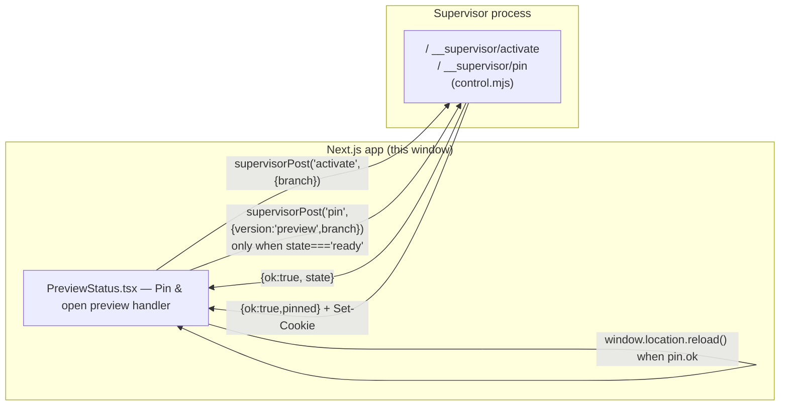
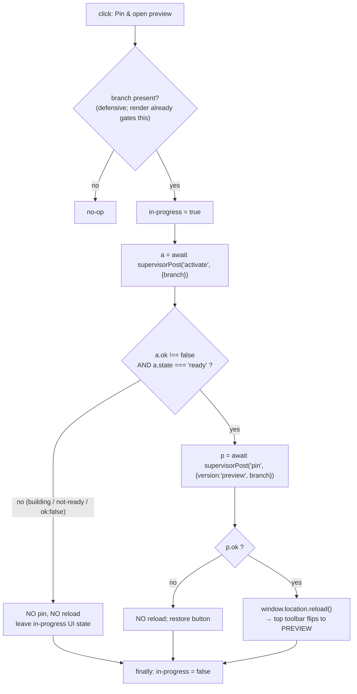

# Architecture Design: Self-Heal "Pin & open preview" performs the Supervisor work

**Spec**: `spec.md` (same directory) | **App Target**: `builtin-app` | **Feature Branch**: `bos/032-self-heal-pin`
**Date**: 2026-09-29

This is a behaviour fix to one existing button in one existing built-in-app file. The design below is deliberately proportioned to that: a single handler rewrite in `PreviewStatus.tsx` plus a co-area unit test. Every claim about the Supervisor's response shapes is cited to the actual code it was read from, because the whole decision logic hinges on what `activate` and `pin` return.

---

## 1. Classification

**`builtin-app`** — a change to a first-class window app compiled into BOS, at `src/apps/build-studio/selfheal/PreviewStatus.tsx`. The button lives in the Build Studio pane's self-heal case card; the fix is a client-side handler in that file. It is not `bos-core` (no Settings/desktop/API-route/server-only change), and not `marketplace-item` (no installable item, no `app/` iframe, no `services/` daemon).

This **agrees** with `spec.md`'s `App Target: builtin-app`. No disagreement to flag.

## 2. Constitution check

| Principle | Status |
|---|---|
| I. Spec-Driven | Pass — `spec.md` (Gate-1 approved) is the source of truth; this design derives from it. |
| II. Server Authority & SSR Boundary | Pass (n/a) — the handler calls the existing `/__supervisor/*` control surface over `fetch` (via `supervisorPost`). No secrets or Node APIs move to the client. |
| III. Always Delegate; Claude Codes | Pass — implementation is delegated to the Developer sub-agent; this document only designs. |
| IV. Minimize Blast Radius | Pass — one component handler + one test, on the feature branch; the Supervisor, top toolbar, and Versions tab are untouched. |
| V. The VFS Is Not the Source | Pass — spec artifacts live in user-specs; the code change is made by the Developer in `src/`. |
| VI. Specs & Docs Stay in Sync | Pass — this is a bug fix to documented 031-self-healing behaviour; the spec records it. No new `docs/usage` page is warranted (the button's documented intent is now *met*, not changed). |
| VII. Respect Boundaries | Pass — no `package.json`/lockfile/build-config edits; quality gates `npx tsc --noEmit` + `npm run lint` must pass for the changed code. |

No conflicts. Nothing to flag.

## 3. Architecture

### Context

The self-heal pane (`SelfHealPane.tsx`) renders a per-case action card. For a class-`e` case whose `status === "preview-ready"` and which carries an `activeFeatureBranch` (`bos/self-heal-<id>`), `PreviewStatus.tsx` shows a **Pin & open preview** button plus a footnote. Today the button's only effect is `launch("settings", { tab: "self-modification", branch })` — it opens the Settings app, which is the reported defect (GitLab #52). After the fix, the same click does the Supervisor work the label promises: ensure the candidate is built, then pin this window to its preview, then reload so the top toolbar flips `BASE → PREVIEW` on the case's branch. The user is then handed to the **existing** top toolbar (`VersionControls.tsx`) for the Promote/Discard decision — the card deliberately does not grow its own (FR-024 of 031-self-healing, kept in the preserved footnote).

### Container

No new containers. The fix sits entirely inside the existing **Next.js app process** (a React client component in `src/apps/build-studio/selfheal/`). It calls out over HTTP to the **Supervisor** control surface — a separate Node process whose routes live in `tools/supervisor/lib/control.mjs` and reach the browser via `/__supervisor/<action>`. There is no new service, daemon, or item repo.



### The decision the handler encodes

The handler composes the same primitives the top toolbar already uses (`supervisorPost` + the `activate`/`pin` endpoints + the `busy`/`finally` in-progress model) — into a single activate→pin→reload sequence that **no single existing toolbar control performs** (`VersionControls.onSelect` does *either* pin, when its polled state says `ready`, *or* activate; `pinPreview` is a separate button). The branching is on the **`state` field the `activate` response itself carries** — not a re-fetch of `/__supervisor/state`:



Why the `activate` response `state` is the correct signal to branch on is verified against the source, in §3.1 below — it is the single most load-bearing assumption in this design, so it is grounded explicitly rather than asserted.

### 3.1 Grounding: what `activate` and `pin` actually return

Read from `tools/supervisor/lib/preview.mjs` and `tools/supervisor/lib/control.mjs`:

- **`activate(branch)`** (`preview.mjs:301`) returns:
  - `{ base: true, state: "ready" }` — when no branch or branch is the base branch;
  - `{ branch, state: "ready" }` — when the preview is **already** `ready` (the common case for a `preview-ready` case, because `completeFix` verified readiness during the pipeline run — this is the idempotent no-op);
  - `{ branch, state: "building" }` — when the preview was `not-built`/`stopped`/failed: it sets `p.state = "building"` and kicks `buildAndStart(p)` **in the background**, then returns immediately with `state: "building"`.
  - The `control.mjs:341` route wraps this as `sendJson(res, { ok: true, ...result })`; an exception falls to the shared `catch` → `{ ok: false, error }`. **So a successful `activate` always has `ok: true` and a `state` of `ready` or `building`.**
- **`pin` with `version:"preview"` + `branch`** (`control.mjs` `sub === "pin"`): requires the feature branch; returns `{ ok: true, pinned: branch }` (with `Set-Cookie`) only when the preview is `ready` — or after resuming a `stopped` one and re-checking `ready`. Any other state → `{ ok: false, error: 'preview for "<branch>" is not ready (state: …)' }`, HTTP 400. **So `pin` refuses a `building` preview** — which is exactly why the handler must not attempt to pin unless `activate` reported `ready`.
- **`replacesServedBuild(action, …)`** (`src/lib/supervisor/client.ts`): returns `true` **only** for `promote` and `pin`; `false` for `activate` (and for `stop`/`discard` unless serving that branch). This is the reload rule: `activate` alone never replaces the build this window serves, so it never justifies a reload.
- **In-progress model** in the two existing controls: a `busy` `useState` boolean set at the start of the `try` and cleared in `finally` (`VersionControls.tsx` `post`; `VersionsTab.tsx` `act`), with an optional `msg` string for the human progress line. The new handler uses the same shape.

## 4. Concrete file / module plan (created or modified)

Only these two paths. No other file is created or touched.

| Path | Change |
|---|---|
| `src/apps/build-studio/selfheal/PreviewStatus.tsx` | **MODIFIED** — replace the button's `onClick` navigation with the async `openPreview` handler; add a local in-progress `useState`; update the button label/`disabled`; remove the now-unused `useOSStore`/`launch`; add the `supervisorPost` import. Preserve the FR-024 footnote verbatim. |
| `tests/self-heal/preview-pin.test.ts` | **NEW** — unit test of the handler's activate→pin→reload decision logic (see §7). Lives in `tests/self-heal/`, the established area for self-heal unit tests (which also has a `_test-env.ts` harness helper), per the spec's assumption and the repo's `tests/<area>/<name>.test.ts` convention — **not** a co-located `src/**/__tests__/`. |

Handler shape (mirrors `VersionControls.onSelect`):

```tsx
const [inProgress, setInProgress] = useState(false);
const openPreview = async () => {
  if (!branch) return;                       // defensive; render gate already requires it
  setInProgress(true);
  try {
    const a = await supervisorPost("activate", { branch });
    if (a.ok === false || a.state !== "ready") return;   // FR-003: no pin, no reload
    const p = await supervisorPost("pin", { version: "preview", branch });
    if (p.ok) window.location.reload();        // FR-002: pin replaces the served build
  } finally {
    setInProgress(false);                      // FR-004: always restore
  }
};
```

Button: `disabled={inProgress}`, label `inProgress ? "Opening preview…" : "Pin & open preview"`, `onClick={() => void openPreview()}`. Its `data-testid` is currently `self-heal-open-versions` — a name that no longer describes the behaviour; recommend renaming to `self-heal-pin-preview`. This testid is **not referenced by any test** (verified by search — only `PreviewStatus.tsx` itself contains it), so the rename is safe.

Imports after the change: keep `Loader2` (still used by the `bs-pipeline` "Building…" line), `ScopeClassBadge`, and `type HealingCase`; **add** `useState` (react) and `supervisorPost` (`@/lib/supervisor/client`); **remove** `useOSStore` (`@/store/os-provider`).

## 5. Integration points (existing mechanisms the design calls into, does NOT create/modify)

| Mechanism | Where | Why it matters here |
|---|---|---|
| `supervisorPost(path, body)` + `PostResult` type | `src/lib/supervisor/client.ts` | The shared client for the Supervisor control surface (FR-006). Its reverse-proxy-timeout contract already returns a structured `{ ok:false, error }` when the body isn't valid JSON — the handler treats that as a non-success (no pin, no reload), per the spec's "Reverse-proxy timeout" edge case. |
| Supervisor `activate` endpoint | `tools/supervisor/lib/control.mjs` (`sub === "activate"`) → `activate()` in `preview.mjs` | Ensures the candidate is built; idempotent no-op when already `ready`; returns `{ ok, state }`. |
| Supervisor `pin` endpoint | `tools/supervisor/lib/control.mjs` (`sub === "pin"`) | Pins the window's preview (`Set-Cookie`); refuses non-`ready`. The top toolbar reads serving from this pin cookie after reload (`pinnedVersion` in `control.mjs`). |
| Top-toolbar reload rule | `replacesServedBuild` in `src/lib/supervisor/client.ts` + the inline `if (r.ok) window.location.reload()` after a pin in `src/components/desktop/VersionControls.tsx` | The authority for "reload only on a successful pin". `activate` is never a reload trigger. |
| In-progress (`busy`) model | `VersionControls.tsx` / `VersionsTab.tsx` | The pattern the new `inProgress` boolean mirrors (set in `try`, clear in `finally`). |
| `HealingCase` record | `src/lib/self-heal/types.ts` | Source of the three fields the handler reads: `status` (the `preview-ready` render gate), `activeFeatureBranch` (the `bos/self-heal-<id>` branch), `scopeClass` (the badge). No new fields are added. |

These are dependencies, not deliverables — none of them is edited by this change.

## 6. ADRs

### ADR-1 — `activate` before `pin`; the `pin` step is retained
- **Context**: The report's literal ask was "trigger building the candidate so I can then press Preview in the top toolbar." The narrower build-only variant was offered as an alternative at Gate 1.
- **Options**: (a) **build-only** — just `activate`, leave the user on base; (b) **build + pin + reload** — the approved scope.
- **Decision**: (b). For a `preview-ready` case the preview is *usually* already `ready` (`completeFix` verified it), so `activate` is a no-op and the click pins + reloads in one go (User Story 1). The `activate`-before-`pin` ordering is retained for the robust case of a preview restored as `not-built`/`stopped` after a Supervisor restart: `pin` refuses a `building` preview, so the handler can only pin once `activate` confirms `ready`.
- **Consequences**: A `ready` case completes the pin in a single click (SC-001); a restored `not-built`/`stopped` case starts the build and hands back to the toolbar rather than completing the pin in the same click (SC-002 / User Story 2). That asymmetry is the accepted cost of the superset behaviour.

### ADR-2 — No new Supervisor endpoint, no second client (FR-006)
- **Context**: A "pin-or-build" one-call endpoint would look convenient (one round-trip instead of two).
- **Options**: (a) add a new combined endpoint; (b) reuse `activate` + `pin` as two calls.
- **Decision**: (b). The control surface already has exactly these two verbs, and the top toolbar (`VersionControls.onSelect`) already composes them this way. A new endpoint would duplicate existing logic, add a new surface to test, and violate "reuse the same Supervisor control surface."
- **Consequences**: The handler is two sequential `supervisorPost` calls. No change to `control.mjs`, `client.ts`, or any Supervisor file.

### ADR-3 — Branch on the `activate` response's `state`, not a re-fetch of `/__supervisor/state`
- **Context**: The toolbar decides build-vs-pin from *polled* `/__supervisor/state` because it maintains a live dropdown. A one-shot button has no poll loop.
- **Options**: (a) re-`GET /__supervisor/state` after `activate` and inspect the preview's `state`; (b) read the `state` field the `activate` response already carries.
- **Decision**: (b). The `activate` route returns the Supervisor's just-computed post-call state (`preview.mjs:301`), so it is authoritative for this click without an extra round-trip, and it cannot race the background build the way a separate `state` fetch issued in parallel with a `building` preview could.
- **Consequences**: One fewer request; the decision is tied to the same response the call itself produced. If a reviewer wants the toolbar's *live* state instead, ADR-1's "hand back to the toolbar" already makes the toolbar the source of truth for the `building → ready` transition.

### ADR-4 — Reload is gated on `pin.ok` (and never on `activate`)
- **Context**: The toolbar reloads inline (`if (r.ok) window.location.reload()`) after a pin, and `replacesServedBuild` says only `pin`/`promote` replace the served build.
- **Options**: (a) reload on `activate.ok`; (b) reload on `pin.ok`.
- **Decision**: (b). `activate` does not change the build this window serves (`replacesServedBuild("activate", …) === false`); only a successful `pin` does. This is byte-for-byte the toolbar's behaviour, and it prevents a build from bouncing the user to base mid-`building` — the exact failure `replacesServedBuild`'s doc comment warns about.
- **Consequences**: The window reloads only when the pin actually landed; a non-`ready` activate or a refused pin leaves the user exactly where they were, retryable.

## 7. Testing

`tests/self-heal/preview-pin.test.ts` runs on the repo's `test:unit` runner — `npm run test:unit`, Playwright used **purely for TS transpilation + reporting** (see `playwright.unit.config.ts`), browser-less, under `NODE_OPTIONS='--conditions=react-server'`. There is **no jest/vitest and no `@testing-library/react` (or any React renderer) in `package.json` devDeps**, so the test **cannot mock a module or render a component**. It follows the only established precedent for a client function in this area — `tests/self-heal/branch-settled-client.test.ts` — which **stubs `globalThis.fetch` directly and calls the function**. Concretely, the test is the only achievable shape:

- **(a) Extract the activate→pin→reload decision to a pure, framework-free function** — inside `PreviewStatus.tsx` (or a small sibling module under the same directory). It takes `(branch, post, reload)`: `post` is the `supervisorPost` thunk, `reload` is the `window.location.reload` thunk. The component wires the real `supervisorPost` and `window.location.reload` into it. Being framework-free means the test can import and call it without rendering anything.
- **(b) In the test, stub `globalThis.fetch`** so the **real, un-mocked `supervisorPost`** (`src/lib/supervisor/client.ts` is literally `fetch(…)` then `r.json()`) receives the shaped JSON for the `activate` and `pin` requests. `supervisorPost`'s only other import, `sessionHeader` (`src/lib/logging/client/session.ts`), guards `typeof window === "undefined"`, so it loads cleanly here. Because **no `window` exists in this runner**, also **define `globalThis.window` with a stubbed `location.reload`** so the reload branch is observable.

With that shape it asserts the same four decision-matrix cases:

1. `activate` not `ready` (e.g. `state:"building"` or `ok:false`) ⇒ no `pin` request, reload **not** called, in-progress restored.
2. `activate` `state:"ready"` + `pin` `ok:true` ⇒ `pin` sent with `{ version:"preview", branch }`, reload called **once**.
3. `activate` `ok:false` or `pin` `ok:false` ⇒ no reload, in-progress cleared (no swallowed error).
4. missing `branch` ⇒ no Supervisor call at all.

The pure-function extraction still lives inside `PreviewStatus.tsx` (or a same-directory sibling), so the two-path scope of §4 is unchanged — **§4 is not modified**.

## 8. Risks / open questions

- **The one-click pin only completes for an already-`ready` preview.** `activate` on a restored `not-built`/`stopped` preview returns `state:"building"` and does **not** block until the build finishes (the rebuild runs in the Supervisor's background). So the button will start the build, clear its in-progress state, and leave the user on the card while the **top toolbar** (which polls `/__supervisor/state`) shows `building…` → `ready`. The user then pins via the toolbar or re-clicks. This matches User Story 2 and the report's own wording ("so that the user then can press the 'Preview' button in the top toolbar"), but it is worth confirming the approved scope does **not** expect the button itself to poll until ready and auto-pin. That would be a materially larger change (a poll loop) and is *out* of scope as specified.
- **Button does not surface the `activate`/`pin` error text.** The toolbar shows failures inline (`setErr`). The card has no equivalent slot, and FR-004 only requires "restore the button to its normal state so the user can retry; no error is silently swallowed." Swallowed ≠ hidden forever — the error is still in the Supervisor log and re-surfaced if the user retries or opens the toolbar. **Open question:** should a non-`ready`/`ok:false` result set a brief inline message on the card, or is the silent-restore acceptable per FR-004? Recommend the minimal compliant reading (silent restore, top toolbar as the error surface) unless a reviewer wants otherwise.
- **`window.location.reload()` discards other unsaved Build Studio pane state.** Identical to the existing toolbar pin behaviour, so not a regression — but it is a whole-window reload, which is why the handler only does it after a confirmed `pin`.
- **testid rename.** `self-heal-open-versions` → `self-heal-pin-preview` recommended for accuracy; verified un-referenced, so low risk. Flagging in case an e2e suite outside the indexed `tests/` relies on it (none found by search).

## 9. UI mockup reference

No `mockup.html` is present in this spec directory and none was provided with the delegation, so there is no mockup to map. (The button's existing visual language — violet outline, `text-[11px]` — is preserved; only the label and `disabled` state change.)
